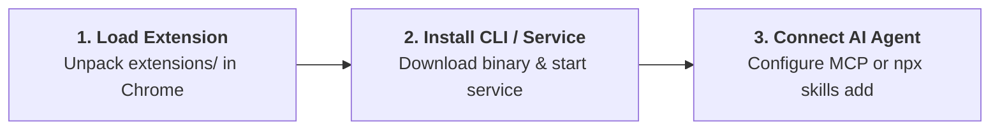

<div align="center">


# 🚀 Agent Pilot
### Universal AI Agent Browser Controller • Antigravity-First

[](extensions/manifest.json)
[](#)
[](docs/CDP_GUIDE.md)
[](#)
[](LICENSE)

[English](README.md) • [Tiếng Việt](README.vi.md) • [Documentation](docs/) • [Contributing](CONTRIBUTING.md)

<p align="center">
  <b>Agent Pilot</b> is a lightweight, zero-dependency browser controller built for <b>AI Coding Agents</b> (Google Antigravity, Claude Code, Cursor, Codex). It bridges Chrome via a <b>Manifest V3 Extension</b>, a <b>Standalone Go CLI</b>, and a <b>Model Context Protocol (MCP) Server</b>.
</p>

</div>

---

## 🌟 Key Capabilities

- **Human-Like Browser Simulation**: Virtual neon cursor with click-ripple animation, real-time typing, drag-and-drop, and automated form filling.
- **Dual Execution Engine (DOM + Trusted CDP)**: Blazing-fast synthetic DOM manipulation by default; seamlessly escalates to Chrome DevTools Protocol (`--via cdp`) for cross-origin iframes, Canvas, and WebGL applications.
- **Zero Runtime Dependencies**: The single Go binary embeds the MCP server, WebSocket/REST bridge, and an embedded DevTools runtime (Lighthouse, heap profiler, tracing). No Node.js or FFmpeg required on the client machine.
- **Background Multi-Agent Isolation**: Automates tabs inside a dedicated tab group (`🤖 Agent Pilot`) without hijacking user focus. Supports multiple concurrent agents via `--tab <id>` and `--port <port>`.
- **In-Page Feedback Studio**: An interactive side panel that allows developers and QA testers to inspect DOM, pick pixel-accurate colors, annotate UI bugs, and push feedback directly to AI agents.

---

## 🚀 Quick Start (3 Steps)



### Step 1: Load the Chrome Extension
1. Download the latest release from [GitHub Releases](https://github.com/ducconit/agent-pilot-extension/releases).
2. Open Chrome and navigate to `chrome://extensions`.
3. Enable **Developer mode** in the top-right corner.
4. Click **Load unpacked**, select the `extensions/` directory, and pin the **Agent Pilot (📌)** icon.

### Step 2: Install the CLI & Service

Download the pre-compiled bundle for your operating system:

| Operating System | Release Bundle | 1-Step Installer | Guide |
| :--- | :--- | :--- | :--- |
| 🐧 **Ubuntu / Linux** | `agent-pilot-*-linux.zip` | `./install.sh` | [README.ubuntu.md](docs/bundles/README.ubuntu.md) |
| 🍎 **macOS** | `agent-pilot-*-macos.zip` | `./install.sh` | [README.macos.md](docs/bundles/README.macos.md) |
| 🪟 **Windows** | `agent-pilot-*-windows.zip` | `powershell -ExecutionPolicy Bypass -File .\install.ps1` | [README.windows.md](docs/bundles/README.windows.md) |

Register the background service to start automatically on login:
```bash
agent-pilot service install
agent-pilot service status
```

### Step 3: Connect to Your AI Agent

#### Option A: Agent Skills Ecosystem ([skills.sh](https://skills.sh/))
```bash
npx skills add https://github.com/ducconit/agent-pilot-extension -g --all
```

#### Option B: MCP Server (`stdio`)
Add Agent Pilot to your MCP configuration (`claude_desktop_config.json`, `~/.gemini/antigravity/mcp/`, or Cursor Settings):
```json
{
  "mcpServers": {
    "agent-pilot": {
      "command": "agent-pilot",
      "args": ["mcp"]
    }
  }
}
```

---

## 💻 CLI Cheat Sheet

```bash
# Open tab in background (no focus stealing)
agent-pilot open "http://localhost:3000" --format json

# Extract interactive DOM snapshot (@1, @2...)
agent-pilot snapshot --tab 12345

# Virtual click & keyboard typing
agent-pilot click "@1" --tab 12345
agent-pilot type "@2" "test@example.com" --enter --tab 12345

# Annotated screenshot with banner & element highlight
agent-pilot screenshot -o login.png --highlight "@1" --title "Login Screen"

# Low-level CDP inspection (Console logs & Page errors)
agent-pilot console errors --tab 12345

# Close tab and free memory
agent-pilot close --tab 12345
```

---

## 📚 Technical Documentation

- 🏛️ **[System Architecture (ARCHITECTURE.md)](docs/ARCHITECTURE.md)**: Deep dive into Manifest V3, IPC Bridge, and process isolation.
- 🤖 **[Antigravity & MCP Integration](docs/ANTIGRAVITY_INTEGRATION.md)**: Comprehensive guide for connecting AI coding assistants.
- ⚡ **[CDP Protocol Guide](docs/CDP_GUIDE.md)**: Low-level Chrome DevTools Protocol, Network, Console, and Trusted Input.
- 🔬 **[Advanced DevTools Features](docs/DEVTOOLS.md)**: Real Lighthouse audits, V8 heap snapshot diffing, performance tracing.
- 📖 **[Full Usage Guide (USAGE_GUIDE.md)](docs/USAGE_GUIDE.md)**: Feature walkthrough for human users and QA engineers.
- 📊 **[Performance Benchmarks](docs/BENCHMARKS.md)**: Empirical comparison of MCP vs CLI latency, tokens, and payload volume.
- 📦 **[OS Bundle Guides (BUNDLE_README.md)](docs/BUNDLE_README.md)**: Native installation guides for Linux, macOS, and Windows.

---

## 🤝 Contributing

Contributions are warmly welcome! Please check out our community guides:
- 🛠️ [Contributing Guide (CONTRIBUTING.md)](CONTRIBUTING.md)
- 📜 [Code of Conduct (CODE_OF_CONDUCT.md)](CODE_OF_CONDUCT.md)
- 🛡️ [Security Policy (SECURITY.md)](SECURITY.md)

---

## 📄 License

Agent Pilot is open-source software licensed under the [MIT License](LICENSE).
Copyright (c) 2026 **DNT** ([@ducconit](https://github.com/ducconit)) & Agent Pilot Contributors.
