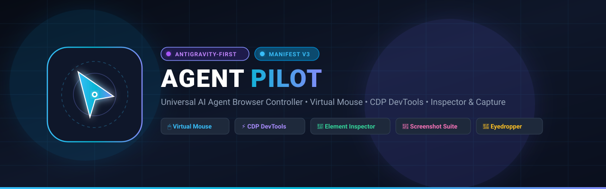

<div align="center">



# 🚀 AGENT PILOT
### Universal AI Agent Browser Controller • Antigravity-First

[](extensions/manifest.json)
[](#)
[](docs/ANTIGRAVITY_INTEGRATION.md)
[](docs/CDP_GUIDE.md)
[](#)
[](CONTRIBUTING.md)
[](LICENSE)

<p align="center">
  <b>Agent Pilot</b> là tiện ích mở rộng Google Chrome (Manifest V3) đột phá, được thiết kế chuyên biệt để giúp <b>mọi AI Agent</b> (ưu tiên tối ưu hóa cho <b>Antigravity</b>) có thể quan sát, phân tích và điều khiển trình duyệt một cách mượt mà, an toàn và trực quan nhất.
</p>

> ⚠️ **Thông Báo Bản Thử Nghiệm (Public Beta)**: Agent Pilot hiện đang được phát hành dưới dạng **Public Beta** cho cộng đồng nhà phát triển. Toàn bộ tính năng cốt lõi đã vượt qua 100% các bài kiểm thử tự động trên trình duyệt thật. Chúng tôi rất mong nhận được đóng góp ý kiến, phản hồi trải nghiệm và báo cáo lỗi từ bạn qua [GitHub Issues](https://github.com/ducconit/agent-pilot-extension/issues) hoặc [Pull Requests](CONTRIBUTING.md)!

[✨ Tính năng chính](#-tính-năng-cốt-lõi) • [🚀 Cài đặt nhanh](#-hướng-dẫn-cài-đặt-nhanh) • [🧪 Trang thử nghiệm](#-phòng-thí-nghiệm-kiểm-thử-test-page) • [📚 Tài liệu chi tiết](#-hệ-thống-tài-liệu-chuyên-sâu) • [🤝 Đóng góp](CONTRIBUTING.md)

---

</div>

## 🌟 Tính Năng Cốt Lõi

| Tính Năng | Biểu Tượng | Mô Tả Kỹ Thuật |
| :--- | :---: | :--- |
| **Điều khiển Trình duyệt** | 🌐 | Mở tab mới, điều hướng URL, reload, chuyển đổi và đóng tab linh hoạt. |
| **Mô phỏng Chuột ảo** | 🖱️ | Con trỏ đồ họa neon bay mượt mà trên màn hình, phát sóng click ripple và chuỗi sự kiện DOM hoàn chỉnh. |
| **Tự động Gõ chữ** | ⌨️ | Focus vào ô nhập liệu và gõ văn bản từng ký tự theo thời gian thực (Human-like Typing). |
| **Giám sát DevTools (CDP)** | ⚡ | Kết nối cấp thấp qua Chrome DevTools Protocol để bắt trọn `console.log/error`, `Network traffic` và `Performance RAM/DOM`. |
| **Soi & Lấy vị trí DOM** | 🎯 | Bắt dính phần tử khi hover, hiển thị kích thước `W × H`, tọa độ `(X, Y)`, trích xuất **CSS Selector** và **XPath**. |
| **Trích xuất Mã màu** | 🎨 | Kính lúp pixel nhặt màu chính xác (HEX, RGB, HSL), tự động copy và lưu khay lịch sử màu sắc. |
| **Bộ Chụp Màn Hình** | 📸 | Hỗ trợ 3 chế độ: Chụp toàn khung nhìn, Kéo chọn vùng cắt tùy ý (Crop), và Chụp riêng phần tử DOM đã khóa. |
| **Chú Thích & Chỉ Điểm UI** | ✏️ | Khoanh vùng, chỉ điểm phần tử/component nguồn (React/Vue/Astro:line), ghim ghi chú lỗi để giao việc cho AI Agent sửa code (hỗ trợ 3 kênh Live Push, Persistent Inbox, Clipboard Prompt). |
| **Tương thích Antigravity** | 🤖 | Tích hợp sẵn bộ chạy kịch bản **JSON Action**, cầu nối `window.__AGENT_PILOT__` và 16 công cụ Antigravity MCP Tools. |

---

## 🏗️ Cấu Trúc Thư Mục Dự Án

Dự án được tổ chức khoa học, module hóa chuyên sâu và tuân thủ các chuẩn kỹ thuật cao nhất:

```
agent-pilot-extension/
├── assets/                             # Tài nguyên đồ họa & nhận diện thương hiệu
│   ├── banner.svg                      # Banner giới thiệu công nghệ cao
│   └── logo.svg                        # Logo vector gốc của Agent Pilot
├── docs/                               # Bộ tài liệu kỹ thuật chuyên sâu
│   ├── ANTIGRAVITY_INTEGRATION.md      # Hướng dẫn tích hợp Antigravity First & MCP
│   ├── ARCHITECTURE.md                 # Kiến trúc chi tiết Manifest V3 & IPC
│   ├── CDP_GUIDE.md                    # Hướng dẫn Chrome DevTools Protocol (CDP)
│   ├── API_REFERENCE.md                # Danh mục tin nhắn & đặc tả JSON Action
│   └── USAGE_GUIDE.md                  # Sổ tay hướng dẫn sử dụng từng tính năng
├── skills/                             # Kỹ năng chuẩn Agent Skills Ecosystem (skills.sh)
│   └── agent-pilot/
│       └── SKILL.md                    # Hướng dẫn & cấu hình skill cho npx skills add
├── cli/                                # Bộ công cụ dòng lệnh (CLI) & MCP Server độc lập bằng Go (Golang)
│   ├── main.go                         # Điểm khởi đầu & phân luồng subcommands (mcp, server, click, type,...)
│   ├── bridge.go                       # WebSocket Server 58765 & HTTP REST API nhúng
│   ├── client.go                       # Trình điều khiển trực tiếp qua CLI cho Tester/QC
│   ├── mcp.go                          # Máy chủ MCP chuẩn 16 công cụ qua giao thức stdio
│   ├── sanitizer.go                    # Lớp che giấu Secret/API Key bảo mật
│   ├── feedback.go                     # Quản lý Hộp thư Feedback Inbox & Waiter
│   └── README.md                       # Hướng dẫn sử dụng & biên dịch Go binary

├── extensions/                         # Toàn bộ mã nguồn Chrome Extension (Manifest V3)
│   ├── manifest.json                   # Cấu hình chuẩn Chrome Extension MV3
│   ├── guide.html                      # Trang Thông tin & Hướng dẫn sử dụng responsive
│   ├── background.js                   # Service Worker chính (ES Module entry)
│   ├── background/                     # Các module dịch vụ nền
│   │   ├── constants.js                # Hằng số hệ thống & cấu hình
│   │   ├── secret-sanitizer.js         # Lớp lọc che giấu Secret & API Key
│   │   ├── cdp-manager.js              # Quản lý Chrome DevTools Protocol
│   │   ├── tab-manager.js              # Quản lý Tabs & Native Tab Groups
│   │   ├── screenshot-service.js       # Dịch vụ chụp ảnh màn hình
│   │   ├── batch-executor.js           # Bộ chạy kịch bản gom cụm Batch Actions
│   │   └── bridge-client.js            # WebSocket client kết nối AI Agent bridge
│   ├── content.js                      # Content Script điều phối in-page
│   ├── content/                        # Các module tương tác DOM & Visuals
│   │   ├── toast.js                    # Thông báo Toast HUD trên trang web
│   │   ├── lock-shield.js              # Lớp bảo vệ Human Input Lock khi Agent thao tác
│   │   ├── cursor-simulator.js         # Con trỏ chuột ảo Neon & sóng ripple
│   │   ├── dom-inspector.js            # Trích xuất thông số DOM & Element Snap
│   │   ├── eyedropper.js               # Kính lúp phóng đại 11x11 lấy mã màu
│   │   └── feedback-studio/            # Chú thích & Chỉ điểm UI in-page (Modular Architecture)
│   │       ├── constants.js            # Bảng màu xoay vòng, tiện ích escape & kéo thả
│   │       ├── state.js                # Quản lý trạng thái phiên chú thích & danh sách vị trí
│   │       ├── capture-service.js      # Dịch vụ chụp ảnh, cắt Canvas & nhận diện component nguồn
│   │       ├── pinned-overlay.js       # Quản lý layer ghim cố định khung chọn trên màn hình
│   │       ├── hud-toolbar.js          # Thanh công cụ HUD nổi trên trang & chuyển chế độ
│   │       ├── modals.js               # Popover ghi chú, Annotator màn hình & modal danh sách
│   │       ├── selection-modes.js      # Logic chọn phần tử, kéo chọn vùng, chụp viewport/fullpage
│   │       ├── export-channels.js      # 3 kênh xuất feedback (Prompt C, Inbox B, Live A)
│   │       └── index.js                # Điều phối vòng đời & xuất API window.__AP_INTERNAL__.feedback
│   ├── content.css                     # Stylesheet cho con trỏ, kính lúp, overlay & feedback HUD
│   ├── sidepanel.html                  # Giao diện trung tâm điều khiển Side Panel
│   ├── sidepanel.css                   # Giao diện Modern Dark Cyberpunk Responsive
│   ├── sidepanel.js                    # Bộ điều phối UI Side Panel (ES Module)
│   ├── sidepanel/                      # Các module quản lý thẻ Side Panel
│   │   ├── ui-helpers.js               # Tiện ích giao diện, toast, badge
│   │   ├── agent-monitor.js            # Giám sát kết nối Agent & Secret Redaction toggle
│   │   ├── inspector-panel.js          # Thẻ Tổng quan DOM & Kiểu dáng CSS
│   │   ├── screenshot-panel.js         # Studio chụp ảnh & Auto-copy Clipboard
│   │   └── feedback-panel.js           # Thẻ Chú thích UI & kênh xuất Prompt/Inbox/Live
│   ├── popup.html                      # Popup tiện ích khởi động nhanh
│   ├── popup.js                        # Xử lý sự kiện popup
│   ├── popup.css
│   └── icons/                          # Bộ icon nhận diện chuẩn các kích thước
├── mcp/agent-pilot/                    # 16 tệp lược đồ chuẩn Single Source of Truth (SSOT)
├── scripts/                            # Bộ công cụ build, test, pack & sync cross-platform
│   ├── agent_pilot_server.mjs          # Máy chủ cầu nối WebSocket & MCP Bridge Server
│   ├── browser_resolver.mjs            # Tự động tìm kiếm Chrome/Chromium/Edge/Brave đa nền tảng
│   ├── export_mcp_schemas.mjs          # Trích xuất schema MCP tự động
│   ├── pack_extension.mjs              # Đóng gói tiện ích ra file ZIP release
│   ├── run_test.mjs                    # Bộ chạy test tự động Windows/macOS/Linux
│   ├── sync_agk.mjs                    # Đồng bộ sang plugin AGK Antigravity
│   ├── verify_all_features.mjs         # Bộ kiểm thử 15 tính năng cốt lõi trên trình duyệt thật
│   ├── verify_agent_connection.mjs     # Bộ kiểm thử 29 tính năng kết nối & điều khiển Agent
│   ├── verify_feedback_system.mjs      # Bộ kiểm thử hệ thống Feedback Channel B & Channel A
│   └── verify_secret_sanitizer.mjs     # Bộ kiểm thử 19 kịch bản lọc che giấu Secret/API Key
├── test-page.html                      # Trang web tương tác phục vụ kiểm thử tức thì
└── README.md                           # Tài liệu giới thiệu dự án
```

---

## 🚀 Hướng Dẫn Cài Đặt Nhanh

### Bước 1: Mở Quản lý Tiện ích trên Chrome
Truy cập đường dẫn sau trên trình duyệt Chrome:
```text
chrome://extensions
```

### Bước 2: Bật Chế độ Nhà phát triển & Tải Extension
1. Gạt bật công tắc **Developer mode** ở góc trên cùng bên phải.
2. Nhấp nút **Load unpacked** (Tải tiện ích đã giải nén) ở góc trên bên trái.
3. Chọn đường dẫn thư mục `extensions` của dự án tương ứng với hệ điều hành của bạn:
   * **Windows**: `C:\path\to\browser-control\extensions`
   * **macOS**: `/Users/<username>/path/to/browser-control/extensions`
   * **Linux**: `/home/<username>/path/to/browser-control/extensions`
   *(Hoặc giải nén tệp sẵn sàng cài đặt tại `dist/agent-pilot-v1.0.2-beta.zip`)*.

### Bước 3: Khởi động Bảng điều khiển (Side Panel)
* **Cách 1 (Nhanh nhất)**: Nhấp chuột vào biểu tượng **Agent Pilot (📌)** trên thanh công cụ Chrome (Side Panel sẽ trượt mở tức thì).
* **Cách 2 (Menu chuột phải)**: Nhấp chuột phải trên bất kỳ trang web nào $\rightarrow$ Chọn **Mở Agent Pilot (Side Panel)**.
* *(Tùy chọn)*: Để gán phím tắt riêng không lo xung đột phần mềm khác, truy cập `chrome://extensions/shortcuts` để cài đặt.

---

## 🧪 Phòng Thí Nghiệm Kiểm Thử (`test-page.html`)

Dự án có sẵn tệp `test-page.html` được thiết kế đặc biệt để bạn kiểm nghiệm toàn bộ các tính năng ngay lập tức mà không cần internet:

1. Kéo thả tệp `test-page.html` vào trình duyệt Chrome (hoặc mở bằng URL `file:///home/ubuntu/workspace/projects/browser-control/test-page.html`).
2. Mở **Agent Pilot Side Panel**:
   - Thử nghiệm **Chuột ảo**: Di chuyển chuột đến nút *"🎯 Click vào đây!"* và nhấp click.
   - Thử nghiệm **Tự động gõ chữ**: Điền nội dung vào ô `#test-search-input`.
   - Thử nghiệm **DevTools**: Nhấp các nút sinh `console.log`, `warn`, `error` hoặc nút gửi API để thấy nhật ký và network nhảy tức thì trong Side Panel.
   - Thử nghiệm **Lấy màu**: Bật nút lấy mã màu và nhặt màu từ dải các ô màu rực rỡ trên trang.
   - Thử nghiệm **Chụp ảnh**: Thử chụp toàn màn hình, kéo khung crop box hoặc chụp riêng khối `#inspector-special-box`.

---

## ⚡ Cài Đặt Kỹ Năng Cho AI Agents (`npx skills add`)

Agent Pilot tương thích hoàn toàn với chuẩn **Agent Skills Open Ecosystem** ([skills.sh](https://skills.sh/)). Mọi trợ lý AI coding (như **Claude Code**, **Cursor**, **Codex**, **OpenCode**, **Antigravity**, **Amp**, **Roo Code**, **Devin**, v.v.) đều có thể tự động tải và cài đặt kỹ năng điều khiển trình duyệt của Agent Pilot chỉ với một lệnh duy nhất:

```bash
# Cài đặt trực tiếp cho dự án hiện tại
npx skills add https://github.com/ducconit/agent-pilot-extension

# Hoặc cài đặt toàn cục (Global) cho tất cả coding agents trên máy
npx skills add https://github.com/ducconit/agent-pilot-extension -g --all
```

Khi được kích hoạt, AI Agent sẽ tự động phát hiện bộ công cụ MCP `agent-pilot` và có thể tự chủ điều khiển tab, click chuột ảo, gõ bàn phím, cuộn trang, trích xuất DOM, chụp ảnh màn hình và theo dõi Chrome DevTools để phục vụ công việc lập trình và kiểm thử tự động.

---

## 📡 Kết Nối AI Agent Trực Tiếp (Cổng 58765 & Chuẩn MCP)

Agent Pilot trang bị sẵn máy chủ WebSocket & MCP Server tại cổng chuyên dụng **`58765`** (thuộc dải cổng riêng tư IANA `49152 – 65535`, chống trùng lặp hoàn toàn với các cổng dev phổ biến như 3000, 5000, 8000, 8080,...):

1. **Khởi chạy Bridge Server**:
   ```bash
   npm run server
   ```
2. **Kiểm thử tự động kết nối AI Agent điều khiển Trình duyệt**:
   ```bash
   npm run test:all
   ```
   *(Bộ test tự động hóa E2E kiểm chứng 29/29 tính năng Agent điều khiển Chrome qua cổng 58765, 15/15 tính năng Extension và 8/8 tính năng Feedback đạt 100% PASS).*
3. **Cấu hình Antigravity MCP**: Xem hướng dẫn 1-click tại [docs/ANTIGRAVITY_INTEGRATION.md](docs/ANTIGRAVITY_INTEGRATION.md).

---

## ⚡ Bộ Binary CLI Độc Lập Bằng Go (`cli/`)

Agent Pilot cung cấp một bản nhị phân độc lập (Single Static Binary) viết bằng **Go (Golang)** nằm trong thư mục `cli/`. Bản binary này giải quyết triệt để sự phụ thuộc vào môi trường Node.js:
- **Tất cả trong 1**: Chứa sẵn **WebSocket/REST Bridge Server 58765**, **MCP Server chuẩn 16 tools qua `stdio`**, và **bộ lệnh CLI thao tác trình duyệt trực tiếp** cho Tester/QC.
- **Siêu nhẹ & tốc độ cao**: Khởi động `<5ms`, tiêu thụ RAM chỉ `~12MB`, đóng gói tĩnh duy nhất `~7MB` không cần cài đặt dependencies.

```bash
# Biên dịch binary (chỉ cần Go 1.21+)
cd cli
go build -ldflags="-s -w" -o agent-pilot .

# 1. Chạy như một MCP Server (cho Claude Desktop, Cursor, Antigravity,...)
./agent-pilot mcp

# 2. Khởi chạy Bridge Server ngầm
./agent-pilot server

# 3. Tester/QC điều khiển trình duyệt trực tiếp qua CLI:
./agent-pilot open https://github.com
./agent-pilot click "#login-btn"
./agent-pilot type "#search-box" "golang automation"
./agent-pilot screenshot --mode=visible --out=page.png
./agent-pilot inspect "#target-elem"
./agent-pilot tabs
./agent-pilot batch '[{"action":"click","selector":"#submit"}]'
./agent-pilot feedback list
```
*(Chi tiết xem thêm tại [cli/README.md](cli/README.md))*


---

## ✏️ Chú Thích & Chỉ Điểm UI Cho Agent (Visual UI Annotator Studio)

Agent Pilot giải quyết bài toán cốt lõi: **Làm thế nào để AI Agent biết chính xác 100% vị trí giao diện, component nguồn, selector và lỗi UI cần chỉnh sửa do người dùng chỉ định?** (Tính năng này được thiết kế để giao việc sửa code cho AI Agent, không phải form góp ý về tiện ích).

### Các Chế Độ Thu Thập Phản Hồi Trực Quan:
- 🎯 **Chọn phần tử (Element Mode)**: Rà chuột highlight bất kỳ khối nào trên trang web $\rightarrow$ Bấm chọn để tự động cắt ảnh phần tử và bóc tách tệp nguồn framework (`fileName:lineNumber` của React Fiber, Vue Component, Astro).
- ✂️ **Kéo chọn vùng (Region Crop Mode)**: Kéo thả chuột tự do để khoanh vùng bất kỳ khu vực nào trên trang web.
- 📱 **Màn hình hiện tại (Screen Viewport Mode)**: Chụp toàn bộ khung nhìn hiển thị và mở công cụ ghim điểm (Pins) để chú thích nhiều lỗi trên cùng 1 ảnh.
- 📄 **Toàn bộ trang web (Full Page Mode)**: Tự động cuộn trang và ghép trọn vẹn toàn bộ trang web dài từ đầu đến cuối.

### 3 Kênh Giao Tiếp Độc Lập:
1. **Kênh A (Reactive Long-Polling)**: Agent gọi công cụ `browser_wait_for_feedback({ timeout: 120 })`. Khi người dùng thao tác xong và bấm **"🚀 Gửi Agent"**, thông tin phản hồi sẽ được truyền thẳng tới Agent ngay lập tức mà không cần copy/paste.
2. **Kênh B (Hộp thư Inbox Lưu Trữ File)**: Người dùng bấm **"💾 Lưu Inbox"** để lưu phiên phản hồi vào thư mục `~/.agent-pilot/inbox/feedback/<timestamp>/*` (bao gồm `session.json`, `prompt.md`, `item_1.png`,...). Agent có thể đọc mọi lúc thông qua công cụ `browser_get_pending_feedback()`.
3. **Kênh C (1-Click Sao Chép Markdown Prompt)**: Bấm **"📋 Copy Prompt"** để tạo prompt định dạng Markdown chứa toàn bộ mã nguồn, selector và ảnh minh họa sẵn sàng dán vào khung chat của bất kỳ mô hình AI nào.

---

## 🤖 Kịch Bản Tự Động Hóa Mẫu (Antigravity Automation)

Bạn có thể dán đoạn mã JSON sau vào ô **Kịch bản Agent** trên Side Panel rồi nhấn **▶ Chạy Kịch bản Agent**:

```json
[
  { "action": "mouse_move", "x": 320, "y": 210, "duration": 400 },
  { "action": "wait", "ms": 250 },
  { "action": "mouse_click", "x": 320, "y": 210 },
  { "action": "wait", "ms": 300 },
  { "action": "type", "selector": "#test-search-input", "text": "Agent Pilot x Antigravity AI" },
  { "action": "scroll", "deltaY": 250 },
  { "action": "screenshot", "mode": "visible" }
]
```

---

## 📚 Hệ Thống Tài Liệu Chuyên Sâu

Để tìm hiểu sâu hơn về kiến trúc và cách tích hợp với AI Agent, vui lòng tham khảo các tài liệu chuyên ngành tại thư mục `docs/`:

* 📖 **[Tích hợp Antigravity & MCP Protocol](docs/ANTIGRAVITY_INTEGRATION.md)**: Hướng dẫn kết nối Agent Pilot với Antigravity coding agents, schema MCP tools và kịch bản end-to-end.
* 🏛️ **[Kiến trúc Hệ thống (ARCHITECTURE.md)](docs/ARCHITECTURE.md)**: Phân tích chi tiết mô hình Manifest V3, vòng đời Service Worker và đường ống truyền thông điệp (IPC).
* ⚡ **[Sổ tay Chrome DevTools Protocol (CDP_GUIDE.md)](docs/CDP_GUIDE.md)**: Cơ chế kết nối cấp thấp với Console, Network, Performance và Page Capture.
* 📚 **[Danh mục Tham chiếu API (API_REFERENCE.md)](docs/API_REFERENCE.md)**: Đặc tả toàn bộ cú pháp tin nhắn và hàm API của `window.__AGENT_PILOT__`.
* 📖 **[Sổ tay Người dùng (USAGE_GUIDE.md)](docs/USAGE_GUIDE.md)**: Hướng dẫn chi tiết từng bước vận hành toàn bộ chức năng.

---

## 🤝 Đóng Góp Cộng Đồng (Contributing)

Chúng tôi hoan nghênh mọi sự đóng góp để giúp Agent Pilot ngày càng hoàn thiện và mạnh mẽ hơn!

* 📖 **[Hướng dẫn Đóng góp (CONTRIBUTING.md)](CONTRIBUTING.md)**: Hướng dẫn cài đặt môi trường dev, chạy kiểm thử, quy ước commit và gửi Pull Request.
* 📜 **[Quy tắc Ứng xử (CODE_OF_CONDUCT.md)](CODE_OF_CONDUCT.md)**: Cam kết môi trường hợp tác văn minh, cởi mở theo chuẩn Contributor Covenant v2.1.
* 🛡️ **[Chính sách Bảo mật (SECURITY.md)](SECURITY.md)**: Báo cáo lỗ hổng an ninh có trách nhiệm và cam kết bảo vệ dữ liệu bí mật.

---

## 👤 Tác Giả & Quản Trị Dự Án (Author & Maintainer)

* **Tác giả (Owner)**: **DNT**
* **GitHub**: [@ducconit](https://github.com/ducconit) ([https://github.com/ducconit](https://github.com/ducconit))
* **Dự án**: [Agent Pilot Extension](https://github.com/ducconit/agent-pilot-extension)

---

## 📄 Bản Quyền & Giấy Phép

Dự án được phát hành theo giấy phép mã nguồn mở [MIT License](LICENSE).
Copyright (c) 2026 **DNT** ([@ducconit](https://github.com/ducconit)) & Agent Pilot Contributors.
Tương thích hoàn hảo với Antigravity, Chrome 116+ (hỗ trợ đầy đủ Side Panel API).
