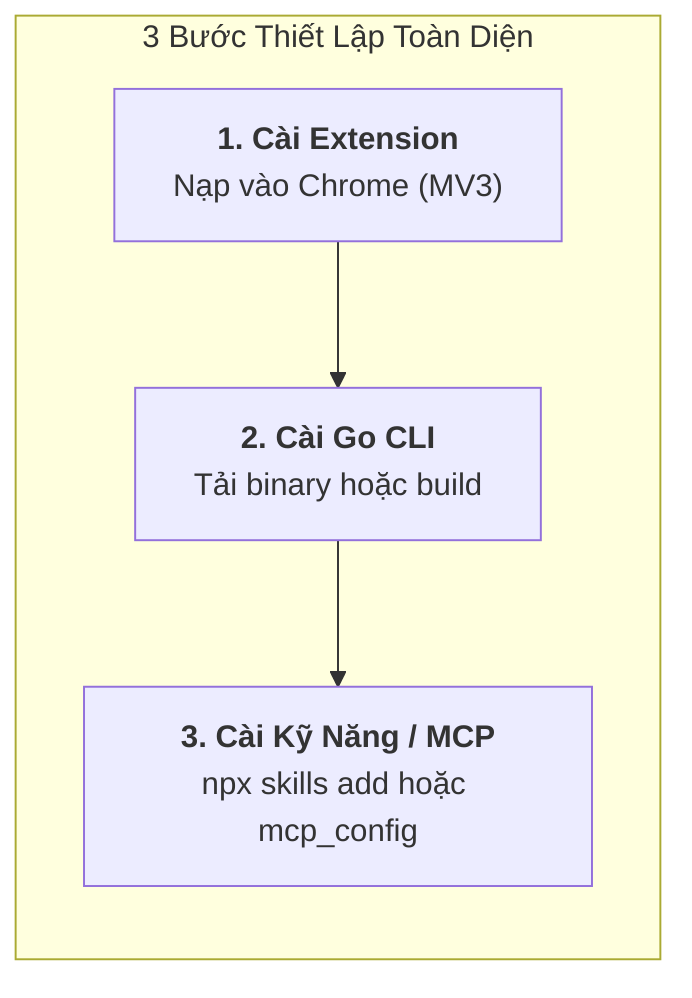

<div align="center">


# 🚀 AGENT PILOT
### Universal AI Agent Browser Controller • Antigravity-First

[](extensions/manifest.json)
[](#)
[](docs/ANTIGRAVITY_INTEGRATION.md)
[](docs/CDP_GUIDE.md)
[](#)
[](CONTRIBUTING.md)
[](LICENSE)

<p align="center">
  <b>Agent Pilot</b> là tiện ích mở rộng Google Chrome (Manifest V3) đột phá, được thiết kế chuyên biệt để giúp <b>mọi AI Agent</b> (ưu tiên tối ưu hóa cho <b>Antigravity</b>) có thể quan sát, phân tích và điều khiển trình duyệt một cách mượt mà, an toàn và trực quan nhất.
</p>

> ⚠️ **Thông Báo Bản Thử Nghiệm (Public Beta)**: Agent Pilot hiện đang được phát hành dưới dạng **Public Beta** cho cộng đồng nhà phát triển. Toàn bộ tính năng cốt lõi đã vượt qua 100% các bài kiểm thử tự động trên trình duyệt thật. Chúng tôi rất mong nhận được đóng góp ý kiến, phản hồi trải nghiệm và báo cáo lỗi từ bạn qua [GitHub Issues](https://github.com/ducconit/agent-pilot-extension/issues) hoặc [Pull Requests](CONTRIBUTING.md)!

[✨ Tính năng chính](#-tính-năng-cốt-lõi) • [🚀 Cài đặt nhanh](#-hướng-dẫn-cài-đặt-nhanh) • [🧪 Trang thử nghiệm](#-phòng-thí-nghiệm-kiểm-thử-test-page) • [📚 Tài liệu chi tiết](#-hệ-thống-tài-liệu-chuyên-sâu) • [🤝 Đóng góp](CONTRIBUTING.md)

---

</div>

## 🌟 Tính Năng Cốt Lõi

| Tính Năng | Biểu Tượng | Mô Tả Kỹ Thuật |
| :--- | :---: | :--- |
| **Điều khiển Trình duyệt** | 🌐 | Mở tab mới, điều hướng URL, reload, chuyển đổi và đóng tab linh hoạt. |
| **Mô phỏng Chuột ảo** | 🖱️ | Con trỏ đồ họa neon bay mượt mà trên màn hình, phát sóng click ripple và chuỗi sự kiện DOM hoàn chỉnh. |
| **Tự động Gõ chữ** | ⌨️ | Focus vào ô nhập liệu và gõ văn bản từng ký tự theo thời gian thực (Human-like Typing). |
| **Giám sát DevTools (CDP)** | ⚡ | Kết nối cấp thấp qua Chrome DevTools Protocol để bắt trọn `console.log/error`, `Network traffic` và `Performance RAM/DOM`. |
| **Soi & Lấy vị trí DOM** | 🎯 | Bắt dính phần tử khi hover, hiển thị kích thước `W × H`, tọa độ `(X, Y)`, trích xuất **CSS Selector** và **XPath**. |
| **Trích xuất Mã màu** | 🎨 | Kính lúp pixel nhặt màu chính xác 5 định dạng (HEX, RGB, RGBA, HSL, OKLCH), 1-click copy từng định dạng và lưu khay lịch sử màu sắc. |
| **Bộ Chụp Màn Hình** | 📸 | Hỗ trợ 3 chế độ: Chụp toàn khung nhìn, Kéo chọn vùng cắt tùy ý (Crop), và Chụp riêng phần tử DOM đã khóa. |
| **Chú Thích & Chỉ Điểm UI** | ✏️ | Khoanh vùng, chỉ điểm phần tử/component nguồn (React/Vue/Astro:line), ghim ghi chú lỗi để giao việc cho AI Agent sửa code (hỗ trợ 3 kênh Live Push, Persistent Inbox, Clipboard Prompt). |
| **Tương thích Antigravity** | 🤖 | Tích hợp sẵn bộ chạy kịch bản **JSON Action**, cầu nối `window.__AGENT_PILOT__` và 16 công cụ Antigravity MCP Tools. |

---

## 🏗️ Cấu Trúc Thư Mục Dự Án

Dự án được tổ chức khoa học, module hóa chuyên sâu và tuân thủ các chuẩn kỹ thuật cao nhất:

```
agent-pilot-extension/
├── assets/                             # Tài nguyên đồ họa & nhận diện thương hiệu
│   ├── banner.svg                      # Banner giới thiệu công nghệ cao
│   └── logo.svg                        # Logo vector gốc của Agent Pilot
├── docs/                               # Bộ tài liệu kỹ thuật chuyên sâu
│   ├── ANTIGRAVITY_INTEGRATION.md      # Hướng dẫn tích hợp Antigravity First & MCP
│   ├── ARCHITECTURE.md                 # Kiến trúc chi tiết Manifest V3 & IPC
│   ├── CDP_GUIDE.md                    # Hướng dẫn Chrome DevTools Protocol (CDP)
│   ├── API_REFERENCE.md                # Danh mục tin nhắn & đặc tả JSON Action
│   └── USAGE_GUIDE.md                  # Sổ tay hướng dẫn sử dụng từng tính năng
├── skills/                             # Kỹ năng chuẩn Agent Skills Ecosystem (skills.sh)
│   └── agent-pilot/
│       └── SKILL.md                    # Hướng dẫn & cấu hình skill cho npx skills add
├── cli/                                # Bộ công cụ dòng lệnh (CLI) & MCP Server độc lập bằng Go (Golang)
│   ├── main.go                         # Điểm khởi đầu & phân luồng subcommands (mcp, server, click, type,...)
│   ├── bridge.go                       # WebSocket Server 58765 & HTTP REST API nhúng
│   ├── client.go                       # Trình điều khiển trực tiếp qua CLI cho Tester/QC
│   ├── mcp.go                          # Máy chủ MCP chuẩn 16 công cụ qua giao thức stdio
│   ├── sanitizer.go                    # Lớp che giấu Secret/API Key bảo mật
│   ├── feedback.go                     # Quản lý Hộp thư Feedback Inbox & Waiter
│   └── README.md                       # Hướng dẫn sử dụng & biên dịch Go binary

├── extensions/                         # Toàn bộ mã nguồn Chrome Extension (Manifest V3)
│   ├── manifest.json                   # Cấu hình chuẩn Chrome Extension MV3
│   ├── guide.html                      # Trang Thông tin & Hướng dẫn sử dụng responsive
│   ├── background.js                   # Service Worker chính (ES Module entry)
│   ├── background/                     # Các module dịch vụ nền
│   │   ├── constants.js                # Hằng số hệ thống & cấu hình
│   │   ├── secret-sanitizer.js         # Lớp lọc che giấu Secret & API Key
│   │   ├── cdp-manager.js              # Quản lý Chrome DevTools Protocol
│   │   ├── tab-manager.js              # Quản lý Tabs & Native Tab Groups
│   │   ├── screenshot-service.js       # Dịch vụ chụp ảnh màn hình
│   │   ├── batch-executor.js           # Bộ chạy kịch bản gom cụm Batch Actions
│   │   └── bridge-client.js            # WebSocket client kết nối AI Agent bridge
│   ├── content.js                      # Content Script điều phối in-page
│   ├── content/                        # Các module tương tác DOM & Visuals
│   │   ├── toast.js                    # Thông báo Toast HUD trên trang web
│   │   ├── lock-shield.js              # Chỉ báo viền phát sáng & pill trạng thái khi Agent thao tác
│   │   ├── cursor-simulator.js         # Con trỏ chuột ảo Neon & sóng ripple
│   │   ├── dom-inspector.js            # Trích xuất thông số DOM & Element Snap
│   │   ├── eyedropper.js               # Kính lúp phóng đại 11x11 lấy mã màu
│   │   └── feedback-studio/            # Chú thích & Chỉ điểm UI in-page (Modular Architecture)
│   │       ├── constants.js            # Bảng màu xoay vòng, tiện ích escape & kéo thả
│   │       ├── state.js                # Quản lý trạng thái phiên chú thích & danh sách vị trí
│   │       ├── capture-service.js      # Dịch vụ chụp ảnh, cắt Canvas & nhận diện component nguồn
│   │       ├── pinned-overlay.js       # Quản lý layer ghim cố định khung chọn trên màn hình
│   │       ├── hud-toolbar.js          # Thanh công cụ HUD nổi trên trang & chuyển chế độ
│   │       ├── modals.js               # Popover ghi chú, Annotator màn hình & modal danh sách
│   │       ├── selection-modes.js      # Logic chọn phần tử, kéo chọn vùng, chụp viewport/fullpage
│   │       ├── export-channels.js      # 3 kênh xuất feedback (Prompt C, Inbox B, Live A)
│   │       └── index.js                # Điều phối vòng đời & xuất API window.__AP_INTERNAL__.feedback
│   ├── content.css                     # Stylesheet cho con trỏ, kính lúp, overlay & feedback HUD
│   ├── sidepanel.html                  # Giao diện trung tâm điều khiển Side Panel
│   ├── sidepanel.css                   # Giao diện Modern Dark Cyberpunk Responsive
│   ├── sidepanel.js                    # Bộ điều phối UI Side Panel (ES Module)
│   ├── sidepanel/                      # Các module quản lý thẻ Side Panel
│   │   ├── ui-helpers.js               # Tiện ích giao diện, toast, badge
│   │   ├── color-utils.js              # Chuyển đổi 5 định dạng màu (HEX, RGB, RGBA, HSL, OKLCH)
│   │   ├── agent-monitor.js            # Giám sát kết nối Agent & Secret Redaction toggle
│   │   ├── inspector-panel.js          # Thẻ Tổng quan DOM & Kiểu dáng CSS
│   │   ├── screenshot-panel.js         # Studio chụp ảnh & Auto-copy Clipboard
│   │   └── feedback-panel.js           # Thẻ Chú thích UI & kênh xuất Prompt/Inbox/Live
│   ├── popup.html                      # Popup tiện ích khởi động nhanh
│   ├── popup.js                        # Xử lý sự kiện popup
│   ├── popup.css
│   └── icons/                          # Bộ icon nhận diện chuẩn các kích thước
├── cli/                                # Công cụ Golang Standalone CLI & MCP Server
│   ├── main.go                         # Điểm vào CLI & bộ định tuyến subcommand
│   ├── mcp.go                          # Máy chủ MCP Stdio JSON-RPC & trích xuất Schema
│   ├── bridge.go                       # WebSocket Bridge & HTTP REST API Gateway
│   ├── commands.go                     # Xử lý lệnh trực tiếp click, type, screenshot, v.v.
│   └── feedback.go                     # Quản lý lưu trữ & reactive wait feedback
├── mcp/agent-pilot/                    # 16 tệp lược đồ chuẩn Single Source of Truth (SSOT)
├── scripts/                            # Bộ công cụ build, test, pack & sync cross-platform
│   ├── browser_resolver.mjs            # Tự động tìm kiếm Chrome/Chromium/Edge/Brave đa nền tảng
│   ├── export_mcp_schemas.mjs          # Trích xuất schema MCP tự động
│   ├── pack_extension.mjs              # Đóng gói tiện ích ra file ZIP release
│   ├── run_test.mjs                    # Bộ chạy test tự động Windows/macOS/Linux
│   ├── sync_agk.mjs                    # Đồng bộ sang plugin AGK Antigravity
│   ├── verify_all_features.mjs         # Bộ kiểm thử 15 tính năng cốt lõi trên trình duyệt thật
│   ├── verify_agent_connection.mjs     # Bộ kiểm thử 29 tính năng kết nối & điều khiển Agent
│   ├── verify_feedback_system.mjs      # Bộ kiểm thử hệ thống Feedback Channel B & Channel A
│   └── verify_secret_sanitizer.mjs     # Bộ kiểm thử 19 kịch bản lọc che giấu Secret/API Key
├── test-page.html                      # Trang web tương tác phục vụ kiểm thử tức thì
└── README.md                           # Tài liệu giới thiệu dự án
```

---

## 🚀 Hướng Dẫn Cài Đặt (Installation Guide)

Agent Pilot cung cấp 3 thành phần chính: **Chrome Extension (Giao diện & Cầu nối trình duyệt)**, **Standalone Go CLI / MCP Server (Bộ máy điều khiển độc lập)**, và **Agent Skill (Kỹ năng cho AI Coding Assistants)**.



### 1. Cài Đặt Chrome Extension

#### Cách A: Cài đặt từ Bản Phát Hành (Khuyên dùng)
1. Tải gói tiện ích mới nhất từ [GitHub Releases](https://github.com/ducconit/agent-pilot-extension/releases) (tệp `agent-pilot-v1.0.5-beta.zip` hoặc trong thư mục `dist/`).
2. Giải nén tệp `.zip` vào một thư mục cố định trên máy.
3. Mở trình duyệt Chrome, truy cập: `chrome://extensions`.
4. Gạt bật công tắc **Developer mode** (Chế độ dành cho nhà phát triển) ở góc trên bên phải.
5. Nhấn nút **Load unpacked** (Tải tiện ích đã giải nén) và chọn thư mục vừa giải nén.
6. Nhấp biểu tượng Extensions (mảnh ghép) trên thanh công cụ Chrome và **Ghim (Pin)** biểu tượng **Agent Pilot (📌)**.

#### Cách B: Cài đặt từ Mã Nguồn (Dành cho Lập trình viên)
```bash
git clone https://github.com/ducconit/agent-pilot-extension.git
cd agent-pilot-extension
npm ci
npm run pack  # Đóng gói tự động ra dist/agent-pilot-v*.zip
```
Sau đó nạp thư mục `extensions/` trực tiếp vào `chrome://extensions`.

---

### 2. Cài Đặt Standalone Go CLI & MCP Server (`agent-pilot`)

Bản binary độc lập viết bằng **Golang** tích hợp sẵn máy chủ **WebSocket/REST Bridge Server (cổng 58765)**, **MCP Server (stdio)** và **bộ lệnh CLI** điều khiển trình duyệt trực tiếp (khởi động `<5ms`, RAM `~12MB`, đóng gói tĩnh pure static `CGO_ENABLED=0`, không phụ thuộc Node.js hay thư viện hệ thống).

#### Cách A: Tải Binary Biên Dịch Sẵn (GitHub Releases)
Tải binary tương ứng với hệ điều hành và kiến trúc máy tính của bạn:

| Hệ Điều Hành | Kiến Trúc | Tên Tệp Tải Về | Lệnh Cài Đặt Toàn Cục |
| :--- | :--- | :--- | :--- |
| **Linux** | x86_64 (amd64) | `agent-pilot-linux-amd64` | `sudo mv agent-pilot-linux-amd64 /usr/local/bin/agent-pilot && sudo chmod +x /usr/local/bin/agent-pilot` |
| **Linux** | ARM64 (aarch64) | `agent-pilot-linux-arm64` | `sudo mv agent-pilot-linux-arm64 /usr/local/bin/agent-pilot && sudo chmod +x /usr/local/bin/agent-pilot` |
| **macOS** | Apple Silicon (M1-M4) | `agent-pilot-darwin-arm64` | `sudo mv agent-pilot-darwin-arm64 /usr/local/bin/agent-pilot && sudo chmod +x /usr/local/bin/agent-pilot` |
| **macOS** | Intel (x86_64) | `agent-pilot-darwin-amd64` | `sudo mv agent-pilot-darwin-amd64 /usr/local/bin/agent-pilot && sudo chmod +x /usr/local/bin/agent-pilot` |
| **Windows** | x86_64 (amd64) | `agent-pilot-windows-amd64.exe` | Đổi tên thành `agent-pilot.exe` và thêm vào biến môi trường `PATH` |
| **Windows** | ARM64 | `agent-pilot-windows-arm64.exe` | Đổi tên thành `agent-pilot.exe` và thêm vào biến môi trường `PATH` |

#### Cách B: Tự Biên Dịch Từ Nguồn (Yêu cầu Go 1.21+)
```bash
# Cách 1: Sử dụng npm script
npm run build:cli

# Cách 2: Tự biên dịch trực tiếp qua go build
cd cli
go build -ldflags="-s -w" -o agent-pilot .

# Hoặc cài đặt trực tiếp qua Go toolchain
go install github.com/ducconit/agent-pilot-extension/cli@latest
```

#### Cách Kích Hoạt Service Chạy Ngầm (Khuyên dùng cho trải nghiệm tốt nhất)
Thay vì phải tự chạy server thủ công, bạn chỉ cần gõ 1 lệnh để hệ thống tự động đăng ký service chạy ngầm (Linux `systemd --user`, macOS `launchd`, Windows `Task Scheduler`):

```bash
# Cài đặt và kích hoạt service tự khởi động cùng máy:
agent-pilot service install

# Kiểm tra trạng thái service:
agent-pilot service status

# Các lệnh quản trị khác:
agent-pilot service restart    # Khởi động lại
agent-pilot service stop       # Dừng tạm thời
agent-pilot service uninstall  # Gỡ bỏ service
```

> 💡 **Lưu Ý Khi Chạy Nhiều AI Agent Đồng Thời (Multi-Agent Concurrency)**:
> - **Chống xung đột cổng**: Khi chạy ngầm bằng `agent-pilot service install`, server đóng vai trò Master Bridge. Bạn có thể bật đồng thời **Antigravity IDE**, **Codex**, **Claude Code**, và **Antigravity CLI** để xử lý nhiều task cùng lúc mà không lo lỗi đụng độ cổng mạng.
> - **Chỉ định `tabId`**: Khi Agent mở tab bằng `browser_open_tab`, hãy truyền `tabId` vào các lệnh tiếp theo (`click`, `type`, `screenshot`, `run_actions`) để mỗi Agent làm việc trên tab riêng của mình mà không tranh chấp tiêu điểm (focus) với nhau.

---

### 3. Cài Đặt Kỹ Năng Cho Trợ Lý AI (Agent Skills Ecosystem)

Agent Pilot tuân thủ chuẩn mở **Agent Skills** ([skills.sh](https://skills.sh/)). Mọi trợ lý AI coding (như **Claude Code**, **Cursor**, **Codex**, **OpenCode**, **Antigravity**, **Amp**, **Roo Code**, **Devin**, v.v.) đều có thể tự động tải và kích hoạt kỹ năng chỉ với 1 lệnh:

```bash
# Cài đặt cho thư mục dự án hiện tại:
npx skills add https://github.com/ducconit/agent-pilot-extension

# Hoặc cài đặt toàn cục (Global) cho mọi AI agent trên hệ thống:
npx skills add https://github.com/ducconit/agent-pilot-extension -g --all
```

---

## 📖 Hướng Dẫn Sử Dụng (User & Developer Guide)

### 1. Dành Cho Người Dùng (Humans)

#### Khởi Động Bảng Điều Khiển (Side Panel)
- **Cách 1**: Nhấp chuột trực tiếp vào biểu tượng **Agent Pilot (📌)** trên thanh công cụ Chrome (Side Panel sẽ trượt mở tức thì).
- **Cách 2**: Nhấp chuột phải trên bất kỳ trang web nào $\rightarrow$ Chọn **Mở Agent Pilot (Side Panel)**.
- **Phím tắt nhanh**: <kbd>Ctrl + Shift + P</kbd> (trên macOS: <kbd>Cmd + Shift + P</kbd>). Bạn có thể tùy chỉnh lại phím tắt tại `chrome://extensions/shortcuts`.

#### Các Tính Năng Nổi Bật Trên Giao Diện:
1. **🎯 Soi Phần Tử DOM (Inspector)**: Bật nút soi $\rightarrow$ rà chuột qua trang web để xem bounding box, kích thước, CSS Selector và XPath. Nhấp vào bất kỳ dòng nào để sao chép nhanh hoặc bấm **📋 Copy Tất cả**.
2. **🎨 Kính Lúp Nhặt Mã Màu (Eyedropper)**: Phóng đại pixel 11×11 bám theo con trỏ chuột, nhặt màu chính xác 5 chuẩn hiện đại (HEX, RGB, RGBA, HSL, OKLCH), hỗ trợ 1-click copy từng dòng định dạng và lưu khay lịch sử màu sắc.
3. **📸 Bộ Chụp Màn Hình (Screenshot Studio)**:
   - Chụp toàn màn hình, kéo khung cắt tùy chọn (Crop), hoặc chụp riêng phần tử DOM đã khóa.
   - Bật công tắc **Tự động sao chép vào Clipboard** để dán ngay lập tức mà không cần bấm lưu.
4. **✏️ Chú Thích & Chỉ Điểm UI Cho Agent (Feedback Studio)**:
   - **4 chế độ chọn**: Chọn phần tử (tự động phát hiện React/Vue/Astro source line), Kéo chọn vùng (ghim khung số hóa #1, #2,...), Toàn màn hình viewport (vẽ khung box & cắm ghim pin), và Toàn trang web cuộn (Full Page).
   - **Chỉnh sửa / Xóa linh hoạt**: Nhấp nút ✏️ để sửa ghi chú trực tiếp trên trang hoặc trên thẻ Side Panel; bấm ✕ để xóa khung ghim.
   - **3 kênh xuất linh hoạt**:
     - **Kênh A (Live Push)**: Đẩy trực tiếp sang cho AI Agent đang chờ.
     - **Kênh B (Shared Inbox)**: Lưu phiên vào `~/.agent-pilot/inbox/feedback/<timestamp>/`.
     - **Kênh C (Clipboard Prompt)**: 1-click tạo prompt Markdown hoàn chỉnh kèm vị trí component.
5. **🛡️ Chỉ Báo Hoạt Động Tinh Tế (Subtle Agent Indicator)**:
   - Khi AI Agent thao tác, giao diện hiển thị viền màn hình phát sáng neon nhẹ nhàng và thanh trạng thái nhỏ gọn (floating pill) hiển thị hành động đang thực thi.
   - Trang bị nút `[ 🔓 Chiếm quyền ]` và lắng nghe phím <kbd>Esc</kbd> để người dùng mở khóa tức thì mà không làm mờ trang web hay cản trở tầm nhìn.

---

### 2. Dành Cho Trợ Lý AI Coding Agents (Antigravity, Claude, Cursor)

#### Cấu Hình MCP Server (`stdio`):
Thêm vào file cấu hình MCP của bạn (`~/.gemini/antigravity/mcp/` hoặc `claude_desktop_config.json` hoặc Cursor Settings):

```json
{
  "mcpServers": {
    "agent-pilot": {
      "command": "agent-pilot",
      "args": ["mcp"]
    }
  }
}
```

#### Khởi Chạy Bridge Server Chống Xung Đột Cổng (Dual Mode):
```bash
# Khởi chạy server độc lập
agent-pilot server
```
Khi chạy đa tác vụ hoặc nhiều cửa sổ IDE, Agent Pilot tự động chuyển sang chế độ **Forwarder**, chuyển tiếp lệnh qua HTTP REST API `http://127.0.0.1:58765/api` mà không bao giờ gặp lỗi xung đột cổng `EADDRINUSE`.

#### 16 Công Cụ MCP Điều Khiển Trình Duyệt:
- `browser_run_actions`: Động cơ thực thi chuỗi kịch bản hàng loạt (Batch Engine), tiết kiệm >80% token.
- `browser_open_tab`, `browser_list_tabs`, `browser_navigate`: Quản lý và điều hướng các tab trình duyệt (mặc định mở ngầm không cướp focus).
- `browser_click`, `browser_type`, `browser_scroll`: Mô phỏng chuột ảo neon với sóng click ripple, tự động gõ chữ và cuộn trang.
- `browser_get_element`, `browser_pick_color`, `browser_screenshot`: Đọc DOM, trích xuất mã màu pixel, chụp ảnh màn hình ngầm qua CDP.
- `browser_get_devtools_data`: Bắt log Console, Network requests và Performance RAM/DOM.
- `browser_list_instances`, `browser_select_instance`: Quản lý đa trình duyệt Chrome đồng thời.
- `browser_set_busy`: Khóa/mở khóa khiên bảo vệ người dùng thao tác khi Agent chạy kịch bản phức tạp.
- `browser_wait_for_feedback`: Chờ phản hồi trực quan từ người dùng theo thời gian thực (Channel A).
- `browser_get_pending_feedback`: Đọc danh sách phản hồi UI trong Inbox cục bộ (Channel B).

---

### 3. Dành Cho Kỹ Sư Kiểm Thử / QC (Standalone CLI Automation)

Kỹ sư kiểm thử tự động có thể điều khiển trình duyệt trực tiếp qua terminal hoặc tích hợp vào shell script/CI mà không cần Node.js:

```bash
# 1. Điều hướng và mở tab
agent-pilot open "https://github.com" --active

# 2. Tương tác chuột & bàn phím
agent-pilot type "#search-input" "agent pilot" --enter
agent-pilot click ".repo-item:first-child"
agent-pilot scroll 0 400

# 3. Trích xuất thông tin DOM
agent-pilot inspect "h1.entry-title"

# 4. Chụp ảnh màn hình kiểm thử
agent-pilot screenshot -o result.png --mode visible

# 5. Xem danh sách các tab đang hoạt động
agent-pilot tabs

# 6. Chạy kịch bản tự động hóa từ tệp JSON
agent-pilot batch flow_test.json

# 7. Quản lý phản hồi UI
agent-pilot feedback list
```

---

## 🧪 Phòng Thí Nghiệm Kiểm Thử (`test-page.html`)

Dự án có sẵn tệp `test-page.html` được thiết kế đặc biệt để bạn kiểm nghiệm toàn bộ các tính năng ngay lập tức mà không cần internet:

1. Kéo thả tệp `test-page.html` vào trình duyệt Chrome (hoặc mở bằng URL `file:///home/ubuntu/workspace/projects/browser-control/test-page.html`).
2. Mở **Agent Pilot Side Panel**:
   - Thử nghiệm **Chuột ảo**: Di chuyển chuột đến nút *"🎯 Click vào đây!"* và nhấp click.
   - Thử nghiệm **Tự động gõ chữ**: Điền nội dung vào ô `#test-search-input`.
   - Thử nghiệm **DevTools**: Nhấp các nút sinh `console.log`, `warn`, `error` hoặc nút gửi API để thấy nhật ký và network nhảy tức thì trong Side Panel.
   - Thử nghiệm **Lấy màu**: Bật nút lấy mã màu và nhặt màu từ dải các ô màu rực rỡ trên trang.
   - Thử nghiệm **Chụp ảnh**: Thử chụp toàn màn hình, kéo khung crop box hoặc chụp riêng khối `#inspector-special-box`.
   - Thử nghiệm **Feedback Studio**: Bấm nút Feedback Studio, kéo chọn vùng, cắm ghim pin và bấm Copy Prompt hoặc Gửi Agent.

---

## 🤖 Kịch Bản Tự Động Hóa Mẫu (Antigravity Automation)

Bạn có thể dán đoạn mã JSON sau vào ô **Kịch bản Agent** trên Side Panel rồi nhấn **▶ Chạy Kịch bản Agent**:

```json
[
  { "action": "mouse_move", "x": 320, "y": 210, "duration": 400 },
  { "action": "wait", "ms": 250 },
  { "action": "mouse_click", "x": 320, "y": 210 },
  { "action": "wait", "ms": 300 },
  { "action": "type", "selector": "#test-search-input", "text": "Agent Pilot x Antigravity AI" },
  { "action": "scroll", "deltaY": 250 },
  { "action": "screenshot", "mode": "visible" }
]
```

---

## 📚 Hệ Thống Tài Liệu Chuyên Sâu

Để tìm hiểu sâu hơn về kiến trúc và cách tích hợp với AI Agent, vui lòng tham khảo các tài liệu chuyên ngành tại thư mục `docs/`:

* 📖 **[Tích hợp Antigravity & MCP Protocol](docs/ANTIGRAVITY_INTEGRATION.md)**: Hướng dẫn kết nối Agent Pilot với Antigravity coding agents, schema MCP tools và kịch bản end-to-end.
* 🏛️ **[Kiến trúc Hệ thống (ARCHITECTURE.md)](docs/ARCHITECTURE.md)**: Phân tích chi tiết mô hình Manifest V3, vòng đời Service Worker và đường ống truyền thông điệp (IPC).
* ⚡ **[Sổ tay Chrome DevTools Protocol (CDP_GUIDE.md)](docs/CDP_GUIDE.md)**: Cơ chế kết nối cấp thấp với Console, Network, Performance và Page Capture.
* 📚 **[Danh mục Tham chiếu API (API_REFERENCE.md)](docs/API_REFERENCE.md)**: Đặc tả toàn bộ cú pháp tin nhắn và hàm API của `window.__AGENT_PILOT__`.
* 📖 **[Sổ tay Người dùng (USAGE_GUIDE.md)](docs/USAGE_GUIDE.md)**: Hướng dẫn chi tiết từng bước vận hành toàn bộ chức năng.

---

## 🤝 Đóng Góp Cộng Đồng (Contributing)

Chúng tôi hoan nghênh mọi sự đóng góp để giúp Agent Pilot ngày càng hoàn thiện và mạnh mẽ hơn!

* 📖 **[Hướng dẫn Đóng góp (CONTRIBUTING.md)](CONTRIBUTING.md)**: Hướng dẫn cài đặt môi trường dev, chạy kiểm thử, quy ước commit và gửi Pull Request.
* 📜 **[Quy tắc Ứng xử (CODE_OF_CONDUCT.md)](CODE_OF_CONDUCT.md)**: Cam kết môi trường hợp tác văn minh, cởi mở theo chuẩn Contributor Covenant v2.1.
* 🛡️ **[Chính sách Bảo mật (SECURITY.md)](SECURITY.md)**: Báo cáo lỗ hổng an ninh có trách nhiệm và cam kết bảo vệ dữ liệu bí mật.

---

## 👤 Tác Giả & Quản Trị Dự Án (Author & Maintainer)

* **Tác giả (Owner)**: **DNT**
* **GitHub**: [@ducconit](https://github.com/ducconit) ([https://github.com/ducconit](https://github.com/ducconit))
* **Dự án**: [Agent Pilot Extension](https://github.com/ducconit/agent-pilot-extension)

---

## 📄 Bản Quyền & Giấy Phép

Dự án được phát hành theo giấy phép mã nguồn mở [MIT License](LICENSE).
Copyright (c) 2026 **DNT** ([@ducconit](https://github.com/ducconit)) & Agent Pilot Contributors.
Tương thích hoàn hảo với Antigravity, Chrome 116+ (hỗ trợ đầy đủ Side Panel API).
