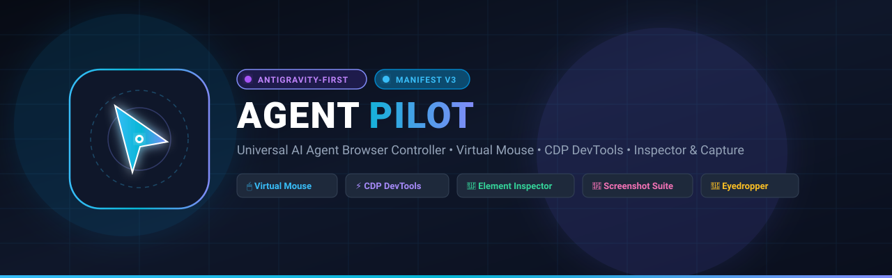
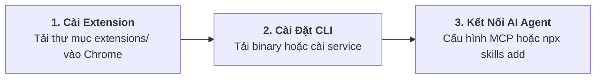

<div align="center">



# 🚀 AGENT PILOT
### Universal AI Agent Browser Controller • Antigravity-First

[](extensions/manifest.json)
[](#)
[](docs/CDP_GUIDE.md)
[](#)
[](LICENSE)

[English](README.md) • [Tiếng Việt](README.vi.md) • [Tài liệu chi tiết](docs/) • [Đóng góp](CONTRIBUTING.md)

<p align="center">
  <b>Agent Pilot</b> là bộ công cụ điều khiển trình duyệt chuyên sâu cho <b>AI Coding Agent</b> (tối ưu hóa cho Google Antigravity, Claude Code, Cursor, Codex). Kết hợp sức mạnh giữa <b>Chrome Extension (Manifest V3)</b>, <b>Standalone Go CLI</b> và <b>MCP Server</b> (Model Context Protocol).
</p>

</div>

---

## 🌟 Tính Năng Nổi Bật

- **Mô phỏng Thao tác Người dùng Thật**: Chuột ảo Neon với hiệu ứng ripple, gõ phím theo thời gian thực (human-like typing), kéo thả canvas/game, upload file.
- **Dual Engine (DOM + Trusted CDP)**: Chạy nhanh và nhẹ trên DOM ảo mặc định; tự động nâng cấp lên Chrome DevTools Protocol (`--via cdp`) khi cần xử lý cross-origin iframe, Canvas, WebGL.
- **Nền tảng Tự hành (Zero Runtime Dependency)**: Binary Go duy nhất tích hợp sẵn MCP Server, REST/WebSocket Bridge, DevTools runtime nhúng (Lighthouse, heap analysis, tracing) — không cần cài đặt Node.js hay FFmpeg trên máy client.
- **Background Multi-Agent Isolation**: Mở tab ngầm trong Tab Group riêng (`🤖 Agent Pilot`), tuyệt đối không cướp focus của người dùng; hỗ trợ nhiều Agent chạy đồng thời qua `--tab <id>`.
- **Feedback Studio & UI Annotator**: Bảng điều khiển Side Panel cho phép người dùng khoanh vùng UI, ghim ghi chú lỗi và đẩy trực tiếp cho AI Agent sửa code.

---

## 🚀 Cài Đặt Nhanh (3 Bước)



### Bước 1: Nạp Extension vào Chrome
1. Tải bản phát hành mới nhất từ [GitHub Releases](https://github.com/ducconit/agent-pilot-extension/releases).
2. Mở Chrome $\to$ `chrome://extensions` $\to$ bật **Developer mode**.
3. Bấm **Load unpacked** $\to$ chọn thư mục `extensions/` và ghim biểu tượng **Agent Pilot (📌)**.

### Bước 2: Tải Binary CLI theo Hệ Điều Hành

| Hệ Điều Hành | Gói Phát Hành | Lệnh Cài Đặt Tự Động | Hướng Dẫn |
| :--- | :--- | :--- | :--- |
| 🐧 **Ubuntu / Linux** | `agent-pilot-*-linux.zip` | `./install.sh` | [README.ubuntu.md](docs/bundles/README.ubuntu.md) |
| 🍎 **macOS** | `agent-pilot-*-macos.zip` | `./install.sh` | [README.macos.md](docs/bundles/README.macos.md) |
| 🪟 **Windows** | `agent-pilot-*-windows.zip` | `powershell -ExecutionPolicy Bypass -File .\install.ps1` | [README.windows.md](docs/bundles/README.windows.md) |

Khởi động dịch vụ chạy ngầm tự khởi động cùng máy:
```bash
agent-pilot service install
agent-pilot service status
```

### Bước 3: Cấu Hình AI Agent

#### Cách A: Cài Đặt Chuẩn Agent Skills ([skills.sh](https://skills.sh/))
```bash
npx skills add https://github.com/ducconit/agent-pilot-extension -g --all
```

#### Cách B: Cấu Hình MCP Server (`stdio`)
Thêm vào `claude_desktop_config.json`, `~/.gemini/antigravity/mcp/` hoặc Cursor Settings:
```json
{
  "mcpServers": {
    "agent-pilot": {
      "command": "agent-pilot",
      "args": ["mcp"]
    }
  }
}
```

---

## 💻 Sử Dụng Nhanh (CLI Cheat Sheet)

```bash
# Mở tab mới ngầm (không cướp focus màn hình)
agent-pilot open "http://localhost:3000" --format json

# Trích xuất bản đồ tương tác siêu nhẹ (@1, @2...)
agent-pilot snapshot --tab 12345

# Thao tác chuột và bàn phím
agent-pilot click "@1" --tab 12345
agent-pilot type "@2" "test@example.com" --enter --tab 12345

# Chụp ảnh màn hình đính kèm khung viền nổi bật
agent-pilot screenshot -o step1.png --highlight "@1" --title "Đăng nhập"

# Đóng tab và giải phóng tài nguyên
agent-pilot close --tab 12345
```

---

## 📚 Hệ Thống Tài Liệu Kỹ Thuật

- 🏛️ **[Kiến trúc Hệ thống (ARCHITECTURE.md)](docs/ARCHITECTURE.md)**: Thiết kế Manifest V3, IPC Bridge và cơ chế cách ly tiến trình.
- 🤖 **[Tích hợp Antigravity & MCP](docs/ANTIGRAVITY_INTEGRATION.md)**: Hướng dẫn kết nối toàn diện với AI coding agents.
- ⚡ **[Sổ tay Chrome DevTools Protocol](docs/CDP_GUIDE.md)**: Tương tác cấp thấp CDP, Network, Console và Trusted Input.
- 🔬 **[Bộ công cụ DevTools Nâng Cao](docs/DEVTOOLS.md)**: Lighthouse audit, heap snapshot, tracing, video screencast.
- 📖 **[Sổ tay Sử dụng Đầy đủ (USAGE_GUIDE.md)](docs/USAGE_GUIDE.md)**: Hướng dẫn chi tiết từng tính năng cho người dùng và QA.
- 📊 **[Đo Lường Hiệu Năng MCP vs CLI](docs/BENCHMARKS.md)**: Báo cáo thực nghiệm so sánh token, độ trễ và video demo.
- 📦 **[Hướng dẫn Cài đặt theo OS (BUNDLE_README.md)](docs/BUNDLE_README.md)**: Chi tiết thiết lập cho Linux, macOS và Windows.

---

## 🤝 Đóng Góp & Phát Triển

- 🛠️ [Hướng dẫn đóng góp (CONTRIBUTING.md)](CONTRIBUTING.md)
- 📜 [Bộ quy tắc ứng xử (CODE_OF_CONDUCT.md)](CODE_OF_CONDUCT.md)
- 🛡️ [Chính sách bảo mật (SECURITY.md)](SECURITY.md)

---

## 📄 Bản Quyền & Giấy Phép

Phát hành theo giấy phép mã nguồn mở [MIT License](LICENSE).
Copyright (c) 2026 **DNT** ([@ducconit](https://github.com/ducconit)) & Agent Pilot Contributors.
