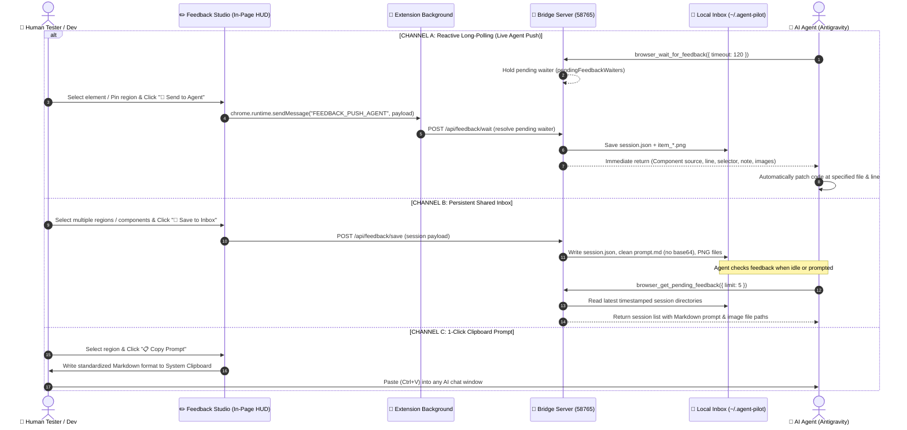

# 🏛️ Agent Pilot System Architecture
**Version**: v1.3.0 
**Mission**: Provide a comprehensive, ultra-low latency, focus-preserving browser control interface for AI Coding Agents (Antigravity-First), featuring dual-engine DOM/CDP execution and rich visual feedback. 
**Maintainer**: DNT ([github.com/ducconit](https://github.com/ducconit))

---

## 1. 🌐 End-to-End Multi-Tier Architecture

Agent Pilot establishes a secure, bidirectional, closed-loop bridge between AI Coding Agents (Google Antigravity, Claude Code, Cursor, OpenCode) and the Chromium browser:

---

## 2. ⏱️ Sequence Diagram: Agent Execution Lifecycle

The diagram below details the end-to-end execution flow when an AI Agent sends an interaction command (e.g. `browser_click` or `browser_run_actions`):

---

## 3. 🎨 3-Channel Visual Feedback Architecture

The system provides 3 bidirectional communication channels between human developers/QA testers and AI agents:

---

## 4. 🛡️ Security Mechanisms & Defense-in-Depth

1. **WebSocket Origin Guard (`verifyClient`)**:
   - Parses incoming request origins via standard URL parsing (`new URL(origin).hostname`).
   - Strictly allowlists: `chrome-extension://`, `127.0.0.1`, and `localhost`.
   - Completely prevents Cross-Site WebSocket Hijacking (CSWSH) from malicious websites the user might browse.
2. **Dual-Layer Secret Redaction**:
   - Automatically detects and masks with asterisks `*` across 12 credential types (OpenAI, Anthropic, Gemini, AWS, Stripe, GitHub, Slack, JWT, Bearer tokens, RSA/SSH/PGP private keys, URL parameters, and sensitive JSON keys).
   - Defends against infinite recursion using a `WeakSet` (`[Circular]`).
   - Redacts at the Service Worker level before network transmission and redundantly at the Go server level before returning payloads to LLMs.
3. **Strict Isolation Between Main World & Content Script**:
   - `main-world-bridge.js` runs in the webpage context (`world: "MAIN"`), exposing `window.__AGENT_PILOT__` without any `chrome.*` privilege.
   - Communicates with the extension strictly via custom DOM events (`__AGENT_PILOT_REQ__` and `__AGENT_PILOT_RES__`).
4. **Tab-Level Mutex Lock**:
   - `runWithTabLock` serializes concurrent operations, preventing race conditions between parallel agent commands and user input on the same tab.
5. **Bridge Trust Model**:
   - The Bridge binds strictly to `127.0.0.1:58765`. Its origin allowlist permits `localhost`, `127.0.0.1`, and `chrome-extension://`. However, it does not require an authentication token; any local process on the machine can connect. Run only trusted local software and never expose this port to an external network.
