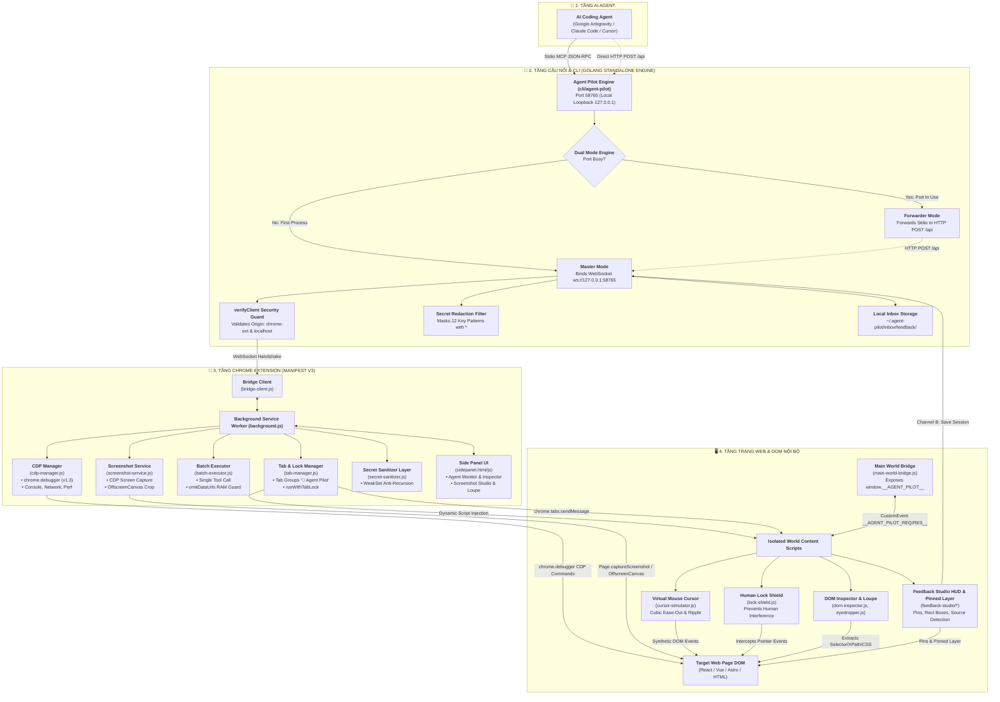
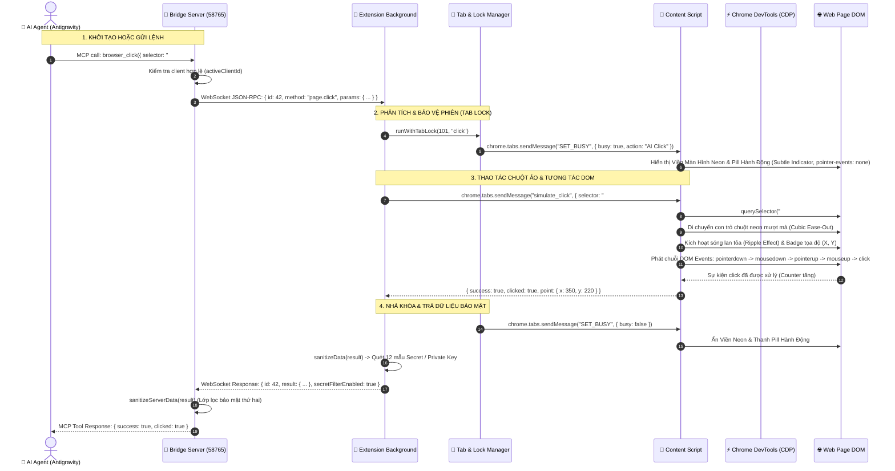

# 🏛️ Tài Liệu Kiến Trúc Hệ Thống Agent Pilot
**Phiên bản**: v1.0.7-beta
**Mục tiêu**: Cung cấp giao diện kiểm soát trình duyệt hoàn chỉnh cho AI Coding Agent (Antigravity First), độ trễ thấp, không chiếm quyền focus, hỗ trợ CDP và phản hồi trực quan (Visual Feedback)
**Tác giả duy trì**: DNT ([github.com/ducconit](https://github.com/ducconit))

---

## 1. 🌐 Sơ Đồ Kiến Trúc Đa Tầng Tổng Thể (End-to-End Architecture)

Agent Pilot xây dựng cầu nối hai chiều khép kín, an toàn giữa các mô hình AI Agent (Antigravity, Claude Code, Cursor, OpenCode) và trình duyệt Chromium:

---

## 2. ⏱️ Sơ Đồ Tuần Tự (Sequence Diagram) - Vòng Đời Lệnh Của Agent

Dưới đây là luồng thực thi chi tiết từng bước khi AI Agent gửi một lệnh tương tác (ví dụ: `browser_click` hoặc `browser_run_actions`) đến trình duyệt:

---

## 3. 🎨 Sơ Đồ 3 Kênh Phản Hồi Trực Quan (3-Channel Visual Feedback)

Hệ thống cung cấp 3 kênh trao đổi hai chiều giữa người dùng và AI Agent khi kiểm thử giao diện:

---

## 4. 🛡️ Các Cơ Chế An Ninh & Phòng Thủ Trọng Yếu

1. **Khóa Nguồn Gốc WebSocket Server (`verifyClient`)**:
   - Sử dụng bộ phân tích URL chuẩn (`new URL(origin).hostname`).
   - Chỉ cho phép: `chrome-extension://`, `127.0.0.1`, `localhost`.
   - Ngăn chặn triệt để tấn công Cross-Site WebSocket Hijacking (CSWSH) từ bất kỳ website độc hại nào người dùng truy cập.
2. **Lớp Lọc Dữ Liệu Nhạy Cảm 2 Tầng (Dual-Layer Secret Redaction)**:
   - Tự động nhận diện và che dấu bằng dấu sao `*` 12 loại thông tin (OpenAI, Anthropic, Gemini, AWS, Stripe, GitHub, Slack, JWT, Bearer token, Private Keys RSA/SSH/PGP, URL parameters, JSON sensitive keys).
   - Bảo vệ chống tràn ngăn đệ quy vô tận bằng `WeakSet` (`[Circular]`).
   - Lọc ở Service Worker trước khi truyền qua mạng và lọc ở Server trước khi trả về cho LLM.
3. **Cách Ly Tuyệt Đối Giữa Main World & Content Script**:
   - `main-world-bridge.js` chạy trong ngữ cảnh của trang web (`world: "MAIN"`), cung cấp `window.__AGENT_PILOT__` nhưng hoàn toàn **không có quyền hạn `chrome.*`**.
   - Giao tiếp với Extension thông qua các sự kiện tùy biến `CustomEvent` (`__AGENT_PILOT_REQ__` và `__AGENT_PILOT_RES__`).
4. **Bảo Vệ Độc Quyền Theo Tab (Tab-Level Mutex Lock)**:
   - `runWithTabLock` ngăn chặn hai hành động của Agent hoặc một hành động của Agent và thao tác gõ/click của người dùng xung đột với nhau trên cùng một tab.
