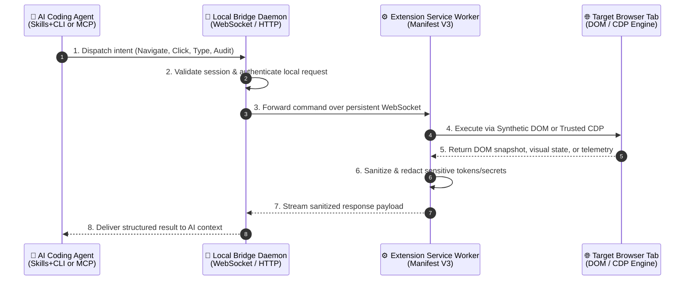
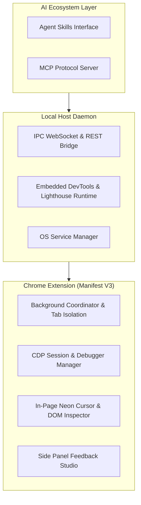
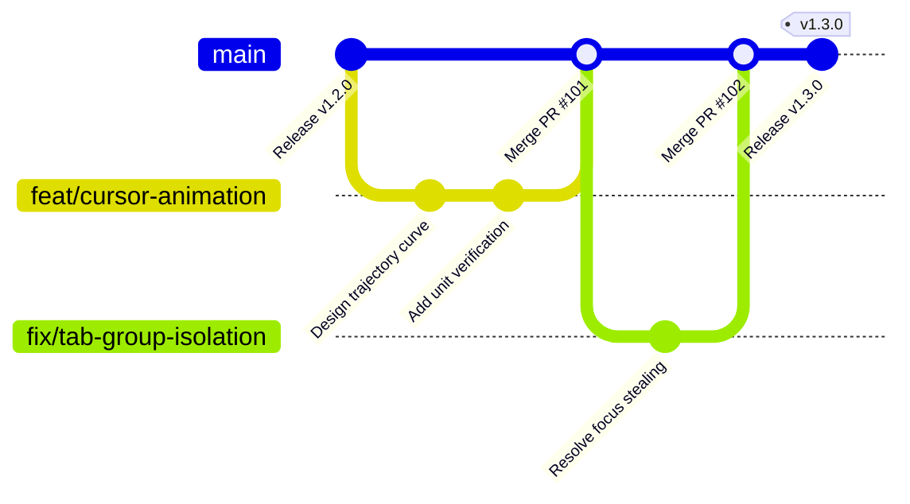
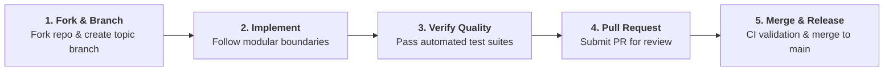

# 🛠️ Developer Guide: Operational Flows & Contributing

Welcome to the engineering and contribution guide for **Agent Pilot**. This document outlines how the system operates internally, how components interact, our Git branching workflow, and how to contribute to the project.

::: tip General Documentation & Bug Reports
- Looking for installation steps or sample AI prompts? Visit [Installation & Features](/USAGE_GUIDE) and [Sample Prompts](/PROMPT_RECIPES).
- Want to report a bug or request a feature? Visit [Report Bugs & Feature Requests](/COMMUNITY_SUPPORT).
:::

---

## 🔄 1. End-to-End Operational Flow

Agent Pilot connects AI coding assistants to the Google Chrome browser through a coordinated multi-layer pipeline. Every command issued by an AI agent passes through four core phases:

### The Four Operational Stages

| Stage | Name | What Happens Internally |
| :--- | :--- | :--- |
| **Stage 1** | **Intent Dispatch** | The AI agent translates a natural language prompt into a structured browser action via the standalone CLI or Model Context Protocol (MCP). |
| **Stage 2** | **Bridge Routing** | The local background daemon receives the action, manages concurrency locks across parallel agents, and routes the instruction to the active Chrome profile. |
| **Stage 3** | **Dual-Engine Execution** | The Chrome Extension determines the optimal execution strategy: fast in-page DOM simulation (with virtual neon cursor trajectories) for standard web elements, or Chrome DevTools Protocol (CDP) escalation for iframes, Canvas, WebGL, and network/heap profiling. |
| **Stage 4** | **Sanitization & Feedback** | Before returning data to the AI model, the built-in 29-rule Secret Sanitizer masks API keys, passwords, JWTs, and private keys in both DOM snapshots and console logs. |

---

## 🧩 2. System Component Responsibilities

The project is strictly divided into decoupled functional modules to ensure maintainability and security isolation:

- **AI Ecosystem Layer**: Translates high-level AI agent tool calls and CLI arguments into standardized internal bridge messages.
- **Local Host Daemon**: Maintains persistent local connectivity, coordinates background service lifecycle across Linux, macOS, and Windows, and hosts heavy diagnostic runtimes (such as Lighthouse and V8 heap diffing) outside the browser process.
- **Chrome Extension (Manifest V3)**: Isolates AI-driven tabs into dedicated tab groups (`🤖 Agent Pilot`) so human developers are never interrupted, renders visual cursor animations, and provides the interactive Side Panel HUD for manual QA inspection.

---

## 🌿 3. Git Flow & Branching Strategy

Agent Pilot follows a trunk-based **Git Flow** workflow. The `main` branch is protected and always represents a stable, deployable state.

### Branch Categories
| Branch Prefix | Purpose | Example Scope |
| :--- | :--- | :--- |
| **`feat/`** | Developing new user-facing features or agent capabilities | New DevTools audit metric or UI panel |
| **`fix/`** | Resolving reported defects, race conditions, or layout bugs | Fixing background tab screenshot timing |
| **`docs/`** | Updating user guides, prompt recipes, or bilingual translations | Translating new prompt templates |
| **`refactor/`** | Improving internal modularity without changing external behavior | Restructuring service worker state |
| **`chore/`** | Updating CI/CD pipelines, build scripts, or release packaging | Adjusting GitHub Pages workflow |

---

## 🤝 4. How to Contribute (Contribution Workflow)

We welcome contributions of all sizes—from improving documentation and adding prompt recipes to optimizing browser automation flows.

### Step-by-Step Contribution Process
1. **Align on Scope**: For major architectural changes or new capabilities, open a discussion or issue first to align on design goals and prevent duplicate effort.
2. **Fork & Create a Topic Branch**: Fork the repository on GitHub and create a descriptive branch from `main` matching the branch categories above.
3. **Follow Architectural Boundaries**:
   - Keep extension background coordination separate from in-page content scripts.
   - Ensure any new data returned to AI agents passes through the Secret Sanitizer layer.
   - Maintain bilingual parity (English & Vietnamese) when updating documentation.
4. **Verify Quality Gates**:
   - **Zero Regressions**: All existing browser automation, CDP, and bridge tests must pass.
   - **Secret Protection**: All 29 secret redaction rules must remain intact.
   - **Clean Formatting**: Follow Conventional Commit naming (`feat:`, `fix:`, `docs:`, `refactor:`) for clear release history.
5. **Submit a Pull Request**: Open a Pull Request against `main` with a clear summary of the problem solved, the approach taken, and verification results.

---

## 📚 Deep-Dive Technical References

For developers exploring specific subsystems in detail:
- 🏛️ [System Architecture Overview](/ARCHITECTURE)
- ⚡ [CDP Engine & Trusted Input Mechanics](/CDP_GUIDE)
- 🔬 [DevTools & Heap Diagnostics Architecture](/DEVTOOLS)
- 📊 [Empirical Performance Benchmarks](/BENCHMARKS)
- 📋 [Internal API & Message Reference](/API_REFERENCE)
