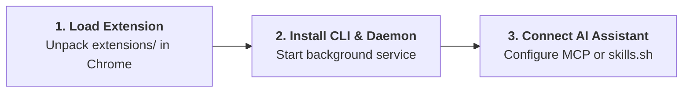

<BrowserShowcase />

<div class="ap-vibe-disclaimer">
  <div class="ap-vibe-header">
    <span>⚠️ 100% Vibe Coding Project Notice</span>
    <span class="ap-vibe-badge">🤖 GOOGLE ANTIGRAVITY</span>
  </div>
  <div class="ap-vibe-body">
    <strong>Agent Pilot was built entirely via "vibe coding" using Google Antigravity.</strong> Every component—from the Go CLI architecture and Manifest V3 Chrome extension to the MCP protocol server and documentation—was authored, refactored, and iterated autonomously by AI agents driven by prompt engineering.
    <ul>
      <li><strong>Pre-use Caution:</strong> While extensive unit, integration, and secret sanitization tests have been implemented, AI-generated code may contain unexpected edge cases or behavioral quirks. <strong>Always test in isolated browser profiles or non-production environments</strong> before granting autonomous control over sensitive web accounts.</li>
      <li><strong>Disclaimer of Liability:</strong> Provided "AS IS" without warranty of any kind. Authors and contributors assume no liability for any data loss, browser corruption, financial loss, or unauthorized actions performed by autonomous AI agents through this controller.</li>
    </ul>
  </div>
</div>

## 🎯 Core Purpose & Web Testing, QA/QC, Debugging Toolkit

**Agent Pilot** was originally built as a personal project to **replace the default Chrome MCP on Google Antigravity** and eliminate the frustrating workflow where **AI agents had to generate ad-hoc Python scripts just to interact with the browser or draw text/annotations onto images** during web testing.

Today, it solves the fundamental bottleneck of AI browser automation across any AI coding assistant: **effortless browser control with minimal token consumption**, paired with a complete suite of native tools for **automated web testing, QA/QC verification, and deep web debugging**.

<div class="ap-feature-grid">
  <div class="ap-feature-card">
    <div class="ap-feature-badge">01 // TOKEN EFFICIENCY</div>
    <div class="ap-feature-title">Effortless & Low-Token Control</div>
    <div class="ap-feature-desc">
      Compact interactive DOM snapshots (<code>@1</code>, <code>@2</code>) and single-roundtrip Batch Execution cut context token consumption by over 50% across both Skills+CLI and MCP modes.
    </div>
  </div>

  <div class="ap-feature-card">
    <div class="ap-feature-badge">02 // VISUAL QA PROOF</div>
    <div class="ap-feature-title">Annotated Screenshots</div>
    <div class="ap-feature-desc">
      Capture visible viewports, full-page scrolls, or specific DOM elements with automatic bounding-box highlights and custom report title banners for QA documentation.
    </div>
  </div>

  <div class="ap-feature-card">
    <div class="ap-feature-badge">03 // VIDEO RECORDING</div>
    <div class="ap-feature-title">Workflow Video Capture</div>
    <div class="ap-feature-desc">
      Record smooth screencast videos of automated test runs and bug reproductions (complete with virtual neon cursor trajectories and click ripples) for visual QA sign-off.
    </div>
  </div>

  <div class="ap-feature-card">
    <div class="ap-feature-badge">04 // PLAYWRIGHT & REPLAY</div>
    <div class="ap-feature-title">Record, Replay & Export Playwright</div>
    <div class="ap-feature-desc">
      Record live user or AI interaction sequences, replay multi-step flows deterministically on demand, and export recorded journeys directly into production-ready Playwright test code.
    </div>
  </div>

  <div class="ap-feature-card">
    <div class="ap-feature-badge">05 // PERFORMANCE</div>
    <div class="ap-feature-title">Performance & Lighthouse Audits</div>
    <div class="ap-feature-desc">
      Execute native Lighthouse audits, measure Core Web Vitals (LCP, CLS, INP), capture performance timelines, and diagnose slow resource waterfalls.
    </div>
  </div>

  <div class="ap-feature-card">
    <div class="ap-feature-badge">06 // MEMORY DIAGNOSTICS</div>
    <div class="ap-feature-title">Memory Leak Detection (Heap Diff)</div>
    <div class="ap-feature-desc">
      Capture and diff V8 Heap snapshots before and after user flows to pinpoint memory leaks, detached DOM trees, and growing closure retainers.
    </div>
  </div>

  <div class="ap-feature-card">
    <div class="ap-feature-badge">07 // WEB DEBUGGING</div>
    <div class="ap-feature-title">Console, Network & DOM Debugging</div>
    <div class="ap-feature-desc">
      Monitor real-time Console errors, inspect failed HTTP 4xx/5xx network payloads, extract computed CSS styles, and automatically redact 29 secret patterns.
    </div>
  </div>

  <div class="ap-feature-card">
    <div class="ap-feature-badge">08 // INTERACTIVE QA</div>
    <div class="ap-feature-title">Feedback Studio & Tab Isolation</div>
    <div class="ap-feature-desc">
      Pin visual bug annotations directly on the webpage, sample pixel-accurate colors, and run multiple AI agents concurrently in background tab groups without stealing focus.
    </div>
  </div>
</div>

---

## ⚖️ Key Differences: Agent Pilot vs. Standard Chrome MCP

Why use **Agent Pilot** instead of the default Chrome MCP in Antigravity or generic browser MCP servers?

| Capability | Standard Chrome MCP | 🚀 Agent Pilot |
| :--- | :--- | :--- |
| **Connection Modes & Token Cost** | MCP-only (`stdio`/SSE); large JSON-RPC schemas & verbose DOM trees consume heavy context tokens. | Supports both **Skills + CLI** (>50% token savings) and **MCP Server**, plus compact `@1, @2` snapshots & Batch Execution. |
| **Visual QA & Annotated Screenshots** | Captures plain screenshots; AI often has to write ad-hoc Python scripts (`Pillow`/`OpenCV`) to draw boxes or text labels. | **Built-in Annotated Screenshots** (viewport, full-page, element) with automatic bounding-box highlights and QA report title banners—zero Python scripts needed. |
| **Browser Session & Focus Isolation** | Typically spawns a separate browser window or steals active window/mouse focus while you work. | Runs directly inside your active Chrome profile (preserving login sessions) inside isolated background tab groups (`🤖 Agent Pilot`) without stealing focus. |
| **Video Recording, Replay & Playwright** | Executes one-off commands with no built-in recording, action replay, or test code generation. | Native `.mp4` workflow video capture (with virtual neon cursor), deterministic **Action Replay**, and 1-click **Playwright** test code export. |
| **Deep Web Debugging & Security** | Basic DOM interaction and raw console/network inspection. | Native **Lighthouse** audits, Core Web Vitals, **V8 Heap Snapshot Diff** for memory leaks, **In-Page Feedback Studio**, and automatic masking of **29 secret patterns**. |

---

## 🧭 Future Direction & Roadmap

::: info STABILITY FIRST — NO NEW FEATURE EXPANSION PLANNED
Because **Agent Pilot** already covers the complete end-to-end workflow for personal and team Web Testing, QA/QC, and Debugging, **the primary goal for the future is to ensure rock-solid stability, reliability, and compatibility of the existing feature set** across browser and OS updates. There are currently **no plans to develop new features**.
:::

---

## ⚡ 1-Step Skill Installation

Connect Agent Pilot to any AI coding assistant in a single terminal command:

```bash
npx skills add https://github.com/ducconit/agent-pilot -g --all
```

---

## 🚀 Quick Start in 3 Steps



### Step 1: Load the Chrome Extension
1. Download the latest release package from [GitHub Releases](https://github.com/ducconit/agent-pilot/releases).
2. Open Chrome and navigate to `chrome://extensions`.
3. Enable **Developer mode** in the top-right corner.
4. Click **Load unpacked**, select the `extensions/` directory, and pin **Agent Pilot (📌)**.

### Step 2: Install CLI & Background Service
Download the pre-compiled bundle for your operating system:

| Platform | Package Bundle | Automated Command | Detailed Guide |
| :--- | :--- | :--- | :--- |
| 🐧 **Linux** | `agent-pilot-*-linux.zip` | `./install.sh` | [Linux Guide](/bundles/README.ubuntu) |
| 🍎 **macOS** | `agent-pilot-*-macos.zip` | `./install.sh` | [macOS Guide](/bundles/README.macos) |
| 🪟 **Windows** | `agent-pilot-*-windows.zip` | `powershell -File .\install.ps1` | [Windows Guide](/bundles/README.windows) |

Manage the background daemon:
```bash
agent-pilot service install
agent-pilot service status
```

### Step 3: Connect to Any AI Agent or Tool

Agent Pilot works universally with any AI coding assistant or automation tool that supports **Agent Skills + Command Line (CLI)** or **Model Context Protocol (MCP)**:

#### Option A: Agent Skills + Command Line (CLI)
Works out-of-the-box with **Claude Code**, **Cursor**, **Windsurf**, **Google Antigravity**, **Cline / Roo Code**, **OpenCode**, **Codex**, **Aider**, and any agent capable of running shell commands:
```bash
# Install via skills.sh ecosystem
npx skills add https://github.com/ducconit/agent-pilot -g --all

# Or install directly via the standalone CLI
agent-pilot install-skill --all
```

#### Option B: Model Context Protocol (MCP) Server (`mcp.json`)
Works with any MCP-compatible client (**Claude Desktop**, **Claude Code**, **Cursor**, **Windsurf**, **Google Antigravity**, **Zed**, **Continue**, etc.):
```json
{
  "mcpServers": {
    "agent-pilot": {
      "command": "agent-pilot",
      "args": ["mcp"]
    }
  }
}
```

---

## ⚠️ Disclaimer & Vibe Coding Statement

::: warning IMPORTANT CAUTION BEFORE RUNNING IN PRODUCTION
This project is an experimental tool created **100% via vibe coding with Google Antigravity**.

* **No Human Handcrafted Code**: All logic, tests, and configurations were synthesized by AI agents through natural language interaction.
* **Sandbox Verification Recommended**: Run inside isolated Chrome instances (`--user-data-dir`) or non-logged-in sessions when experimenting with autonomous agents.
* **Limitation of Liability**: In no event shall the authors, maintainers, or Google be held liable for any direct, indirect, incidental, or consequential damages (including loss of data, unauthorized purchases, account lockouts, or financial losses) resulting from the execution of AI actions via Agent Pilot.
:::

---

<div style="text-align: center; margin: 3rem 0; color: var(--ap-text-muted); font-size: 0.85rem;">
  Engineered with Google Antigravity • MIT License • Use at your own risk
</div>
