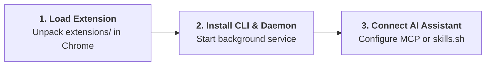

<BrowserShowcase />

<div class="ap-vibe-disclaimer">
  <div class="ap-vibe-header">
    <span>⚠️ 100% Vibe Coding Project Notice</span>
    <span class="ap-vibe-badge">🤖 GOOGLE ANTIGRAVITY</span>
  </div>
  <div class="ap-vibe-body">
    <strong>Agent Pilot was built entirely via "vibe coding" using Google Antigravity.</strong> Every component—from the Go CLI architecture and Manifest V3 Chrome extension to the MCP protocol server and documentation—was authored, refactored, and iterated autonomously by AI agents driven by prompt engineering.
    <ul>
      <li><strong>Pre-use Caution:</strong> While extensive unit, integration, and secret sanitization tests have been implemented, AI-generated code may contain unexpected edge cases or behavioral quirks. <strong>Always test in isolated browser profiles or non-production environments</strong> before granting autonomous control over sensitive web accounts.</li>
      <li><strong>Disclaimer of Liability:</strong> Provided "AS IS" without warranty of any kind. Authors and contributors assume no liability for any data loss, browser corruption, financial loss, or unauthorized actions performed by autonomous AI agents through this controller.</li>
    </ul>
  </div>
</div>

<div class="ap-feature-grid">
  <div class="ap-feature-card">
    <div class="ap-feature-badge">01 // HUMAN SIMULATION</div>
    <div class="ap-feature-title">Virtual Neon Cursor</div>
    <div class="ap-feature-desc">
      Fluid cubic ease-out trajectories with luminous click-ripple animations, realistic keystroke cadences, and smooth scrolling without frame drops.
    </div>
  </div>

  <div class="ap-feature-card">
    <div class="ap-feature-badge">02 // DUAL ENGINE</div>
    <div class="ap-feature-title">DOM + Trusted CDP</div>
    <div class="ap-feature-desc">
      Sub-millisecond synthetic DOM execution by default; escalates seamlessly to Chrome DevTools Protocol for cross-origin iframes, Canvas, and WebGL.
    </div>
  </div>

  <div class="ap-feature-card">
    <div class="ap-feature-badge">03 // ISOLATION</div>
    <div class="ap-feature-title">Background Multi-Agent</div>
    <div class="ap-feature-desc">
      Operates inside dedicated tab groups without hijacking developer focus. Concurrently orchestrates parallel coding agents via explicit tab handles.
    </div>
  </div>

  <div class="ap-feature-card">
    <div class="ap-feature-badge">04 // ZERO DEPENDENCIES</div>
    <div class="ap-feature-title">Standalone Go Binary</div>
    <div class="ap-feature-desc">
      Embeds the WebSocket/REST bridge, MCP server, and DevTools runtime into a single compiled binary. Zero Node.js or external toolchains needed.
    </div>
  </div>

  <div class="ap-feature-card">
    <div class="ap-feature-badge">05 // VISUAL QA</div>
    <div class="ap-feature-title">In-Page Feedback Studio</div>
    <div class="ap-feature-desc">
      Interactive HUD for DOM element inspection, pixel-precise eyedropper color sampling, UI bug annotation, and direct feedback push to AI agents.
    </div>
  </div>

  <div class="ap-feature-card">
    <div class="ap-feature-badge">06 // DEEP DIAGNOSTICS</div>
    <div class="ap-feature-title">Audits & Profiling</div>
    <div class="ap-feature-desc">
      Native Lighthouse audits, V8 heap snapshot diffing for memory leaks, performance tracing, and live network/console telemetry streaming.
    </div>
  </div>
</div>

---

## ⚡ 1-Step Skill Installation

Connect Agent Pilot to any AI coding assistant in a single terminal command:

```bash
npx skills add https://github.com/ducconit/agent-pilot -g --all
```

---

## 🚀 Quick Start in 3 Steps



### Step 1: Load the Chrome Extension
1. Download the latest release package from [GitHub Releases](https://github.com/ducconit/agent-pilot/releases).
2. Open Chrome and navigate to `chrome://extensions`.
3. Enable **Developer mode** in the top-right corner.
4. Click **Load unpacked**, select the `extensions/` directory, and pin **Agent Pilot (📌)**.

### Step 2: Install CLI & Background Service
Download the pre-compiled bundle for your operating system:

| Platform | Package Bundle | Automated Command | Detailed Guide |
| :--- | :--- | :--- | :--- |
| 🐧 **Linux** | `agent-pilot-*-linux.zip` | `./install.sh` | [Linux Guide](/bundles/README.ubuntu) |
| 🍎 **macOS** | `agent-pilot-*-macos.zip` | `./install.sh` | [macOS Guide](/bundles/README.macos) |
| 🪟 **Windows** | `agent-pilot-*-windows.zip` | `powershell -File .\install.ps1` | [Windows Guide](/bundles/README.windows) |

Manage the background daemon:
```bash
agent-pilot service install
agent-pilot service status
```

### Step 3: Connect to Your AI Coding Agent

#### Option A: Agent Skills Ecosystem ([skills.sh](https://skills.sh/))
```bash
npx skills add https://github.com/ducconit/agent-pilot -g --all
```

#### Option B: MCP Server Configuration (`mcp.json`)
For **Google Antigravity**, **Claude Code**, or **Cursor**:
```json
{
  "mcpServers": {
    "agent-pilot": {
      "command": "agent-pilot",
      "args": ["mcp"]
    }
  }
}
```

---

## ⚠️ Disclaimer & Vibe Coding Statement

::: warning IMPORTANT CAUTION BEFORE RUNNING IN PRODUCTION
This project is an experimental tool created **100% via vibe coding with Google Antigravity**.

* **No Human Handcrafted Code**: All logic, tests, and configurations were synthesized by AI agents through natural language interaction.
* **Sandbox Verification Recommended**: Run inside isolated Chrome instances (`--user-data-dir`) or non-logged-in sessions when experimenting with autonomous agents.
* **Limitation of Liability**: In no event shall the authors, maintainers, or Google be held liable for any direct, indirect, incidental, or consequential damages (including loss of data, unauthorized purchases, account lockouts, or financial losses) resulting from the execution of AI actions via Agent Pilot.
:::

---

<div style="text-align: center; margin: 3rem 0; color: var(--ap-text-muted); font-size: 0.85rem;">
  Engineered with Google Antigravity • MIT License • Use at your own risk
</div>
