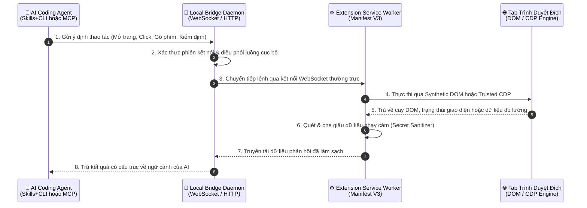
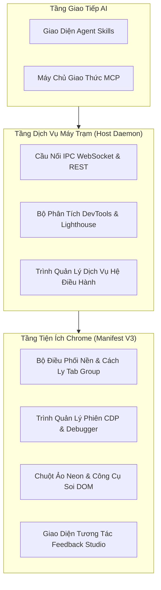
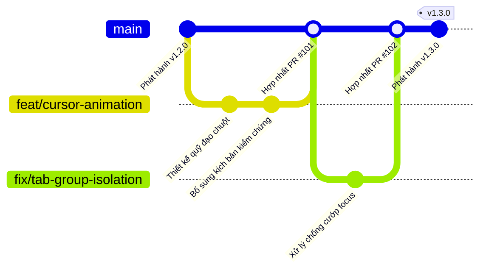
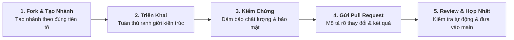

# 🛠️ Tài Liệu Dành Cho Lập Trình Viên: Luồng Hoạt Động & Đóng Góp

Chào mừng bạn đến với tài liệu định hướng phát triển của **Agent Pilot**. Tài liệu này mô tả luồng vận hành nội bộ của hệ thống, vai trò của từng thành phần, quy trình quản lý nhánh Git Flow và cách thức tham gia đóng góp cho dự án.

::: tip Tài Liệu Chung & Báo Lỗi
- Nếu bạn cần xem hướng dẫn cài đặt hoặc mẫu câu lệnh cho AI, vui lòng truy cập [Hướng Dẫn & Cài Đặt](/vi/USAGE_GUIDE) và [Prompt Mẫu](/vi/PROMPT_RECIPES).
- Nếu bạn muốn báo cáo lỗi hoặc đề xuất tính năng mới, vui lòng truy cập mục [Báo Lỗi & Đề Xuất](/vi/COMMUNITY_SUPPORT).
:::

---

## 🔄 1. Luồng Hoạt Động Tổng Thể (Operational Flow)

Agent Pilot kết nối các trợ lý AI với trình duyệt Google Chrome thông qua một chuỗi xử lý đa tầng khép kín. Mọi yêu cầu điều khiển từ AI Agent đều đi qua 4 giai đoạn cốt lõi:

### Chi Tiết 4 Giai Đoạn Xử Lý

| Giai đoạn | Tên gọi | Cơ chế hoạt động bên trong |
| :--- | :--- | :--- |
| **Giai đoạn 1** | **Tiếp Nhận Ý Định (Intent Dispatch)** | AI Agent chuyển đổi yêu cầu ngôn ngữ tự nhiên của người dùng thành lệnh điều khiển chuẩn hóa thông qua CLI hoặc giao thức MCP. |
| **Giai đoạn 2** | **Điều Phối Qua Bridge (Bridge Routing)** | Dịch vụ chạy ngầm trên máy trạm tiếp nhận yêu cầu, quản lý khóa đồng thời khi có nhiều AI chạy song song và định tuyến lệnh tới đúng phiên trình duyệt. |
| **Giai đoạn 3** | **Thực Thi Động Cơ Kép (Dual-Engine)** | Chrome Extension tự động chọn phương thức tối ưu: dùng mô phỏng DOM tốc độ cao (kèm hiệu ứng chuột ảo neon) cho các tác vụ thông thường, hoặc nâng cấp lên Chrome DevTools Protocol (CDP) khi xử lý iframe chéo miền, Canvas, WebGL và đo lường bộ nhớ. |
| **Giai đoạn 4** | **Làm Sạch & Phản Hồi (Sanitization)** | Trước khi dữ liệu rời khỏi trình duyệt để trả về cho mô hình AI, bộ lọc Secret Sanitizer (13 mẫu Regex chuyên biệt & 23 khóa thuộc tính nhạy cảm) sẽ tự động che giấu mật khẩu, API key, JWT token, URL Basic Auth và khóa bí mật trong cả DOM lẫn log console. |

---

## 🧩 2. Phân Tách Trách Nhiệm Các Thành Phần

Hệ thống được thiết kế theo kiến trúc phân tầng độc lập nhằm đảm bảo tính ổn định, dễ mở rộng và an toàn bảo mật:

- **Tầng Giao Tiếp AI**: Chuẩn hóa mọi lệnh gọi từ các công cụ AI khác nhau (Claude Code, Cursor, Windsurf, Antigravity, OpenCode...) về một định dạng thông điệp thống nhất.
- **Tầng Dịch Vụ Máy Trạm (Host Daemon)**: Duy trì kết nối nền ổn định trên Linux, macOS và Windows; đồng thời đảm nhận các tác vụ phân tích nặng (như kiểm định Lighthouse và so sánh snapshot bộ nhớ V8) ở ngoài trình duyệt để không làm chậm tab web.
- **Tầng Tiện Ích Chrome (Manifest V3)**: Gom toàn bộ tab do AI điều khiển vào nhóm riêng (`🤖 Agent Pilot`) để không làm gián đoạn công việc của người dùng, tái hiện chuyển động chuột trực quan và cung cấp bảng điều khiển Side Panel cho việc kiểm thử thủ công.

---

## 🌿 3. Quy Trình Git Flow & Quản Lý Nhánh

Dự án áp dụng mô hình **Git Flow** xoay quanh nhánh chính `main`. Nhánh `main` luôn được bảo vệ và duy trì ở trạng thái ổn định, sẵn sàng phát hành.

### Phân Loại Nhánh Phát Triển
| Tiền tố nhánh | Mục đích sử dụng | Ví dụ phạm vi |
| :--- | :--- | :--- |
| **`feat/`** | Phát triển tính năng mới hoặc mở rộng năng lực cho AI Agent | Bổ sung chỉ số chẩn đoán DevTools mới |
| **`fix/`** | Khắc phục lỗi vận hành, xung đột luồng hoặc lỗi hiển thị | Sửa lỗi chụp ảnh màn hình trên tab chạy ngầm |
| **`docs/`** | Cập nhật hướng dẫn sử dụng, bổ sung prompt mẫu hoặc dịch thuật | Thêm kịch bản prompt mẫu cho kiểm thử form |
| **`refactor/`** | Tối ưu hóa cấu trúc nội bộ mà không làm thay đổi hành vi bên ngoài | Chuẩn hóa luồng sự kiện trong Service Worker |
| **`chore/`** | Cập nhật quy trình tự động hóa CI/CD hoặc đóng gói bản phát hành | Tinh chỉnh luồng xuất bản GitHub Pages |

---

## 🤝 4. Quy Trình Đóng Góp (How to Contribute)

Chúng tôi luôn chào đón mọi đóng góp từ cộng đồng—từ việc hoàn thiện tài liệu, chia sẻ thêm các mẫu prompt thực tế cho đến cải tiến hiệu năng điều khiển trình duyệt.

### Các Bước Tham Gia Đóng Góp
1. **Thảo Luận Định Hướng**: Với các đề xuất thay đổi lớn về kiến trúc hoặc tính năng mới, hãy mở thảo luận trước để thống nhất hướng tiếp cận và tránh trùng lặp công việc.
2. **Fork & Khởi Tạo Nhánh**: Fork kho lưu trữ về tài khoản cá nhân và tạo nhánh mới từ `main` theo đúng bảng phân loại tiền tố nhánh ở trên.
3. **Tuân Thủ Nguyên Tắc Thiết Kế**:
   - Giữ sự tách biệt rõ ràng giữa tầng điều phối nền (Background) và tầng tương tác giao diện trên trang (Content).
   - Đảm bảo mọi dữ liệu trích xuất trả về cho AI đều đi qua lớp lọc bảo mật thông tin nhạy cảm.
   - Duy trì tính đồng bộ song ngữ (Tiếng Anh và Tiếng Việt) khi bổ sung hoặc cập nhật tài liệu.
4. **Đảm Bảo Tiêu Chuẩn Chất Lượng**:
   - **Không gây lỗi hồi quy (Zero Regression)**: Giữ nguyên tính tương thích của các tính năng điều khiển DOM, CDP và MCP hiện có.
   - **An toàn dữ liệu**: Bảo toàn 100% 13 mẫu Regex chuyên biệt và các quy tắc che giấu thông tin bí mật.
   - **Lịch sử rõ ràng**: Đặt tiêu đề commit ngắn gọn, súc tích theo chuẩn Conventional Commits (`feat:`, `fix:`, `docs:`, `refactor:`).
5. **Gửi Yêu Cầu Hợp Nhất (Pull Request)**: Tạo Pull Request về nhánh `main` kèm mô tả rõ vấn đề giải quyết, phạm vi ảnh hưởng và kết quả kiểm chứng thực tế.

---

## 📚 Tài Liệu Kiến Trúc Chuyên Sâu

Dành cho lập trình viên muốn tìm hiểu sâu hơn về thiết kế của từng phân hệ:
- 🏛️ [Kiến Trúc Tổng Thể Hệ Thống](/vi/ARCHITECTURE)
- ⚡ [Cơ Chế Giao Thức CDP & Trusted Input](/vi/CDP_GUIDE)
- 🔬 [Chẩn Đoán DevTools & Phân Tích Bộ Nhớ](/vi/DEVTOOLS)
- 📊 [Báo Cáo Đo Lường Hiệu Năng Thực Nghiệm](/vi/BENCHMARKS)
- 📋 [Danh Mục Tham Chiếu API & Bản Tin](/vi/API_REFERENCE)
