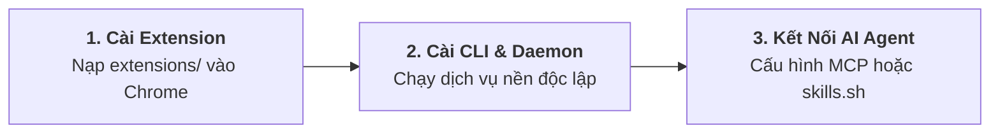

<BrowserShowcase />

<div class="ap-vibe-disclaimer">
  <div class="ap-vibe-header">
    <span>⚠️ Cảnh Báo: Dự Án 100% Vibe Coding</span>
    <span class="ap-vibe-badge">🤖 GOOGLE ANTIGRAVITY</span>
  </div>
  <div class="ap-vibe-body">
    <strong>Agent Pilot là sản phẩm được xây dựng 100% bằng hình thức "vibe coding" thông qua Google Antigravity.</strong> Toàn bộ thành phần—từ kiến trúc CLI Golang, Chrome Extension Manifest V3, MCP Server đến hệ thống tài liệu—đều do AI Agent tự động sinh mã, refactor và tối ưu hoá thông qua prompt engineering.
    <ul>
      <li><strong>Khuyến cáo trước khi sử dụng:</strong> Dù đã vượt qua các bộ kiểm thử đơn vị, tích hợp và lọc che giấu secret tự động, mã nguồn do AI tạo ra vẫn có thể phát sinh các trường hợp ngoại lệ (edge cases) ngoài ý muốn. <strong>Vui lòng thử nghiệm trên profile Chrome riêng biệt (sandbox) hoặc môi trường non-production</strong> trước khi trao quyền điều khiển cho AI trên các tài khoản quan trọng.</li>
      <li><strong>Tuyên bố miễn trừ trách nhiệm (Disclaimer):</strong> Phần mềm được cung cấp theo nguyên trạng ("AS IS"), không có bất kỳ sự bảo đảm nào. Tác giả và cộng đồng đóng góp hoàn toàn không chịu trách nhiệm đối với bất kỳ sự cố mất mát dữ liệu, lỗi trình duyệt, thiệt hại tài chính hay hành động ngoài ý muốn nào do AI Agent gây ra trong quá trình vận hành.</li>
    </ul>
  </div>
</div>

## 🎯 Giới Thiệu, Mục Đích & Bộ Công Cụ Kiểm Thử, QA/QC, Debug Web

**Agent Pilot** ban đầu được xây dựng phục vụ nhu cầu cá nhân nhằm **thay thế Chrome MCP mặc định trên Google Antigravity**, đồng thời giải quyết triệt để sự bất tiện khi **AI Agent phải tự sinh các đoạn code Python tạm bợ để thao tác trình duyệt hoặc vẽ chữ/khoanh vùng lên hình ảnh** trong quá trình kiểm thử web.

Hiện tại, dự án hỗ trợ mọi công cụ AI điều khiển trình duyệt với tiêu chí cốt lõi: **thao tác trình duyệt thuận tiện, tốn ít token nhất**, tích hợp sẵn trọn bộ công cụ chuyên dụng phục vụ **kiểm thử tự động (Web Testing), QA/QC và Debug ứng dụng web**.

<div class="ap-feature-grid">
  <div class="ap-feature-card">
    <div class="ap-feature-badge">01 // TIẾT KIỆM TOKEN</div>
    <div class="ap-feature-title">Điều Khiển Thuận Tiện & Ít Token</div>
    <div class="ap-feature-desc">
      Cây DOM tương tác được rút gọn thông minh (<code>@1</code>, <code>@2</code>) cùng cơ chế thực thi theo lô (Batch Execution), giúp tiết kiệm hơn 50% lượng token tiêu thụ trên cả Skills+CLI lẫn MCP.
    </div>
  </div>

  <div class="ap-feature-card">
    <div class="ap-feature-badge">02 // MINH CHỨNG QA/QC</div>
    <div class="ap-feature-title">Chụp Màn Hình & Ghi Chú Thích</div>
    <div class="ap-feature-desc">
      Chụp khung nhìn hiện tại, chụp toàn trang (full-page) hoặc từng phần tử; hỗ trợ tự động khoanh vùng highlight phần tử lỗi và đóng dấu tiêu đề báo cáo kiểm thử.
    </div>
  </div>

  <div class="ap-feature-card">
    <div class="ap-feature-badge">03 // QUAY VIDEO</div>
    <div class="ap-feature-title">Ghi Video Luồng Kiểm Thử</div>
    <div class="ap-feature-desc">
      Quay video trực tiếp quá trình tương tác, kiểm thử và tái hiện lỗi trên trình duyệt (kèm hiệu ứng chuột ảo neon và sóng click) để làm bằng chứng báo cáo trực quan.
    </div>
  </div>

  <div class="ap-feature-card">
    <div class="ap-feature-badge">04 // PLAYWRIGHT & REPLAY</div>
    <div class="ap-feature-title">Ghi Nhận, Replay & Xuất Playwright</div>
    <div class="ap-feature-desc">
      Tự động ghi lại chuỗi thao tác thực tế trên trang, phát lại (replay) kịch bản kiểm thử bất kỳ lúc nào và xuất (export) trực tiếp ra mã nguồn kiểm thử Playwright chuẩn chỉnh.
    </div>
  </div>

  <div class="ap-feature-card">
    <div class="ap-feature-badge">05 // ĐO HIỆU NĂNG</div>
    <div class="ap-feature-title">Đo Performance & Lighthouse</div>
    <div class="ap-feature-desc">
      Chạy kiểm định Lighthouse thực tế ngay từ dòng lệnh hoặc qua AI, đo lường các chỉ số Core Web Vitals (LCP, CLS, INP), phân tích performance trace và tốc độ tải tài nguyên.
    </div>
  </div>

  <div class="ap-feature-card">
    <div class="ap-feature-badge">06 // BẮT LỖI BỘ NHỚ</div>
    <div class="ap-feature-title">Tìm Memory Leak (V8 Heap Diff)</div>
    <div class="ap-feature-desc">
      Chụp và đối chiếu chênh lệch giữa các bản chụp bộ nhớ V8 Heap trước/sau thao tác để phát hiện chính xác rò rỉ bộ nhớ, các node DOM bị treo hoặc sự kiện chưa giải phóng.
    </div>
  </div>

  <div class="ap-feature-card">
    <div class="ap-feature-badge">07 // DEBUG WEB</div>
    <div class="ap-feature-title">Bắt Lỗi Console, Network & DOM</div>
    <div class="ap-feature-desc">
      Giám sát lỗi Console thời gian thực, lọc các truy vấn mạng thất bại (HTTP 4xx/5xx), soi thuộc tính CSS thực tế và tự động che giấu 29 loại thông tin nhạy cảm (API key, token).
    </div>
  </div>

  <div class="ap-feature-card">
    <div class="ap-feature-badge">08 // TRỰC QUAN & CÁCH LY</div>
    <div class="ap-feature-title">Feedback Studio & Chạy Ngầm</div>
    <div class="ap-feature-desc">
      Ghim chú thích lỗi trực tiếp lên giao diện web, lấy mã màu pixel chuẩn xác để đẩy về AI; đồng thời gom tab tự động vào nhóm riêng không bao giờ cướp chuột của người dùng.
    </div>
  </div>
</div>

---

## ⚖️ Điểm Khác Biệt Giữa Agent Pilot & Chrome MCP Thông Thường

Tại sao nên dùng **Agent Pilot** thay vì Chrome MCP mặc định trên Antigravity hoặc các trình điều khiển MCP thông thường?

| Tiêu chí so sánh | Chrome MCP Thông Thường | 🚀 Agent Pilot |
| :--- | :--- | :--- |
| **Phương thức kết nối & Chi phí Token** | Chỉ hỗ trợ MCP; cấu trúc JSON-RPC và cây DOM thô tiêu tốn rất nhiều token ngữ cảnh. | Hỗ trợ song song cả **Skills + CLI** (tiết kiệm >50% token) lẫn **MCP Server**; rút gọn phần tử thành nhãn `@1, @2` và hỗ trợ gộp lệnh (Batch Execution). |
| **Chụp ảnh & Vẽ chú thích báo cáo QA** | Chỉ chụp ảnh màn hình thô; AI thường phải tự sinh code Python (`Pillow`/`OpenCV`) tạm bợ để vẽ chữ hoặc khoanh vùng lỗi lên ảnh. | **Tích hợp sẵn chụp ảnh kèm chú thích** (khung nhìn, full-page, từng phần tử), tự động vẽ khung viền highlight đỏ và đóng dấu tiêu đề báo cáo mà không cần sinh script Python. |
| **Phiên trình duyệt & Chạy ngầm** | Thường mở cửa sổ trình duyệt mới (mất trạng thái đăng nhập) hoặc liên tục cướp chuột/focus màn hình khi đang làm việc. | Chạy trực tiếp trên trình duyệt Chrome đang mở (giữ nguyên cookie/phiên đăng nhập), tự động gom tab vào nhóm riêng (`🤖 Agent Pilot`) chạy ngầm không cướp focus. |
| **Quay Video, Replay & Xuất Playwright** | Chỉ thực thi từng lệnh rời rạc, không có cơ chế lưu lại thao tác hay sinh mã kiểm thử tự động. | Quay trực tiếp video `.mp4` (kèm chuột ảo neon), ghi nhận & **Replay** lại kịch bản kiểm thử, và **xuất trực tiếp ra code Playwright**. |
| **Debug chuyên sâu & Bảo mật Secret** | Chủ yếu dừng ở thao tác DOM cơ bản và đọc log thô. | Tích hợp đo Core Web Vitals, chạy **Lighthouse**, so sánh **V8 Heap Diff** tìm Memory Leak, **Feedback Studio** ghim lỗi trên trang và tự động che giấu **29 mẫu secret/token**. |

---

## 🧭 Định Hướng Trong Tương Lai

::: info ƯU TIÊN ĐẢM BẢO SỰ ỔN ĐỊNH — CHƯA CÓ DỰ ĐỊNH PHÁT TRIỂN TÍNH NĂNG MỚI
Hiện tại bộ công cụ của **Agent Pilot** đã đáp ứng đầy đủ nhu cầu điều khiển trình duyệt, kiểm thử QA/QC và debug web. **Mục tiêu trọng tâm của dự án trong tương lai là duy trì, tối ưu và đảm bảo các tính năng hiện có hoạt động thật ổn định**, tương thích tốt với các bản cập nhật trình duyệt và hệ điều hành, **chưa có dự định phát triển thêm tính năng mới**.
:::

---

## ⚡ Cài Đặt 1 Lệnh Chuẩn Agent Skills

Kết nối Agent Pilot với mọi trợ lý AI coding chỉ với 1 dòng lệnh terminal:

```bash
npx skills add https://github.com/ducconit/agent-pilot -g --all
```

---

## 🚀 Cài Đặt Nhanh Trong 3 Bước



### Bước 1: Nạp Extension vào Chrome
1. Tải bản phát hành mới nhất từ [GitHub Releases](https://github.com/ducconit/agent-pilot/releases).
2. Mở Chrome, truy cập `chrome://extensions` và bật **Developer mode**.
3. Nhấp **Load unpacked**, chọn thư mục `extensions/` và ghim biểu tượng **Agent Pilot (📌)**.

### Bước 2: Cài Đặt Go CLI & Dịch Vụ Nền
Chọn gói cài đặt tương ứng với hệ điều hành:

| Hệ Điều Hành | Gói Cài Đặt | Lệnh Cài Đặt Tự Động | Hướng Dẫn Chi Tiết |
| :--- | :--- | :--- | :--- |
| 🐧 **Linux** | `agent-pilot-*-linux.zip` | `./install.sh` | [Xem hướng dẫn Linux](/vi/bundles/README.ubuntu) |
| 🍎 **macOS** | `agent-pilot-*-macos.zip` | `./install.sh` | [Xem hướng dẫn macOS](/vi/bundles/README.macos) |
| 🪟 **Windows** | `agent-pilot-*-windows.zip` | `powershell -File .\install.ps1` | [Xem hướng dẫn Windows](/vi/bundles/README.windows) |

Khởi động và kiểm tra dịch vụ chạy ngầm:
```bash
agent-pilot service install
agent-pilot service status
```

### Bước 3: Kết Nối Với Bất Kỳ AI Agent Hoặc Công Cụ Nào

Agent Pilot tương thích đa năng với mọi trợ lý AI coding hoặc công cụ tự động hóa có hỗ trợ **Agent Skills + Command Line (CLI)** hoặc **Model Context Protocol (MCP)**:

#### Cách A: Dùng Agent Skills + Command Line (CLI)
Hoạt động tức thì với **Claude Code**, **Cursor**, **Windsurf**, **Google Antigravity**, **Cline / Roo Code**, **OpenCode**, **Codex**, **Aider**, hoặc bất kỳ agent nào có quyền thực thi lệnh terminal:
```bash
# Cài đặt qua hệ sinh thái skills.sh
npx skills add https://github.com/ducconit/agent-pilot -g --all

# Hoặc cài trực tiếp bằng CLI độc lập
agent-pilot install-skill --all
```

#### Cách B: Cấu Hình MCP Server (`mcp.json`)
Tương thích với mọi MCP Client (**Claude Desktop**, **Claude Code**, **Cursor**, **Windsurf**, **Google Antigravity**, **Zed**, **Continue**, v.v.):
```json
{
  "mcpServers": {
    "agent-pilot": {
      "command": "agent-pilot",
      "args": ["mcp"]
    }
  }
}
```

---

## ⚠️ Tuyên Bố Miễn Trừ Trách Nhiệm & Vibe Coding

::: warning LƯU Ý QUAN TRỌNG TRƯỚC KHI VẬN HÀNH THỰC TẾ
Dự án này là sản phẩm thử nghiệm được xây dựng **100% bằng Vibe Coding với Google Antigravity**.

* **Không qua can thiệp viết code thủ công của con người**: Toàn bộ logic, kiểm thử và cấu hình đều do các AI coding agent tự động tổng hợp thông qua ngôn ngữ tự nhiên.
* **Khuyến nghị chạy môi trường cách ly (Sandbox)**: Luôn khởi chạy trình duyệt trong môi trường cô lập (`--user-data-dir` riêng biệt) hoặc các phiên làm việc không đăng nhập tài khoản nhạy cảm khi thử nghiệm các tác vụ tự động hóa.
* **Giới hạn trách nhiệm pháp lý**: Trong mọi tình huống, tác giả, nhóm phát triển hoặc Google không chịu trách nhiệm pháp lý đối với bất kỳ thiệt hại trực tiếp, gián tiếp, ngẫu nhiên hoặc do hậu quả phát sinh (bao gồm mất mát dữ liệu, mua hàng ngoài ý muốn, khóa tài khoản, hoặc tổn thất tài chính) xuất phát từ việc thực thi hành động của AI thông qua Agent Pilot.
:::

---

<div style="text-align: center; margin: 3rem 0; color: var(--ap-text-muted); font-size: 0.85rem;">
  Phát triển với Google Antigravity • Giấy phép MIT License • Tự chịu trách nhiệm khi sử dụng
</div>
