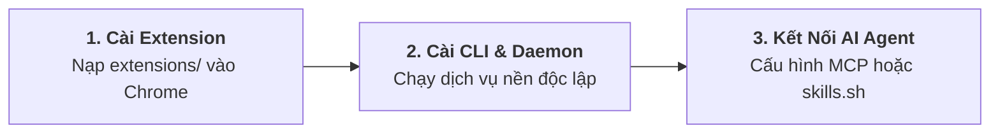

<BrowserShowcase />

<div class="ap-vibe-disclaimer">
  <div class="ap-vibe-header">
    <span>⚠️ Cảnh Báo: Dự Án 100% Vibe Coding</span>
    <span class="ap-vibe-badge">🤖 GOOGLE ANTIGRAVITY</span>
  </div>
  <div class="ap-vibe-body">
    <strong>Agent Pilot là sản phẩm được xây dựng 100% bằng hình thức "vibe coding" thông qua Google Antigravity.</strong> Toàn bộ thành phần—từ kiến trúc CLI Golang, Chrome Extension Manifest V3, MCP Server đến hệ thống tài liệu—đều do AI Agent tự động sinh mã, refactor và tối ưu hoá thông qua prompt engineering.
    <ul>
      <li><strong>Khuyến cáo trước khi sử dụng:</strong> Dù đã vượt qua các bộ kiểm thử đơn vị, tích hợp và lọc che giấu secret tự động, mã nguồn do AI tạo ra vẫn có thể phát sinh các trường hợp ngoại lệ (edge cases) ngoài ý muốn. <strong>Vui lòng thử nghiệm trên profile Chrome riêng biệt (sandbox) hoặc môi trường non-production</strong> trước khi trao quyền điều khiển cho AI trên các tài khoản quan trọng.</li>
      <li><strong>Tuyên bố miễn trừ trách nhiệm (Disclaimer):</strong> Phần mềm được cung cấp theo nguyên trạng ("AS IS"), không có bất kỳ sự bảo đảm nào. Tác giả và cộng đồng đóng góp hoàn toàn không chịu trách nhiệm đối với bất kỳ sự cố mất mát dữ liệu, lỗi trình duyệt, thiệt hại tài chính hay hành động ngoài ý muốn nào do AI Agent gây ra trong quá trình vận hành.</li>
    </ul>
  </div>
</div>

<div class="ap-feature-grid">
  <div class="ap-feature-card">
    <div class="ap-feature-badge">01 // MÔ PHỎNG NGƯỜI DÙNG</div>
    <div class="ap-feature-title">Chuột Ảo Neon & Phím Thật</div>
    <div class="ap-feature-desc">
      Quỹ đạo lướt chuột mượt mà (cubic ease-out), hiệu ứng sóng click-ripple phát sáng, gõ phím theo nhịp tự nhiên và cuộn trang không giật lag.
    </div>
  </div>

  <div class="ap-feature-card">
    <div class="ap-feature-badge">02 // ĐỘNG CƠ KÉP</div>
    <div class="ap-feature-title">Synthetic DOM + Trusted CDP</div>
    <div class="ap-feature-desc">
      Thao tác DOM siêu tốc dưới 1ms theo mặc định; tự động leo thang lên Chrome DevTools Protocol khi gặp cross-origin iframe, Canvas và WebGL.
    </div>
  </div>

  <div class="ap-feature-card">
    <div class="ap-feature-badge">03 // CÁCH LY TIẾN TRÌNH</div>
    <div class="ap-feature-title">Đa Agent Chạy Ngầm Độc Lập</div>
    <div class="ap-feature-desc">
      Tự động gom tab vào nhóm riêng ('🤖 Agent Pilot') không cướp focus của lập trình viên. Điều phối song song nhiều agent qua mã định danh tab.
    </div>
  </div>

  <div class="ap-feature-card">
    <div class="ap-feature-badge">04 // ZERO DEPENDENCIES</div>
    <div class="ap-feature-title">Binary Golang Độc Lập</div>
    <div class="ap-feature-desc">
      Tích hợp sẵn WebSocket/REST bridge, MCP server và DevTools runtime vào một binary thực thi duy nhất. Không cần cài Node.js hay FFmpeg.
    </div>
  </div>

  <div class="ap-feature-card">
    <div class="ap-feature-badge">05 // VISUAL QA STUDIO</div>
    <div class="ap-feature-title">In-Page Feedback Studio</div>
    <div class="ap-feature-desc">
      Side Panel tương tác soi thông số DOM, kính lúp lấy mã màu pixel cực nét, ghim lỗi trực tiếp trên giao diện và đẩy phản hồi về AI agent.
    </div>
  </div>

  <div class="ap-feature-card">
    <div class="ap-feature-badge">06 // CHẨN ĐOÁN CHUYÊN SÂU</div>
    <div class="ap-feature-title">Lighthouse & Heap Profiling</div>
    <div class="ap-feature-desc">
      Kiểm định Lighthouse thực tế, so sánh snapshot rò rỉ bộ nhớ V8 Heap, performance tracing và giám sát luồng network/console thời gian thực.
    </div>
  </div>
</div>

---

## ⚡ Cài Đặt 1 Lệnh Chuẩn Agent Skills

Kết nối Agent Pilot với mọi trợ lý AI coding chỉ với 1 dòng lệnh terminal:

```bash
npx skills add https://github.com/ducconit/agent-pilot -g --all
```

---

## 🚀 Cài Đặt Nhanh Trong 3 Bước



### Bước 1: Nạp Extension vào Chrome
1. Tải bản phát hành mới nhất từ [GitHub Releases](https://github.com/ducconit/agent-pilot/releases).
2. Mở Chrome, truy cập `chrome://extensions` và bật **Developer mode**.
3. Nhấp **Load unpacked**, chọn thư mục `extensions/` và ghim biểu tượng **Agent Pilot (📌)**.

### Bước 2: Cài Đặt Go CLI & Dịch Vụ Nền
Chọn gói cài đặt tương ứng với hệ điều hành:

| Hệ Điều Hành | Gói Cài Đặt | Lệnh Cài Đặt Tự Động | Hướng Dẫn Chi Tiết |
| :--- | :--- | :--- | :--- |
| 🐧 **Linux** | `agent-pilot-*-linux.zip` | `./install.sh` | [Xem hướng dẫn Linux](/vi/bundles/README.ubuntu) |
| 🍎 **macOS** | `agent-pilot-*-macos.zip` | `./install.sh` | [Xem hướng dẫn macOS](/vi/bundles/README.macos) |
| 🪟 **Windows** | `agent-pilot-*-windows.zip` | `powershell -File .\install.ps1` | [Xem hướng dẫn Windows](/vi/bundles/README.windows) |

Khởi động và kiểm tra dịch vụ chạy ngầm:
```bash
agent-pilot service install
agent-pilot service status
```

### Bước 3: Cấu Hình MCP Server (`mcp.json`)
Dành cho **Google Antigravity**, **Claude Code**, hoặc **Cursor**:
```json
{
  "mcpServers": {
    "agent-pilot": {
      "command": "agent-pilot",
      "args": ["mcp"]
    }
  }
}
```

---

## ⚠️ Tuyên Bố Miễn Trừ Trách Nhiệm & Vibe Coding

::: warning LƯU Ý QUAN TRỌNG TRƯỚC KHI VẬN HÀNH THỰC TẾ
Dự án này là sản phẩm thử nghiệm được xây dựng **100% bằng Vibe Coding với Google Antigravity**.

* **Không qua can thiệp viết code thủ công của con người**: Toàn bộ logic, kiểm thử và cấu hình đều do các AI coding agent tự động tổng hợp thông qua ngôn ngữ tự nhiên.
* **Khuyến nghị chạy môi trường cách ly (Sandbox)**: Luôn khởi chạy trình duyệt trong môi trường cô lập (`--user-data-dir` riêng biệt) hoặc các phiên làm việc không đăng nhập tài khoản nhạy cảm khi thử nghiệm các tác vụ tự động hóa.
* **Giới hạn trách nhiệm pháp lý**: Trong mọi tình huống, tác giả, nhóm phát triển hoặc Google không chịu trách nhiệm pháp lý đối với bất kỳ thiệt hại trực tiếp, gián tiếp, ngẫu nhiên hoặc do hậu quả phát sinh (bao gồm mất mát dữ liệu, mua hàng ngoài ý muốn, khóa tài khoản, hoặc tổn thất tài chính) xuất phát từ việc thực thi hành động của AI thông qua Agent Pilot.
:::

---

<div style="text-align: center; margin: 3rem 0; color: var(--ap-text-muted); font-size: 0.85rem;">
  Phát triển với Google Antigravity • Giấy phép MIT License • Tự chịu trách nhiệm khi sử dụng
</div>
