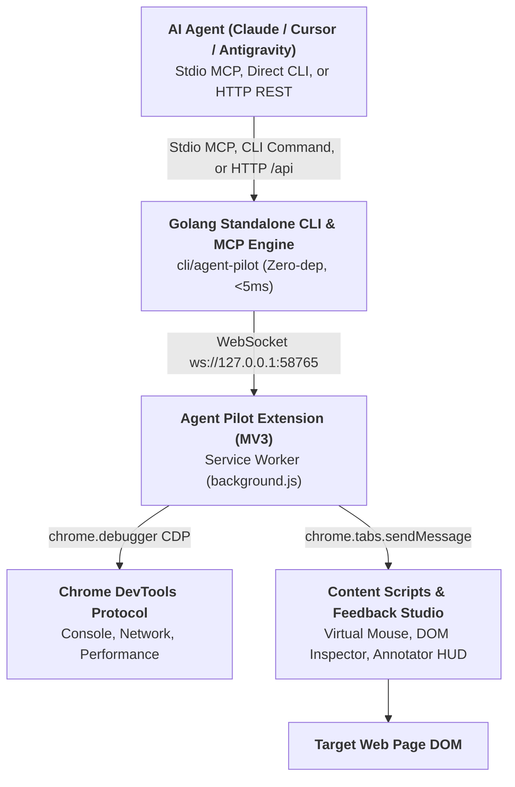

# Agent Pilot - Universal AI Agent Browser Controller

> **Next-Gen AI Browser Companion & Automation Engine (Antigravity First)**  
> Maintained by **DNT** ([@ducconit](https://github.com/ducconit)) • Open Source Public Beta

Use this skill when an AI agent needs to automate browser flows, interact with web applications, click elements, fill forms, inspect DOM trees, capture visual screenshots, pick on-screen colors, or debug web applications via Chrome DevTools Protocol (CDP).

---

## ⚡ Quick Install via `skills` CLI

Any AI coding agent (Claude Code, Cursor, Codex, OpenCode, Antigravity, Amp, Roo, Devin, etc.) can install this skill with a single command:

```bash
# Install to current project
npx skills add https://github.com/ducconit/agent-pilot-extension

# Or install globally for all agents
npx skills add https://github.com/ducconit/agent-pilot-extension -g --all
```

---

## 🏗️ Architecture & Communication Flow



### Dual Mode & Zero Port Collision
Agent Pilot includes an automatic **Dual Mode** engine:
- **Master Bridge Mode**: The first process binds local loopback port `58765` and coordinates WebSocket connections to the Chrome Extension.
- **Forwarder Mode**: If multiple AI agents, multi-agent swarms, or multiple IDE windows run concurrently, subsequent agent processes detect the active bridge, skip port binding without `EADDRINUSE` conflicts, and seamlessly forward stdio MCP calls over the local HTTP bridge (`http://127.0.0.1:58765/api`).

---

## ⚡ Standalone Go CLI & MCP Server (`cli/agent-pilot`)

Agent Pilot provides an all-in-one compiled Go binary (`cli/agent-pilot`) for ultra-fast startup and environments without Node.js:
- **Zero Runtime Dependencies**: Stripped ~7MB binary, `<5ms` startup time, `~12MB` RAM usage.
- **MCP Server Mode (`stdio`)**: Run `agent-pilot mcp` directly inside MCP client configs (Claude Desktop, Cursor, Antigravity, OpenCode).
- **Direct CLI Automation**: Fast, scriptable commands for agents, QC/testers, and CI/CD pipelines:
  ```bash
  agent-pilot open https://example.com
  agent-pilot click "#login-button"
  agent-pilot type "#search-box" "automation testing" --enter
  agent-pilot screenshot --mode visible -o ./report.png
  agent-pilot inspect "#target-element"
  agent-pilot tabs
  agent-pilot batch flow.json
  agent-pilot feedback list
  ```

---


## 🛠️ Available MCP Tools (16 Tools)

When the `agent-pilot` MCP server or skill is active, agents have direct access to the following 16 tools:

| Tool Name | Key Parameters | Description |
| :--- | :--- | :--- |
| `browser_run_actions` | `{ actions: Action[], tabId?: number, stopOnError?: boolean }` | **Batch Execution Engine**: Executes an ordered sequence of actions (`open`, `navigate`, `wait_for_selector`, `scroll_into_view`, `click`, `type`, `press_key`, `scroll`, `sleep`, `screenshot`, `get_element`, `evaluate`, `cdp`, `close`) in a single round-trip, saving ~80% context tokens and eliminating network latency. |
| `browser_open_tab` | `{ url: string, active?: boolean }` | Opens a new browser tab with the specified URL. Defaults to `active: false` (background mode) to never interrupt or steal focus from the user's active window. |
| `browser_list_tabs` | `{}` | Lists all open tabs with IDs, titles, URLs, active state, and agent ownership indicators. |
| `browser_navigate` | `{ url: string, tabId?: number }` | Navigates the specified or active tab to a URL. |
| `browser_click` | `{ x?: number, y?: number, selector?: string, tabId?: number }` | Smoothly moves virtual mouse cursor and triggers a synthetic click with visual ripple and coordinate badge. Auto-scrolls off-screen elements into view. |
| `browser_type` | `{ text: string, selector: string, clear?: boolean, delay?: number, pressEnter?: boolean, tabId?: number }` | Simulates human typing into inputs with realistic keystroke delays. Automatically brings target elements into viewport. |
| `browser_scroll` | `{ deltaX?: number, deltaY?: number, tabId?: number }` | Smoothly scrolls the page viewport by relative pixel offsets. |
| `browser_get_element` | `{ selector: string, tabId?: number }` | Inspects DOM elements, returning tag name, coordinates, bounding box dimensions, visible text (up to 1,000 characters), input value, and computed CSS attributes. |
| `browser_screenshot` | `{ mode?: "visible" \| "region" \| "element", selector?: string, tabId?: number }` | Captures high-resolution PNG screenshot via CDP even on background tabs. Automatically unpacked to native MCP image blocks to avoid base64 text bloat. |
| `browser_get_devtools_data` | `{ tabId?: number, type?: "all" \| "console" \| "network" \| "performance", limit?: number, clear?: boolean }` | Intercepts real-time CDP Console logs, Network requests (status, method, mimeType), and Chrome Performance metrics (JS Heap Used/Total, DOM Nodes, Layouts). |
| `browser_pick_color` | `{ tabId?: number, x?: number, y?: number }` | Samples any on-screen pixel color. AI agents pass coordinates for instant sampling; human users trigger the interactive Magnifying Loupe Eyedropper. |
| `browser_list_instances` | `{}` | Lists all connected browser instances (Chrome, Brave, Edge, profiles/windows). |
| `browser_select_instance` | `{ instanceId: string }` | Switches active target browser instance in multi-browser setups. |
| `browser_set_busy` | `{ busy?: boolean, action?: string, tabId?: number }` | Displays an operator lock shield banner on the target page during mission-critical agent workflows. |
| `browser_get_pending_feedback` | `{ sessionId?: string, limit?: number, clear?: boolean }` | **Channel B Feedback Reader**: Retrieves pending human visual UI feedback sessions saved in `~/.agent-pilot/inbox/feedback/<timestamp>/*` with component source paths, line numbers, CSS selectors, user notes, and screenshots. |
| `browser_wait_for_feedback` | `{ timeout?: number, tabId?: number }` | **Channel A Reactive Long-Polling**: Reactively halts agent execution until a human submits visual feedback via Feedback Studio in the browser (or until timeout). Returns complete metadata, source locations, notes, and screenshots immediately upon submission. |

---

## 🎨 3-Channel Visual UI Feedback System

Agent Pilot bridges the communication gap between human users and AI coding agents through 3 complementary feedback channels:

1. **Kênh A (Reactive Long-Polling)**:
   - Agent calls `browser_wait_for_feedback({ timeout: 120 })` to pause and wait for user guidance.
   - User enters **Feedback Studio** in browser, marks elements/crops, writes notes, and clicks **"🚀 Gửi Agent"**.
   - Long-poll resolves immediately, passing exact file locations (`src/components/Navbar.tsx:42`), component names (`<Navbar />`), CSS rules, and screenshots to the agent.
2. **Kênh B (Shared Inbox File Storage)**:
   - User clicks **"💾 Lưu Inbox"** in Feedback Studio or Sidepanel.
   - Extension transmits items to `~/.agent-pilot/inbox/feedback/<timestamp>/*`:
     - `session.json` (metadata, count, component mapping, user notes).
     - `prompt.md` (clean markdown without base64 bloat).
     - `item_1.png`, `item_2.png` (binary PNG screenshots).
   - Agent calls `browser_get_pending_feedback()` at any time to inspect pending requests.
3. **Kênh C (1-Click Clipboard Prompt)**:
   - User clicks **"📋 Copy Prompt"** in Feedback Studio or Sidepanel.
   - Formats a comprehensive markdown prompt into the clipboard, ready to paste into any chat or prompt box.

## 🔒 Secret & Private Key Redaction Layer

Agent Pilot includes an automatic **zero-trust security layer** enabled by default:
- Automatically scans responses for sensitive credentials:
  - Private Keys (RSA, EC, OpenSSH, DSA, PGP)
  - API Keys (OpenAI `sk-proj-*`, Anthropic `sk-ant-*`, Google `AIzaSy*`, GitHub `ghp_*`, AWS, Stripe, Slack)
  - Bearer Tokens, JWTs, and sensitive URL query parameters
- Redacts detected secrets with asterisks (`*`) and attaches an explicit security notice:
  `[SECURITY NOTE: Sensitive credentials in this output were masked with asterisks (*) by Agent Pilot's Secret Filter]`
- Prevents accidental token leakage into cloud LLM training data and logs.

---

## 📋 Standard Agent Operating Workflow

### 1. Verification & Pre-Flight
Check whether the browser bridge is operational:
- Check health: `http://127.0.0.1:58765/health`
- Or list open tabs: `browser_list_tabs()`

### 2. High-Efficiency Automation (Batch Mode - Recommended)
To save ~80% tokens and minimize latency, combine multiple steps into `browser_run_actions`:
```json
{
  "actions": [
    { "action": "open", "url": "https://example.com", "waitUntil": true },
    { "action": "wait_for_selector", "selector": "#login-btn", "timeout": 5000 },
    { "action": "type", "selector": "input#username", "text": "agent_test", "clear": true },
    { "action": "type", "selector": "input#password", "text": "secret123", "pressEnter": true },
    { "action": "sleep", "ms": 1000 },
    { "action": "screenshot", "mode": "visible" }
  ]
}
```

### 3. Granular Step-by-Step Execution
For exploratory tasks or interactive debugging:
1. **Navigate**: `browser_navigate({ url: "https://example.com" })`
2. **Inspect**: `browser_get_element({ selector: "button.submit-btn" })`
3. **Click**: `browser_click({ selector: "button.submit-btn" })`
4. **Audit DevTools**: `browser_get_devtools_data({ type: "console" })`

---

## 🌐 Fallback HTTP REST API

If stdio MCP is not supported by your environment, invoke tools directly via HTTP JSON-RPC:

```bash
# Health check
curl -s http://127.0.0.1:58765/health

# Move virtual mouse & click
curl -s -X POST http://127.0.0.1:58765/api \
  -H "Content-Type: application/json" \
  -d '{"method": "page.click", "params": {"selector": "#submit-btn"}}'

# Take screenshot
curl -s -X POST http://127.0.0.1:58765/api \
  -H "Content-Type: application/json" \
  -d '{"method": "page.screenshot", "params": {"mode": "visible"}}'
```

---

## ⚙️ Configuration & Environment Variables

- **Default Port**: `58765` (customizable via `AGENT_PILOT_PORT=58765`).
- **Host**: `127.0.0.1` (loopback only for maximum host security).
- **Extension Settings**: Click the ⚙️ icon in the Extension Side Panel to change the bridge port or toggle the Secret Redaction Filter.
