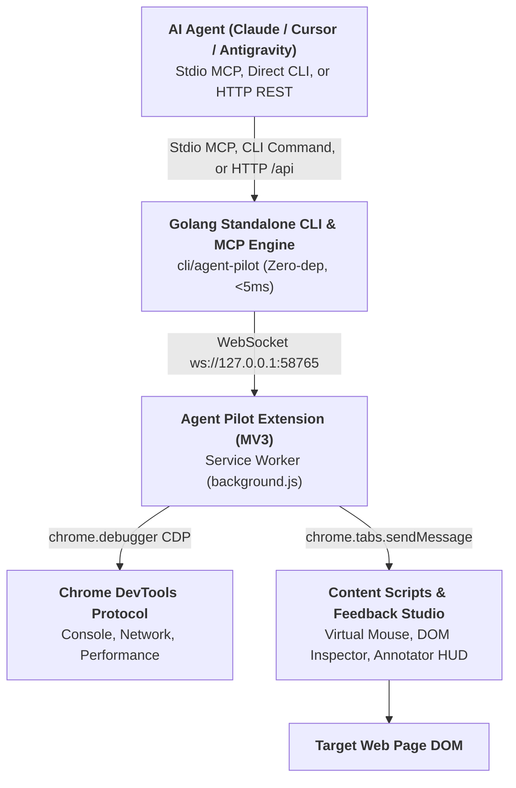

# Agent Pilot - Universal AI Agent Browser Controller

> **Next-Gen AI Browser Companion & Automation Engine (Antigravity First)**
> Maintained by **DNT** ([@ducconit](https://github.com/ducconit)) • Open Source Public Beta

Use this skill when an AI agent needs to automate browser flows, interact with web applications, click elements, fill forms, inspect DOM trees, capture visual screenshots, pick on-screen colors, or debug web applications via Chrome DevTools Protocol (CDP).

---

## ⚡ Quick Install via `skills` CLI

Any AI coding agent (Claude Code, Cursor, Codex, OpenCode, Antigravity, Amp, Roo, Devin, etc.) can install this skill with a single command:

```bash
# Install to current project
npx skills add https://github.com/ducconit/agent-pilot-extension

# Or install globally for all agents
npx skills add https://github.com/ducconit/agent-pilot-extension -g --all
```

### Or install with the Agent Pilot CLI (no Node.js / repo clone required)

The skill files are embedded in the standalone binary:

```bash
agent-pilot skill install                # ~/.agents/skills/agent-pilot
agent-pilot skill install --agy          # ~/.gemini/config/skills/agent-pilot (Antigravity)
agent-pilot skill install --path <dir>   # custom skills root
agent-pilot skill install --force        # overwrite an existing installation
```

---

## 🏗️ Architecture & Communication Flow



### Dual Mode & Zero Port Collision
Agent Pilot includes an automatic **Dual Mode** engine:
- **Master Bridge Mode**: The first process binds local loopback port `58765` and coordinates WebSocket connections to the Chrome Extension.
- **Forwarder Mode**: If multiple AI agents, multi-agent swarms, or multiple IDE windows run concurrently, subsequent agent processes detect the active bridge, skip port binding without `EADDRINUSE` conflicts, and seamlessly forward stdio MCP calls over the local HTTP bridge (`http://127.0.0.1:58765/api`).

---

## ⚡ Standalone Go CLI & MCP Server (`cli/agent-pilot`)

Agent Pilot provides an all-in-one compiled Go binary (`cli/agent-pilot`) for ultra-fast startup and environments without Node.js:
- **Zero Runtime Dependencies**: Stripped ~7MB binary, `<5ms` startup time, `~12MB` RAM usage (approximate figures; may vary by platform).
- **MCP Server Mode (`stdio`)**: Run `agent-pilot mcp` directly inside MCP client configs (Claude Desktop, Cursor, Antigravity, OpenCode).
- **Direct CLI Automation**: Fast, scriptable commands for agents, QC/testers, and CI/CD pipelines:
  ```bash
  # Background Service Management (Linux systemd, macOS launchd, Windows Task Scheduler)
  agent-pilot service install
  agent-pilot service status
  agent-pilot service restart
  agent-pilot service uninstall

  # Direct Browser Actions (Always open a tab in Agent Pilot group, then close when done to save RAM)
  agent-pilot open https://example.com
  agent-pilot click "#login-button"
  agent-pilot type "#search-box" "automation testing" --enter
  agent-pilot screenshot --mode visible
  agent-pilot inspect "#target-element"
  agent-pilot tabs
  agent-pilot close
  agent-pilot batch flow.json
  agent-pilot feedback list

  # Trusted CDP input (opt-in) for cross-origin iframes / canvas / WebGL games
  agent-pilot cdp status --tab 123
  agent-pilot click -x 733 -y 668 --via cdp --tab 123
  agent-pilot drag --from-x 745 --from-y 490 --to-x 745 --to-y 832 --hold 800 --via cdp --tab 123
  ```
- **Multi-Agent, Multi-Conversation & External Tool Concurrency (`🤖 Agent Pilot`)**:
  - **Strict Group Boundary**: AI Agents and external CLI/API tools are **strictly restricted** to operating on tabs inside the `🤖 Agent Pilot` tab group (`agentControlledTabs`). Attempting to target a personal user tab outside the group or calling page commands when no tab exists in the group will be rejected. Always start by opening a tab via `browser_open_tab` / `agent-pilot open` (or `"action": "open"` in `browser_run_actions`), which automatically places the tab into the `🤖 Agent Pilot` group in background mode (`active: false`). Users can also grant access to an existing tab by dragging it into the `🤖 Agent Pilot` Chrome tab group or clicking **"Gắn CDP"** in the Sidepanel.
  - **Concurrent Agents & Explicit `tabId` Discipline**: Multiple agents (e.g., multiple Antigravity conversations, Claude Code, Cursor, subagents, or external CLI scripts) can share the bridge concurrently. Each MCP session automatically tracks its own `agentId` and tab ownership so agents do not hijack or close each other's tabs. For deterministic multi-tab/multi-agent execution, **always capture the `id` (`tabId`) returned by `browser_open_tab` and pass `tabId` explicitly** on subsequent calls (`browser_click`, `browser_screenshot`, `browser_close_tab`, etc.).
  - **Mandatory Tab Cleanup (Save RAM)**: After completing any test or verification workflow on a tab you created, **always close your tab** (`browser_close_tab({ tabId })`, `agent-pilot close --tab <id>`, `{ "action": "close" }` at the end of `browser_run_actions`, or `browser_end_session({ tabId, closeTab: true })`) so temporary test tabs do not accumulate and waste browser RAM. Never close tabs belonging to other agents unless explicitly instructed by the user.

---


## 🛠️ Available MCP Tools (36 Tools)

When the `agent-pilot` MCP server or skill is active, agents have direct access to the following 36 tools:

| Tool Name | Key Parameters | Description |
| :--- | :--- | :--- |
| `browser_snapshot` | `{ maxElements?: number, format?: "text" \| "json", waitUntil?: boolean, waitMs?: number, waitForSelector?: string, waitForText?: string, tabId?: number }` | **Token-Efficient Interactive Map**: Captures an accessibility tree of interactive elements with numbered refs (`@1`, `@2`, etc.) in ~300 tokens. Supports pre-snapshot `waitMs`/`waitForSelector`/`waitForText` to wait for SPA rendering and snapshot in 1 call. |
| `browser_fill_form` | `{ fields: Array<{ selector: string, value: any, clear?: boolean }>, submitSelector?: string, pressEnter?: boolean, waitMs?: number, waitForSelector?: string, waitForText?: string, tabId?: number }` | **Fast Batch Form Filler**: Fills multiple form inputs, selects, native checkboxes/radios, and ARIA controls (`role="checkbox"`, `role="switch"`, `role="radio"`) and optionally clicks submit (plus optional inline post-fill wait) in a single tool call. |
| `browser_run_actions` | `{ actions: Action[], tabId?: number, stopOnError?: boolean }` | **Batch Execution Engine**: Executes an ordered sequence of actions (`open`, `navigate`, `wait_for_selector`, `scroll_into_view`, `click`, `type`, `fill_form`, `snapshot`, `hover`, `drag`, `upload`, `dialog`, `press_key`, `scroll`, `sleep`, `screenshot`, `get_element`, `evaluate`, `cdp`, `performance_metrics`, `performance_trace`, `heap_snapshot`, `close`) in a single round-trip, saving ~80% context tokens, decoding batch screenshots to disk, and stripping base64 bloat by default. |
| `browser_upload_file` | `{ selector: string, files: string[], via?: "auto" \| "cdp" \| "synthetic", waitMs?: number, waitForSelector?: string, waitForText?: string, tabId?: number }` | **Resilient Local File Uploader**: Uploads local files to `<input type="file">` (including hidden inputs and React/Dropzone inputs) via CDP `DOM.setFileInputFiles` with automatic `MAIN`-world `DataTransfer` fallback (`via: "auto"`). Supports `@ref`, CSS selector, and inline post-upload wait. |
| `browser_handle_dialog` | `{ accept?: boolean, promptText?: string, tabId?: number }` | **JavaScript Dialog Handler**: Automatically accepts or dismisses `alert`, `confirm`, or `prompt` browser dialogs with optional text. |
| `browser_hover` | `{ selector: string, waitMs?: number, waitForSelector?: string, waitForText?: string, tabId?: number }` | **Virtual Mouse Hover**: Simulates hovering over an element (triggering `mouseenter`, `mouseover`, `mousemove`) with optional inline post-hover wait. |
| `browser_drag` | `{ from?: string, to?: string, fromX?: number, fromY?: number, toX?: number, toY?: number, steps?: number, holdMs?: number, via?: "synthetic"\|"cdp"\|"auto", waitMs?: number, waitForSelector?: string, waitForText?: string, tabId?: number }` | **Virtual Drag & Drop**: Drags an element or between coordinates with optional inline post-drag wait. `via:"cdp"` uses trusted CDP input; `holdMs` holds before release. |
| `browser_press_key` | `{ key: string, selector?: string, waitMs?: number, waitForSelector?: string, waitForText?: string, tabId?: number }` | **Virtual Keyboard Shortcuts**: Dispatches key presses and keyboard combinations (`Enter`, `Tab`, `Escape`, `Control+A`, `Control+Shift+R`...) with optional inline post-key wait. |
| `browser_wait_for` | `{ selector?: string, text?: string, state?: "visible" \| "attached" \| "hidden", timeoutMs?: number, waitMs?: number, sleepMs?: number, ms?: number, tabId?: number }` | **Smart Waiter & Sleeper**: Polling wait until an element or text meets state condition, or pure sleep (`waitMs`/`sleepMs`/`ms`), or `document.readyState === "complete"` wait when called with no selector/text/ms. |
| `browser_emulate` | `{ cpuThrottlingRate?: number, networkConditions?: string, colorScheme?: "dark" \| "light", tabId?: number }` | **Environment Emulation**: Emulates CPU throttling (slowdown 1x/4x/6x), network conditions (`offline`, `slow-3g`, `fast-3g`), and dark/light mode. |
| `browser_resize_page` | `{ width: number, height: number, deviceScaleFactor?: number, mobile?: boolean, tabId?: number }` | **Viewport Resizer**: Overrides device metrics and screen resolution for responsive UI testing. |
| `browser_list_network_requests` | `{ filterUrl?: string, method?: string, resourceType?: string, limit?: number, tabId?: number }` | **Network Inspector**: Lists recent HTTP requests captured on the tab with filtering by URL, method, or resource type. |
| `browser_get_network_request` | `{ requestId: string, tabId?: number }` | **Response Body Inspector**: Retrieves the full response body (JSON/text) and headers for a specific network request via CDP `Network.getResponseBody`. |
| `browser_performance_trace` | `{ action?: "start" \| "stop", categories?: string, tabId?: number }` | **Timeline Bottleneck Analyzer**: Records DevTools timeline trace (`Tracing.start/end`) and automatically parses trace events into CPU breakdown (`scriptingMs`, `renderingMs`, `paintingMs`), Long Tasks ($\ge 50\text{ms}$), synchronous Forced Reflows / Layout Thrashing with stack trace URLs, Hot Scripts, and actionable `diagnostics`. |
| `browser_performance_metrics` | `{ includeWebVitals?: boolean, includeResources?: boolean, includeDomHealth?: boolean, tabId?: number }` | **Deep Performance & Core Web Vitals**: Queries live CDP metrics (`JSHeapUsedSize`, `Nodes`, `JSEventListeners`), Core Web Vitals (`TTFB`, `FCP`, `LCP` + element selector, `CLS` + shifting elements, `TBT` + long tasks), slowest & render-blocking resources, DOM/A11y health (`maxDepth`, `duplicateIds`, missing alt/labels), and automated `diagnostics`. |
| `browser_take_heapsnapshot` | `{ action?: "snapshot" \| "baseline" \| "diff" \| "check_leak" \| "gc", collectGarbage?: boolean, forceGC?: boolean, recordBaseline?: boolean, compareWithBaseline?: boolean, maxConstructors?: number, tabId?: number }` | **V8 Heap Profiler & Memory Leak Detector**: Triggers V8 GC, parses V8 `.heapsnapshot` nodes/strings into `topConstructors` and `detachedDomNodes` (`Detached HTML*` / `detachedness=2`), and supports `baseline` $\rightarrow$ `diff` comparison to detect memory leaks (`leakSuspected`, `severity`, `growingConstructors`, DOM/listener deltas). |
| `browser_manage_extensions` | `{ action?: "list" \| "setEnabled", extensionId?: string, enabled?: boolean }` | **Extension Manager**: Lists installed browser extensions or toggles them on/off via `chrome.management`. |
| `browser_start_session` | `{ name?: string, tabId?: number }` | **Continuous Session Start**: Initiates an active AI Agent session. Keeps the virtual cursor and glowing neon lock shield continuously visible on the tab until ended. |
| `browser_end_session` | `{ tabId?: number, closeTab?: boolean }` | **Continuous Session End**: Concludes the active AI Agent session. Set `closeTab: true` to automatically close the agent tab and free RAM when the test finishes. |
| `browser_evaluate` | `{ expression?: string, script?: string, waitMs?: number, waitForSelector?: string, waitForText?: string, tabId?: number }` | **Page Evaluator**: Evaluates a JavaScript expression or script in the context of the page (accepts either `expression` or `script`, plus optional post-eval wait) and returns the serialized result. |
| `browser_open_tab` | `{ url: string, username?: string, password?: string, active?: boolean, waitUntil?: boolean, waitMs?: number, waitForSelector?: string, waitForText?: string }` | Opens a new browser tab inside the `🤖 Agent Pilot` tab group (auto-creates a window if none exists, and waits for page load completion by default). Supports HTTP Basic Auth (`username`/`password`) and inline `waitMs`/`waitForSelector`/`waitForText`. |
| `browser_close_tab` | `{ tabId?: number }` | Closes an Agent-controlled tab inside the `🤖 Agent Pilot` tab group to free browser RAM after testing is complete. |
| `browser_list_tabs` | `{}` | Lists all open tabs with IDs, titles, URLs, active state, and agent ownership indicators. |
| `browser_navigate` | `{ url: string, username?: string, password?: string, waitUntil?: boolean, waitMs?: number, waitForSelector?: string, waitForText?: string, tabId?: number }` | Navigates an Agent-controlled tab in the `🤖 Agent Pilot` group to a URL (waits for load completion by default, plus optional `username`/`password` Basic Auth and inline `waitMs`/`waitForSelector`/`waitForText`). |
| `browser_click` | `{ x?: number, y?: number, selector?: string, via?: "synthetic"\|"cdp"\|"auto", waitMs?: number, waitForSelector?: string, waitForText?: string, tabId?: number }` | Moves virtual mouse cursor and clicks, with optional inline post-click `waitMs`/`sleepMs`/`waitForSelector`/`waitForText` to avoid a separate wait tool call. |
| `browser_type` | `{ text: string, selector?: string, clear?: boolean, pressEnter?: boolean, waitMs?: number, waitForSelector?: string, waitForText?: string, tabId?: number }` | Simulates human typing into inputs with realistic keystroke delays and optional inline post-type `waitMs`/`waitForSelector`/`waitForText`. |
| `browser_scroll` | `{ deltaX?: number, deltaY?: number, waitMs?: number, waitForSelector?: string, waitForText?: string, tabId?: number }` | Smoothly scrolls the page viewport by relative pixel offsets with optional inline post-scroll wait. |
| `browser_get_element` | `{ selector: string, includeStyles?: boolean, tabId?: number }` | Inspects DOM elements, returning tag name, coordinates, bounding box dimensions, text, and value. Pass `includeStyles: true` only when styling details are needed (omitted by default to save tokens). |
| `browser_screenshot` | `{ mode?: "visible" \| "region" \| "element" \| "full", selector?: string, path?: string, savePath?: string, step?: number \| string, title?: string, caption?: string, description?: string, highlightSelector?: string, highlightBox?: { x, y, width, height }, base64?: boolean, waitMs?: number, waitForSelector?: string, waitForText?: string, tabId?: number }` | Captures high-resolution PNG screenshot via CDP even on background tabs. Supports built-in visual annotations (`step`, `title`, `description`, `highlightSelector`) rendered directly onto the PNG, pre-capture `waitMs`/`waitForSelector`/`waitForText`, and saves to `path` (or `savePath` alias, default OS temp dir). |
| `browser_get_devtools_data` | `{ tabId?: number, type?: "all" \| "console" \| "network" \| "performance", filterOrigin?: boolean, limit?: number, clear?: boolean }` | **All-in-One DevTools Diagnostic**: Intercepts real-time CDP Console logs, uncaught JS exceptions, Network requests (with failed status/MIME), runtime CDP metrics, Core Web Vitals (`webVitals`), DOM/A11y health (`domHealth`), and actionable `diagnostics`. Extension noise (`chrome-extension://*`) is filtered by default (`filterOrigin: true`). |
| `browser_pick_color` | `{ tabId?: number, x?: number, y?: number }` | Samples any on-screen pixel color. Returns all 5 modern color formats (`hex`, `rgb`, `rgba`, `hsl`, `oklch`). |
| `browser_list_instances` | `{}` | Lists all connected browser instances (Chrome, Brave, Edge, profiles/windows). |
| `browser_select_instance` | `{ instanceId: string }` | Switches active target browser instance in multi-browser setups. |
| `browser_set_busy` | `{ busy?: boolean, action?: string, session?: boolean, tabId?: number }` | Displays a subtle glowing neon border and compact floating pill with action label and emergency unlock button (`Escape`) on the target page during agent workflows. |
| `browser_get_pending_feedback` | `{ sessionId?: string, limit?: number, clear?: boolean }` | **Channel B Feedback Reader**: Retrieves pending human visual UI feedback sessions saved in `~/.agent-pilot/inbox/feedback/<timestamp>/*`. |
| `browser_wait_for_feedback` | `{ timeout?: number, tabId?: number }` | **Channel A Reactive Long-Polling**: Reactively halts agent execution until a human submits visual feedback via Feedback Studio in the browser. |

---

## 🔌 Which Features Require CDP? (Mandatory vs Optional)

Agent Pilot has two automation engines:
- **Synthetic DOM engine** (content script, no debugger): produces `isTrusted: false` DOM events. Fine for regular pages, but **cannot cross cross-origin iframes** and cannot drive canvas/WebGL apps.
- **CDP engine** (`chrome.debugger` + `Input.*` / `Page.*`): produces **trusted input** and works on cross-origin iframes, canvas and WebGL apps (Unity, Playables, games).

### Requirement matrix

| Feature (MCP tool / CLI) | Engine | CDP required? |
| :--- | :--- | :--- |
| `browser_snapshot` / `snapshot` | DOM (content script) | ❌ No |
| `browser_get_element` / `inspect` | DOM | ❌ No |
| `browser_type` / `type` | Synthetic DOM | ❌ No |
| `browser_scroll` / `scroll` | Synthetic DOM | ❌ No |
| `browser_fill_form` / `fill` | Synthetic DOM | ❌ No |
| `browser_wait_for` / `wait` | DOM | ❌ No |
| `browser_pick_color` | DOM sampling | ❌ No |
| `browser_list_tabs`, `browser_open_tab`, `browser_navigate` | `chrome.tabs` API | ❌ No |
| `browser_evaluate` / `evaluate` | MAIN-world scripting (CDP only as fallback) | ❌ No |
| `browser_click` / `click` | Synthetic by default | ⚙️ Optional — `via:"cdp"` for cross-origin iframe / canvas / WebGL |
| `browser_drag` / `drag` | Synthetic by default | ⚙️ Optional — `via:"cdp"` + coordinates (fromX/fromY/toX/toY) for canvas games |
| `browser_hover` / `hover` | CDP first, synthetic fallback | ⚙️ Optional (automatic, no flag) |
| `browser_press_key` / `key` | CDP first, synthetic fallback | ⚙️ Optional (automatic, no flag) |
| `browser_screenshot` / `screenshot` | CDP `Page.captureScreenshot` | ✅ Yes for background tabs (active tab falls back to `captureVisibleTab`) |
| `browser_upload_file` / `upload` | CDP `DOM.setFileInputFiles` + `MAIN`-world `DataTransfer` fallback (`via: "auto"`) | ⚙️ Optional — tries CDP first, falls back to synthetic `DataTransfer` + `File` (`via: "cdp"` requires CDP) |
| `browser_handle_dialog` / `dialog` | CDP dialog handling | ✅ Yes |
| `browser_emulate` / `emulate` | CDP `Emulation.set*` | ✅ Yes |
| `browser_resize_page` / `resize` | CDP `Emulation.setDeviceMetricsOverride` | ✅ Yes |
| `browser_list_network_requests`, `browser_get_network_request` / `network` | CDP Network domain | ✅ Yes |
| `browser_performance_trace` / `trace` | CDP Tracing | ✅ Yes |
| `browser_performance_metrics` / `metrics` | CDP Performance domain | ✅ Yes |
| `browser_take_heapsnapshot` / `heap` | CDP HeapProfiler | ✅ Yes |
| `browser_get_devtools_data` | CDP Console/Network/Performance buffers | ✅ Yes |
| raw `cdp.send` / `agent-pilot cdp status` | CDP | ✅ Yes (by definition) |

### CDP failure semantics
- `click`/`drag` with `via:"cdp"`: **no silent fallback** — returns `CDP_UNAVAILABLE: <reason>` so the agent knows trusted input was not delivered. Use `via:"auto"` when a synthetic fallback is acceptable.
- ✅-group features attach the debugger automatically and fail/degrade when attachment is impossible.
- Common causes: DevTools already open on the tab, `chrome.debugger` blocked by the user/profile policy.
- Pre-flight check: `agent-pilot cdp status --tab <id>`, or HTTP `{"method":"cdp.status","params":{"tabId":123}}`.

### When to use which
- Regular DOM pages: default synthetic commands are enough (visual cursor + ripple included).
- Cross-origin iframe, `<canvas>`, WebGL/Unity game: `via:"cdp"` for click/drag (with explicit coordinates) after a `cdp status` check.
- The neon virtual cursor / ripple is only drawn by the synthetic engine; CDP input does not render it.

---

## 🎨 3-Channel Visual UI Feedback System

Agent Pilot bridges the communication gap between human users and AI coding agents through 3 complementary feedback channels:

1. **Kênh A (Reactive Long-Polling)**:
   - Agent calls `browser_wait_for_feedback({ timeout: 120 })` to pause and wait for user guidance.
   - User enters **Feedback Studio** in browser, marks elements/crops, writes notes, and clicks **"🚀 Gửi Agent"**.
   - Long-poll resolves immediately, passing exact file locations (`src/components/Navbar.tsx:42`), component names (`<Navbar />`), CSS rules, and screenshots to the agent.
2. **Kênh B (Shared Inbox File Storage)**:
   - User clicks **"💾 Lưu Inbox"** in Feedback Studio or Sidepanel.
   - Extension transmits items to `~/.agent-pilot/inbox/feedback/<timestamp>/*`:
     - `session.json` (metadata, count, component mapping, user notes).
     - `prompt.md` (clean markdown without base64 bloat).
     - `item_1.png`, `item_2.png` (binary PNG screenshots).
   - Agent calls `browser_get_pending_feedback()` at any time to inspect pending requests.
3. **Kênh C (1-Click Clipboard Prompt)**:
   - User clicks **"📋 Copy Prompt"** in Feedback Studio or Sidepanel.
   - Formats a comprehensive markdown prompt into the clipboard, ready to paste into any chat or prompt box.

## 🔒 Secret & Private Key Redaction Layer

Agent Pilot includes an automatic **zero-trust security layer** enabled by default:
- Automatically scans responses for sensitive credentials:
  - Private Keys (RSA, EC, OpenSSH, DSA, PGP)
  - API Keys (OpenAI `sk-proj-*`, Anthropic `sk-ant-*`, Google `AIzaSy*`, GitHub `ghp_*`, AWS, Stripe, Slack)
  - Bearer Tokens, JWTs, and sensitive URL query parameters
- Redacts detected secrets with asterisks (`*`) and attaches an explicit security notice:
  `[SECURITY NOTE: Sensitive credentials in this output were masked with asterisks (*) by Agent Pilot's Secret Filter]`
- Prevents accidental token leakage into cloud LLM training data and logs.

---

## 📋 Standard Agent Operating Workflow

### 1. Verification & Pre-Flight
Check whether the browser bridge is operational:
- Check health: `http://127.0.0.1:58765/health`
- Or list open tabs: `browser_list_tabs()`

### 2. High-Efficiency Automation (Batch Mode - Recommended)
To save ~80% tokens, minimize latency, and automatically close the test tab when finished to free RAM, combine steps (ending with `"close"`) into `browser_run_actions`:
```json
{
  "actions": [
    { "action": "open", "url": "https://example.com", "waitUntil": true },
    { "action": "wait_for_selector", "selector": "#login-btn", "timeout": 5000 },
    { "action": "type", "selector": "input#username", "text": "agent_test", "clear": true },
    { "action": "type", "selector": "input#password", "text": "secret123", "pressEnter": true },
    { "action": "sleep", "ms": 1000 },
    { "action": "screenshot", "mode": "visible" },
    { "action": "close" }
  ]
}
```

### 3. Granular Step-by-Step Execution
For exploratory tasks or interactive debugging (always open a tab in the `🤖 Agent Pilot` group first, and close it when finished):
1. **Open Agent Tab**: `browser_open_tab({ url: "https://example.com" })` (returns `tabId`)
2. **Inspect**: `browser_get_element({ selector: "button.submit-btn", tabId })`
3. **Click**: `browser_click({ selector: "button.submit-btn", tabId })`
4. **Audit DevTools**: `browser_get_devtools_data({ type: "console", tabId })`
5. **Cleanup Tab (Save RAM)**: `browser_close_tab({ tabId })`

---

## ⚡ Token Efficiency & Anti-Bloat Best Practices (Kinh nghiệm tối ưu Token & RAM)

Browser automation có thể tiêu tốn lượng token và RAM rất lớn nếu không sử dụng đúng các công cụ tối ưu. Hãy tuân thủ 6 nguyên tắc sau:

1. **Chỉ thao tác trên nhóm tab `🤖 Agent Pilot` & Đóng tab ngay sau khi test xong**:
   - Agent chỉ được phép thao tác với các tab thuộc nhóm `🤖 Agent Pilot`. Mặc định khi tạo tab mới (`browser_open_tab` / `agent-pilot open`) để kiểm thử, sau khi hoàn tất bắt buộc phải đóng tab (`browser_close_tab`, `agent-pilot close`, hoặc `{ "action": "close" }` ở cuối batch) để giải phóng RAM trình duyệt.
2. **Ưu tiên Batch Engine (`browser_run_actions`)**:
   - Thay vì thực hiện 5-7 lượt chat đơn lẻ (mỗi lượt phải gửi lại toàn bộ lịch sử hội thoại), hãy gom các bước (`open` $\rightarrow$ `wait` $\rightarrow$ `fill_form` $\rightarrow$ `click` $\rightarrow$ `screenshot` $\rightarrow$ `close`) vào một lệnh gọi `browser_run_actions`. Tiết kiệm $\sim 80\%$ token và loại bỏ độ trễ mạng giữa các bước.
3. **Tận dụng Inline Wait (`waitMs` / `waitForSelector` / `waitForText`) ngay trong lệnh tương tác**:
   - Hầu hết các công cụ điều hướng, tương tác và quan sát (`browser_open_tab`, `browser_navigate`, `browser_click`, `browser_type`, `browser_fill_form`, `browser_hover`, `browser_drag`, `browser_press_key`, `browser_upload_file`, `browser_evaluate`, `browser_snapshot`, `browser_screenshot`) đều hỗ trợ truyền trực tiếp `waitMs`, `waitForSelector`, hoặc `waitForText`.
   - Thay vì gọi `browser_click` rồi lại tốn thêm một lượt gọi `browser_wait_for`, hãy truyền luôn `{ "selector": "#open-modal", "waitForSelector": ".modal-body", "waitMs": 200 }` trong 1 lệnh duy nhất.
4. **Dùng `browser_snapshot` thay vì dump raw HTML**:
   - Không bao giờ trích xuất toàn bộ DOM HTML bằng JavaScript (thường tốn 30.000 - 100.000 tokens).
   - Sử dụng `browser_snapshot` để lấy Cây tiếp cận (Accessibility Tree) với mã tham chiếu `@1`, `@2` nhỏ gọn (chỉ tốn $\sim 300 - 800$ tokens cho toàn trang). Có thể kèm `waitForSelector`/`waitMs` để đợi SPA render xong rồi mới chụp snapshot.
5. **Tận dụng `browser_screenshot` lưu vào thư mục tạm của hệ điều hành (`os.TempDir()`)**:
   - Mặc định khi không chỉ định `path` (hoặc `savePath`), ảnh chụp được decode và lưu ra file `.png` trong thư mục tạm của hệ điều hành (`os.TempDir()`, ví dụ `/tmp/screenshot_<timestamp>.png`), tránh làm rác thư mục `HOME` hoặc thư mục dự án, đồng thời chỉ trả về đường dẫn file và kích thước byte (tốn $\sim 30$ tokens thay vì $\sim 100.000$ tokens khi trả Base64 inline).
   - Chỉ truyền `base64: true` khi bắt buộc cần inline data trong bộ nhớ.
6. **Điền form hàng loạt với `browser_fill_form`**:
   - Điền toàn bộ các trường input, select, checkbox (kèm `submitSelector` và `waitMs` nếu cần) trong một lệnh duy nhất thay vì click và type từng ô.

---

## 🎭 Phối hợp với Playwright trong Automation Testing (Synergy with Playwright)

Agent Pilot và Playwright bổ trợ cho nhau theo mô hình hai tầng:

```text
Agent Pilot (Khám phá trên browser thật & Human Feedback)
    ↳ AI Agent phân tích DOM & luồng nghiệp vụ
        ↳ Sinh kịch bản Playwright E2E (`.spec.ts`) chuẩn Page Object Model
            ↳ Chạy tự động trong CI/CD (Token Cost = 0)
```

1. **Khám phá trước, đóng gói sau**:
   - Dùng Agent Pilot tương tác trên trình duyệt thật (giữ nguyên session, cookies, 2FA) để AI hiểu luồng người dùng và tìm kiếm các locator bền vững (`getByRole`, `getByLabel`).
   - Yêu cầu AI Agent viết mã kịch bản Playwright hoàn chỉnh (`.spec.ts`) và Page Object Model tương ứng.
2. **Cảnh báo xung đột CDP (CDP Conflict)**:
   - **Tuyệt đối không** gọi lệnh Agent Pilot bên trong file test Playwright đang chạy trên cùng một tab trình duyệt. Chromium chỉ cho phép một debugger client (`chrome.debugger`) đính kèm tại một thời điểm.
3. **Biến Visual Feedback thành Regression Test**:
   - Khi Tester ghim lỗi qua Feedback Studio của Agent Pilot, AI Agent vừa sửa mã nguồn vừa tự động bổ sung một test case Playwright tương ứng để khóa lỗi (Zero Regression).
4. **Tự phục hồi Locator (Self-Healing Tests)**:
   - Khi test Playwright bị fail trên CI do thay đổi giao diện, AI Agent dùng `browser_snapshot` của Agent Pilot để quét lại DOM trang thật và tự động cập nhật selector trong file test.

---

## 🎯 Mẹo Tương Tác Khi Không Tìm Thấy Button/Element (Coordinate Click Fallback)

Khi AI Agent gặp các phần tử không có selector DOM rõ ràng hoặc không thể click qua CSS selector (nút không có ID/class ổn định, Canvas game/chart, WebGL, Shadow DOM đóng, iframe bảo mật, SVG phức tạp, dynamic obfuscated class):

1. **Chụp toàn màn hình (`browser_screenshot`)**:
   - Mặc định `browser_screenshot` luôn chụp toàn bộ màn hình hiển thị (viewport hiện tại, `mode: "visible"`).
   - Tệp ảnh được giải mã và lưu thành file `.png` trên đĩa cục bộ, chỉ trả về đường dẫn tệp (`path`) và kích thước byte, giúp Agent phân tích hình ảnh mà không làm phình context token.
2. **Xác định tọa độ pixel `(x, y)`**:
   - Dựa trên ảnh chụp màn hình, xác định tọa độ pixel `(x, y)` tại tâm của nút bấm hoặc vùng cần tương tác (tọa độ pixel tương đối theo viewport hiển thị).
3. **Click bằng chuột ảo (Mặc định không cần CDP vs Tùy chọn CDP)**:
   - **Click thông thường (Mặc định - Khuyên dùng cho 95% trường hợp)**:
     Chỉ cần truyền `x` và `y`, bỏ qua `selector` và `via`:
     ```json
     {
       "x": 540,
       "y": 320
     }
     ```
     Cơ chế chuột ảo dùng `document.elementFromPoint(x, y)` định vị phần tử và phát chuỗi sự kiện DOM hoàn chỉnh (`pointerdown` $\rightarrow$ `mousedown` $\rightarrow$ `pointerup` $\rightarrow$ `mouseup` $\rightarrow$ `click`). **Ưu điểm lớn**: Hoàn toàn không chiếm quyền debugger, không sợ xung đột với DevTools hay Playwright.
   - **Click phần cứng qua CDP (`via: "cdp"`)**:
     Dành cho 5% trường hợp đặc thù khi nút nằm trong Canvas/WebGL, cross-origin iframe, hoặc website chống bot yêu cầu sự kiện chuột phần cứng (`event.isTrusted === true`):
     ```json
     {
       "x": 540,
       "y": 320,
       "via": "cdp"
     }
     ```

---

## 🎨 Lấy Màu Sắc & Computed CSS Style Của Element (Color & Style Inspection)

AI Agent hoàn toàn có thể tự động bóc tách màu sắc, font chữ, layout và CSS của bất kỳ phần tử nào trên trang thông qua 2 cơ chế chuyên dụng:

### Cách 1: Đọc CSS Computed Styles & Thông số Hộp (`browser_get_element`)
Khi cần kiểm tra mã màu (background, text color), font chữ, padding, border, hoặc kích thước layout của một element:
- Gọi `browser_get_element` với `includeStyles: true`:
  ```json
  {
    "selector": "button.primary-btn",
    "includeStyles": true
  }
  ```
- **Dữ liệu trả về**:
  - `styles.color`: Mã màu chữ (e.g. `rgb(255, 255, 255)`).
  - `styles.backgroundColor`: Mã màu nền (e.g. `rgb(37, 99, 235)`).
  - `computedStyles`: Chi tiết Typography (`font-family`, `font-size`, `font-weight`, `line-height`), Box Model (`margin`, `padding`, `border`, `border-radius`, `box-shadow`), và Flex/Grid layout.
  - `rect`: Toạ độ và kích thước thực tế trên màn hình (`x`, `y`, `width`, `height`).

> [!TIP]
> Thuộc tính `includeStyles` mặc định tắt (`false`) để tiết kiệm token. Chỉ bật `includeStyles: true` khi Agent cần thẩm định giao diện (UI QA), trích xuất Design System, hoặc kiểm tra contrast màu sắc theo chuẩn WCAG.

### Cách 2: Lấy màu pixel thực tế tại tọa độ màn hình (`browser_pick_color`)
Khi phần tử là hình ảnh, icon Canvas/SVG, hoặc gradient mà CSS selector không biểu diễn được giá trị màu cụ thể:
- Gọi `browser_pick_color` kèm tọa độ `x`, `y`:
  ```json
  {
    "x": 350,
    "y": 180
  }
  ```
- **Dữ liệu trả về**: Trả về chính xác giá trị màu tại pixel đó dưới nhiều hệ màu hiện đại:
  ```json
  {
    "hex": "#2563EB",
    "rgb": "rgb(37, 99, 235)",
    "rgba": "rgba(37, 99, 235, 1)",
    "hsl": "hsl(221, 83%, 53%)",
    "oklch": "oklch(54.6% 0.215 262.9)"
  }
  ```

---

## 🌐 Fallback HTTP REST API

If stdio MCP is not supported by your environment, invoke tools directly via HTTP JSON-RPC:

```bash
# Health check
curl -s http://127.0.0.1:58765/health

# Move virtual mouse & click
curl -s -X POST http://127.0.0.1:58765/api \
  -H "Content-Type: application/json" \
  -d '{"method": "page.click", "params": {"selector": "#submit-btn"}}'

# Take screenshot
curl -s -X POST http://127.0.0.1:58765/api \
  -H "Content-Type: application/json" \
  -d '{"method": "page.screenshot", "params": {"mode": "visible"}}'
```

---

## 🛡️ Cơ Chế Cô Lập Tab Group (Tab Group Isolation & Safety Boundary)

Để bảo vệ tối đa tính riêng tư và bảo mật cho người dùng, Agent Pilot áp dụng cơ chế **Cô lập Tab Group độc quyền**:
1. **Chỉ hoạt động trong nhóm tab "🤖 Agent Pilot"**:
   - Khi Agent mở tab bằng `browser_open_tab` (`tabs.create`) hoặc `open` trong batch, tab sẽ được tự động gom vào Native Chrome Tab Group mang tên `🤖 Agent Pilot` (màu cyan) kèm huy hiệu `AI` trên biểu tượng extension.
   - Agent **chỉ được phép** truy vấn, đọc nội dung, click, nhập liệu, chụp màn hình hoặc điều khiển các tab nằm trong nhóm `🤖 Agent Pilot`.
2. **Tuyệt đối cấm can thiệp tab hoặc group khác**:
   - Mọi nỗ lực truy cập hoặc thao tác vào tab thuộc group khác (ví dụ: nhóm "Cá nhân", "Công việc") hoặc các tab cá nhân chưa gom nhóm (`groupId === -1`) sẽ bị hệ thống **chặn đứng lập tức** với lỗi bảo mật: `Access denied: Tab [id] does not belong to the Agent Pilot tab group`.
   - Danh sách tab từ `browser_list_tabs` (`tabs.listAll`) và `tabs.query` tự động lọc sạch, không bao giờ làm rò rỉ tiêu đề hay URL các tab cá nhân của người dùng vào context của AI.
3. **Người dùng toàn quyền kiểm soát**:
   - Người dùng có thể kéo thả tab bất kỳ vào nhóm `🤖 Agent Pilot` để cấp quyền cho Agent tương tác.
   - Ngược lại, chỉ cần kéo tab ra khỏi nhóm `🤖 Agent Pilot`, Agent lập tức bị tước quyền thao tác trên tab đó.

---

## ⚙️ Configuration & Environment Variables

- **Default Port**: `58765` (customizable via `AGENT_PILOT_PORT=58765`).
- **Host**: `127.0.0.1` (loopback only for maximum host security).
- **Extension Settings**: Click the ⚙️ icon in the Extension Side Panel to change the bridge port or toggle the Secret Redaction Filter.

---

## 📸 Multi-Step Recording, Annotated Screenshots, Resilient Upload & Basic Auth

When recording multi-step QA test guides, user manuals, or end-to-end flows with visual evidence, use built-in Agent Pilot features instead of writing external Python/PIL scripts or manual `browser_evaluate` workarounds:

1. **Built-in Annotated Screenshots (`step`, `title`, `description`, `highlightSelector`)**:
   - Both `browser_screenshot` and `{ "action": "screenshot" }` inside `browser_run_actions` can render a dark translucent header banner (with step badge, title, and word-wrapped description) and a red highlight box around any target element directly inside the Extension Worker (`OffscreenCanvas`) before saving the PNG to disk:
   ```json
   {
     "action": "screenshot",
     "path": "/tmp/step-01-packages.png",
     "step": 1,
     "title": "Chọn gói chụp và thêm vào giỏ",
     "description": "Khách hàng chọn gói chụp và bấm Thêm vào giỏ hàng",
     "highlightSelector": "[data-testid='package-card']"
   }
   ```
   - In `browser_run_actions` (`agent-pilot batch`), each screenshot action with `path` (or `savePath`) is automatically decoded and written to disk by the Go bridge, and raw `dataUrl` is stripped from the JSON response (unless `base64: true`) so a 10-step recording consumes ~300 tokens instead of ~500,000 tokens.

2. **Resilient File Upload (`browser_upload_file` / `upload` action)**:
   - Supports `via: "auto"` (default), `"cdp"`, or `"synthetic"`.
   - When `via: "auto"`, Agent Pilot first attempts CDP `DOM.setFileInputFiles` (supporting `input[type="file"]` inside hidden wrappers or adjacent to trigger buttons). If CDP cannot attach (e.g., DevTools is open or policy blocks debugger), it automatically falls back to `MAIN`-world synthetic `DataTransfer` + `File` construction using pre-loaded file payloads from the Go bridge, resets React's `_valueTracker`, dispatches `input` + `change`, and waits `80ms` for async `FileReader.onload` previews.
   - Never write manual `atob(...)` + `DataTransfer` scripts in `browser_evaluate` to upload files—just call `browser_upload_file` or `{ "action": "upload", "selector": "input[type=file]", "files": ["/path/to/file.png"] }`.

3. **Radix UI / shadcn Form Controls in `browser_fill_form`**:
   - `browser_fill_form` natively toggles ARIA checkboxes (`role="checkbox"`), switches (`role="switch"`), and radios (`role="radio"`) by checking `aria-checked` / `data-state="checked"` against the boolean `value` and dispatching a trusted synthetic click only when a state transition is needed.

4. **HTTP Basic Auth with Special Characters (`username` / `password`)**:
   - Pass `username` and `password` directly to `browser_open_tab`, `browser_navigate`, or batch `open`/`navigate` actions (or `--user` / `--password` in CLI). Credentials containing `@`, `:`, `&`, or `#` are safely URL-encoded via `encodeURIComponent` and CDP debugger attachment automatically retries after auth challenge navigation completes.

---

## 🔬 Deep Website Diagnostics, Core Web Vitals, Trace Insights & Memory Leak Detection

Agent Pilot provides built-in deep performance diagnostics and V8 memory leak detection so AI agents never need to parse multi-megabyte raw CDP JSON files manually:

### 1. Core Web Vitals, Resource Bottlenecks & DOM/A11y Health (`browser_performance_metrics` & `browser_get_devtools_data`)
Call `browser_performance_metrics({ tabId })` (or `browser_get_devtools_data({ type: "all", tabId })`) to receive a compact, structured diagnostic report:
- **`webVitals`**:
  - `ttfbMs`, `fcpMs`, `lcpMs` + `lcpElement` (exact CSS selector of the Largest Contentful Paint element), `cls` + `clsCulprits` (selectors causing layout shifts), `totalBlockingTimeMs` (Total Blocking Time $\sum(\text{dur} - 50\text{ms})$) + `longTasksCount`, `maxLongTaskMs`, `topLongTasks`, and `ratings` (`"good"`, `"needs-improvement"`, `"poor"`).
- **`resources`**:
  - `totalCount`, `totalTransferKB`, `renderBlockingCount`, `renderBlockingUrls`, and `slowestResources` (top 5 slowest network resources with `url`, `initiatorType`, `durationMs`, `transferKB`).
- **`domHealth`**:
  - `totalElements`, `maxDepth`, `maxChildrenCount` + `maxChildrenSelector`, `iframeCount`, `duplicateIds` (`[{ id, count }]`), `imagesMissingAlt`, and `unlabelledInputs`.
- **`diagnostics`**:
  - Automated root-cause warnings/critical alerts with `severity` (`"warning"` | `"critical"`), `category`, `metric` (`LCP`, `CLS`, `TBT`, `DOMNodes`, `JSHeapUsedMB`, `DuplicateIDs`, `DOMDepth`, `RenderBlockingResources`), and `message`.

### 2. Timeline Trace Bottleneck Analyzer (`browser_performance_trace`)
To diagnose slow interactions, jank, or main-thread freezes:
1. Start tracing: `browser_performance_trace({ action: "start", tabId })`
2. Trigger the slow UI action (`browser_click`, `browser_scroll`, etc.)
3. Stop & analyze: `browser_performance_trace({ action: "stop", tabId })`
- **Returned `insights` & `eventsSummary`**:
  - `insights.breakdownMs`: Main-thread CPU time split into `scriptingMs`, `renderingMs` (Layout / Recalculate Style), `paintingMs` (Paint / Composite), and `otherMs`.
  - `insights.longTasks`: `count`, `totalBlockingTimeMs`, `maxDurationMs`, and `topTasks` (main-thread tasks $\ge 50\text{ms}$ with source script `url`/`functionName`/`lineNumber`).
  - `insights.forcedReflows`: Synchronous Forced Layout / Recalculate Style events triggered inside JavaScript execution (Layout Thrashing), including `type`, `durationMs`, `functionName`, `url`, and `lineNumber`.
  - `insights.hotScripts`: Top scripts ranked by main-thread CPU execution time (`url`, `totalMs`, `callCount`).
  - `insights.bottlenecks`: Actionable summary strings of detected main-thread bottlenecks.

### 3. Memory Leak Detection & V8 Heap Snapshot Diffing (`browser_take_heapsnapshot`)
To verify whether an SPA interaction (e.g., opening and closing a modal, switching routes, or polling data) leaks memory:
1. **Record Baseline (triggers V8 GC automatically first)**:
   ```json
   { "action": "baseline", "tabId": 123 }
   ```
2. **Perform the suspect UI cycle** (e.g. open modal $\rightarrow$ close modal, or navigate to detail $\rightarrow$ back).
3. **Compare against Baseline (`diff` / `check_leak`)**:
   ```json
   { "action": "diff", "tabId": 123 }
   ```
- **Returned Memory & Leak Analysis**:
  - `heapSummary.topConstructors`: Top V8 object constructors ranked by retained `selfSizeBytes` (`selfSizeKB`) and instance `count`.
  - `heapSummary.detachedDomNodes`: `{ totalCount, totalBytes, totalKB, items }` for Detached DOM trees (`Detached HTMLDivElement`, `Detached HTMLLIElement`, or V8 `detachedness === 2`) still retained in JS memory after removal from the document.
  - `leakAnalysis`:
    - `leakSuspected` (`boolean`) and `severity` (`"none"` | `"low"` | `"medium"` | `"high"`).
    - `deltas`: Exact growth in `jsHeapUsedBytes`, `jsHeapUsedMB`, `domNodes`, `jsEventListeners`, `documents`, and `detachedDomCount`.
    - `growingConstructors`: Constructors with the largest positive instance and byte deltas (`deltaCount`, `deltaBytes`, `deltaKB`, `baselineCount`, `currentCount`) between baseline and post-interaction snapshot.
    - `suspectedCauses`: Human- and agent-readable diagnosis of detached DOM retention, unremoved `addEventListener` handlers, or growing JS caches/closures.
- Can also be run in a single `browser_run_actions` batch using `{ "action": "heap_snapshot", "mode": "baseline" }` $\rightarrow$ UI steps $\rightarrow$ `{ "action": "heap_snapshot", "mode": "diff" }`.

---

## 📚 References & Resources

Detailed guides, troubleshooting instructions, and reference specifications are available in the skill directory:

- [Setup, Installation & Troubleshooting Guide](references/setup.md): Complete setup for Chrome Extension, Go CLI, Background Services (`systemd`, `launchd`, `Task Scheduler`), and MCP Client configurations.
- [CLI Command & Automation Reference](references/cli-usage.md): Syntax, arguments, and copy-paste examples for all `agent-pilot` CLI commands.
- [Architecture, Server & Concurrency Reference](references/architecture-and-server.md): Deep dive into Master Bridge Dual Mode, HTTP REST endpoints, WebSocket protocol, and the 12-rule Secret Redaction Layer.
- [Batch Automation Example](examples/batch-flow-example.json): Ready-to-use JSON batch flow for automated web testing and regression suites.
- [Step Recording & Booking Flow Example](examples/step-recording-booking-flow.json): Single-call multi-step recording workflow with Basic Auth, Radix/shadcn `fill_form`, resilient `upload`, and annotated screenshots saved directly to disk.
