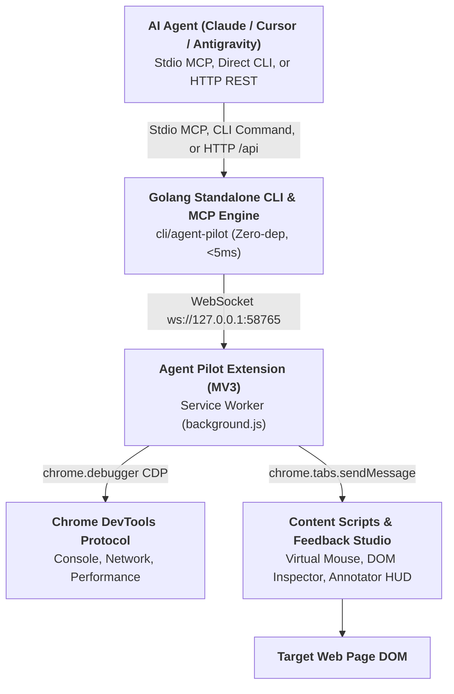

# Agent Pilot - Universal AI Agent Browser Controller

> **Next-Gen AI Browser Companion & Automation Engine (Antigravity First)**
> Maintained by **DNT** ([@ducconit](https://github.com/ducconit)) • Open Source Public Beta

Use this skill when an AI agent needs to automate browser flows, interact with web applications, click elements, fill forms, inspect DOM trees, capture visual screenshots, pick on-screen colors, or debug web applications via Chrome DevTools Protocol (CDP).

---

## ⚡ Quick Install via `skills` CLI

Any AI coding agent (Claude Code, Cursor, Codex, OpenCode, Antigravity, Amp, Roo, Devin, etc.) can install this skill with a single command:

```bash
# Install to current project
npx skills add https://github.com/ducconit/agent-pilot-extension

# Or install globally for all agents
npx skills add https://github.com/ducconit/agent-pilot-extension -g --all
```

### Or install with the Agent Pilot CLI (no Node.js / repo clone required)

The skill files are embedded in the standalone binary:

```bash
agent-pilot skill install                # ~/.agents/skills/agent-pilot
agent-pilot skill install --agy          # ~/.gemini/config/skills/agent-pilot (Antigravity)
agent-pilot skill install --path <dir>   # custom skills root
agent-pilot skill install --force        # overwrite an existing installation
```

---

## 🏗️ Architecture & Communication Flow



### Dual Mode & Zero Port Collision
Agent Pilot includes an automatic **Dual Mode** engine:
- **Master Bridge Mode**: The first process binds local loopback port `58765` and coordinates WebSocket connections to the Chrome Extension.
- **Forwarder Mode**: If multiple AI agents, multi-agent swarms, or multiple IDE windows run concurrently, subsequent agent processes detect the active bridge, skip port binding without `EADDRINUSE` conflicts, and seamlessly forward stdio MCP calls over the local HTTP bridge (`http://127.0.0.1:58765/api`).

---

## ⚡ Standalone Go CLI & MCP Server (`cli/agent-pilot`)

Agent Pilot provides an all-in-one compiled Go binary (`cli/agent-pilot`) for ultra-fast startup and environments without Node.js:
- **Zero Runtime Dependencies**: Stripped ~7MB binary, `<5ms` startup time, `~12MB` RAM usage (approximate figures; may vary by platform).
- **MCP Server Mode (`stdio`)**: Run `agent-pilot mcp` directly inside MCP client configs (Claude Desktop, Cursor, Antigravity, OpenCode).
- **Direct CLI Automation**: Fast, scriptable commands for agents, QC/testers, and CI/CD pipelines:
  ```bash
  # Background Service Management (Linux systemd, macOS launchd, Windows Task Scheduler)
  agent-pilot service install
  agent-pilot service status
  agent-pilot service restart
  agent-pilot service uninstall

  # Direct Browser Actions
  agent-pilot open https://example.com
  agent-pilot click "#login-button"
  agent-pilot type "#search-box" "automation testing" --enter
  agent-pilot screenshot --mode visible -o ./report.png
  agent-pilot inspect "#target-element"
  agent-pilot tabs
  agent-pilot batch flow.json
  agent-pilot feedback list

  # Trusted CDP input (opt-in) for cross-origin iframes / canvas / WebGL games
  agent-pilot cdp status --tab 123
  agent-pilot click -x 733 -y 668 --via cdp --tab 123
  agent-pilot drag --from-x 745 --from-y 490 --to-x 745 --to-y 832 --hold 800 --via cdp --tab 123
  ```
- **Multi-Agent Multitasking**: Install the background service (`agent-pilot service install`) so port 58765 is persistently available. Agents operating concurrently should always retain and pass `tabId` across tool calls to operate on dedicated background tabs without collision.

---


## 🛠️ Available MCP Tools (35 Tools)

When the `agent-pilot` MCP server or skill is active, agents have direct access to the following 35 tools:

| Tool Name | Key Parameters | Description |
| :--- | :--- | :--- |
| `browser_snapshot` | `{ maxElements?: number, format?: "text" \| "json", tabId?: number }` | **Token-Efficient Interactive Map**: Captures an accessibility tree of interactive elements with numbered refs (`@1`, `@2`, etc.) in ~300 tokens. Enables agents to see the entire page and target inputs/buttons with minimal token consumption. |
| `browser_fill_form` | `{ fields: Array<{ selector: string, value: any, clear?: boolean }>, submitSelector?: string, pressEnter?: boolean, tabId?: number }` | **Fast Batch Form Filler**: Fills multiple form inputs, selects, and checkboxes and optionally clicks submit in a single tool call. Fully compatible with React Hook Form, Vue, and HTML5 validation. |
| `browser_run_actions` | `{ actions: Action[], tabId?: number, stopOnError?: boolean }` | **Batch Execution Engine**: Executes an ordered sequence of actions (`open`, `navigate`, `wait_for_selector`, `scroll_into_view`, `click`, `type`, `fill_form`, `snapshot`, `hover`, `drag`, `upload`, `dialog`, `press_key`, `scroll`, `sleep`, `screenshot`, `get_element`, `evaluate`, `cdp`, `close`) in a single round-trip, saving ~80% context tokens and eliminating network latency. |
| `browser_upload_file` | `{ selector: string, files: string[], tabId?: number }` | **Local File Uploader**: Uploads local files to `<input type="file">` via CDP `DOM.setFileInputFiles`. Supports `@ref` or CSS selector. |
| `browser_handle_dialog` | `{ accept?: boolean, promptText?: string, tabId?: number }` | **JavaScript Dialog Handler**: Automatically accepts or dismisses `alert`, `confirm`, or `prompt` browser dialogs with optional text. |
| `browser_hover` | `{ selector: string, tabId?: number }` | **Virtual Mouse Hover**: Simulates hovering over an element (triggering `mouseenter`, `mouseover`, `mousemove`) to open tooltips and dropdowns. |
| `browser_drag` | `{ from?: string, to?: string, fromX?: number, fromY?: number, toX?: number, toY?: number, steps?: number, holdMs?: number, via?: "synthetic"\|"cdp"\|"auto", tabId?: number }` | **Virtual Drag & Drop**: Drags an element or between coordinates. `via:"cdp"` uses trusted CDP input (required for cross-origin iframes, canvas/WebGL games); `holdMs` holds before release (slingshot pull). |
| `browser_press_key` | `{ key: string, selector?: string, tabId?: number }` | **Virtual Keyboard Shortcuts**: Dispatches key presses and keyboard combinations (`Enter`, `Tab`, `Escape`, `Control+A`, `Control+Shift+R`...). |
| `browser_wait_for` | `{ selector?: string, text?: string, state?: "visible" \| "attached" \| "hidden", timeoutMs?: number, tabId?: number }` | **Smart Waiter**: Polling wait until an element or text appears/disappears or meets state condition with customizable timeout. |
| `browser_emulate` | `{ cpuThrottlingRate?: number, networkConditions?: string, colorScheme?: "dark" \| "light", tabId?: number }` | **Environment Emulation**: Emulates CPU throttling (slowdown 1x/4x/6x), network conditions (`offline`, `slow-3g`, `fast-3g`), and dark/light mode. |
| `browser_resize_page` | `{ width: number, height: number, deviceScaleFactor?: number, mobile?: boolean, tabId?: number }` | **Viewport Resizer**: Overrides device metrics and screen resolution for responsive UI testing. |
| `browser_list_network_requests` | `{ filterUrl?: string, method?: string, resourceType?: string, limit?: number, tabId?: number }` | **Network Inspector**: Lists recent HTTP requests captured on the tab with filtering by URL, method, or resource type. |
| `browser_get_network_request` | `{ requestId: string, tabId?: number }` | **Response Body Inspector**: Retrieves the full response body (JSON/text) and headers for a specific network request via CDP `Network.getResponseBody`. |
| `browser_performance_trace` | `{ action?: "start" \| "stop", categories?: string, tabId?: number }` | **Performance Tracer**: Records DevTools timeline trace (`Tracing.start/end`) to detect rendering bottlenecks and long tasks. |
| `browser_performance_metrics` | `{ tabId?: number }` | **Runtime Metrics**: Queries live CDP performance metrics (JSHeapUsedSize, JSHeapTotalSize, LayoutCount, Nodes...). |
| `browser_take_heapsnapshot` | `{ collectGarbage?: boolean, tabId?: number }` | **Memory Heap Profiler**: Captures memory heap snapshot or triggers V8 Garbage Collection to detect memory leaks. |
| `browser_manage_extensions` | `{ action?: "list" \| "setEnabled", extensionId?: string, enabled?: boolean }` | **Extension Manager**: Lists installed browser extensions or toggles them on/off via `chrome.management`. |
| `browser_start_session` | `{ name?: string, tabId?: number }` | **Continuous Session Start**: Initiates an active AI Agent session. Keeps the virtual cursor and glowing neon lock shield continuously visible on the tab until ended. |
| `browser_end_session` | `{ tabId?: number }` | **Continuous Session End**: Concludes the active AI Agent session. Fades out and dismisses the virtual cursor and lock shield. |
| `browser_evaluate` | `{ expression: string, tabId?: number }` | **Page Evaluator**: Evaluates a JavaScript expression or script in the context of the page (MAIN world first for direct framework/DOM state access, with CDP Runtime.evaluate fallback) and returns the serialized result. |
| `browser_open_tab` | `{ url: string, active?: boolean }` | Opens a new browser tab with the specified URL. Defaults to `active: false` (background mode) to never interrupt or steal focus from the user's active window. |
| `browser_list_tabs` | `{}` | Lists all open tabs with IDs, titles, URLs, active state, and agent ownership indicators. |
| `browser_navigate` | `{ url: string, tabId?: number }` | Navigates the specified or active tab to a URL. |
| `browser_click` | `{ x?: number, y?: number, selector?: string, via?: "synthetic"\|"cdp"\|"auto", tabId?: number }` | Moves virtual mouse cursor and clicks. `via:"cdp"` (opt-in) uses trusted CDP `Input.dispatchMouseEvent` which works on cross-origin iframes, canvas & WebGL apps; `via:"auto"` falls back to synthetic. Default remains synthetic. |
| `browser_type` | `{ text: string, selector: string, clear?: boolean, pressEnter?: boolean, tabId?: number }` | Simulates human typing into inputs with realistic keystroke delays. Supports CSS selector or snapshot ref (`@1`). |
| `browser_scroll` | `{ deltaX?: number, deltaY?: number, tabId?: number }` | Smoothly scrolls the page viewport by relative pixel offsets. |
| `browser_get_element` | `{ selector: string, includeStyles?: boolean, tabId?: number }` | Inspects DOM elements, returning tag name, coordinates, bounding box dimensions, text, and value. Pass `includeStyles: true` only when styling details are needed (omitted by default to save tokens). |
| `browser_screenshot` | `{ mode?: "visible" \| "region" \| "element" \| "full", selector?: string, tabId?: number }` | Captures high-resolution PNG screenshot via CDP even on background tabs. Automatically unpacked to native MCP image blocks to avoid base64 text bloat. |
| `browser_get_devtools_data` | `{ tabId?: number, type?: "all" \| "console" \| "network" \| "performance", filterOrigin?: boolean, limit?: number, clear?: boolean }` | Intercepts real-time CDP Console logs, Network requests, and Performance metrics. Extension noise (`chrome-extension://*`) is filtered by default (`filterOrigin: true`). |
| `browser_pick_color` | `{ tabId?: number, x?: number, y?: number }` | Samples any on-screen pixel color. Returns all 5 modern color formats (`hex`, `rgb`, `rgba`, `hsl`, `oklch`). |
| `browser_list_instances` | `{}` | Lists all connected browser instances (Chrome, Brave, Edge, profiles/windows). |
| `browser_select_instance` | `{ instanceId: string }` | Switches active target browser instance in multi-browser setups. |
| `browser_set_busy` | `{ busy?: boolean, action?: string, session?: boolean, tabId?: number }` | Displays a subtle glowing neon border and compact floating pill with action label and emergency unlock button (`Escape`) on the target page during agent workflows. |
| `browser_get_pending_feedback` | `{ sessionId?: string, limit?: number, clear?: boolean }` | **Channel B Feedback Reader**: Retrieves pending human visual UI feedback sessions saved in `~/.agent-pilot/inbox/feedback/<timestamp>/*`. |
| `browser_wait_for_feedback` | `{ timeout?: number, tabId?: number }` | **Channel A Reactive Long-Polling**: Reactively halts agent execution until a human submits visual feedback via Feedback Studio in the browser. |

---

## 🔌 Which Features Require CDP? (Mandatory vs Optional)

Agent Pilot has two automation engines:
- **Synthetic DOM engine** (content script, no debugger): produces `isTrusted: false` DOM events. Fine for regular pages, but **cannot cross cross-origin iframes** and cannot drive canvas/WebGL apps.
- **CDP engine** (`chrome.debugger` + `Input.*` / `Page.*`): produces **trusted input** and works on cross-origin iframes, canvas and WebGL apps (Unity, Playables, games).

### Requirement matrix

| Feature (MCP tool / CLI) | Engine | CDP required? |
| :--- | :--- | :--- |
| `browser_snapshot` / `snapshot` | DOM (content script) | ❌ No |
| `browser_get_element` / `inspect` | DOM | ❌ No |
| `browser_type` / `type` | Synthetic DOM | ❌ No |
| `browser_scroll` / `scroll` | Synthetic DOM | ❌ No |
| `browser_fill_form` / `fill` | Synthetic DOM | ❌ No |
| `browser_wait_for` / `wait` | DOM | ❌ No |
| `browser_pick_color` | DOM sampling | ❌ No |
| `browser_list_tabs`, `browser_open_tab`, `browser_navigate` | `chrome.tabs` API | ❌ No |
| `browser_evaluate` / `evaluate` | MAIN-world scripting (CDP only as fallback) | ❌ No |
| `browser_click` / `click` | Synthetic by default | ⚙️ Optional — `via:"cdp"` for cross-origin iframe / canvas / WebGL |
| `browser_drag` / `drag` | Synthetic by default | ⚙️ Optional — `via:"cdp"` + coordinates (fromX/fromY/toX/toY) for canvas games |
| `browser_hover` / `hover` | CDP first, synthetic fallback | ⚙️ Optional (automatic, no flag) |
| `browser_press_key` / `key` | CDP first, synthetic fallback | ⚙️ Optional (automatic, no flag) |
| `browser_screenshot` / `screenshot` | CDP `Page.captureScreenshot` | ✅ Yes for background tabs (active tab falls back to `captureVisibleTab`) |
| `browser_upload_file` / `upload` | CDP `DOM.setFileInputFiles` | ✅ Yes |
| `browser_handle_dialog` / `dialog` | CDP dialog handling | ✅ Yes |
| `browser_emulate` / `emulate` | CDP `Emulation.set*` | ✅ Yes |
| `browser_resize_page` / `resize` | CDP `Emulation.setDeviceMetricsOverride` | ✅ Yes |
| `browser_list_network_requests`, `browser_get_network_request` / `network` | CDP Network domain | ✅ Yes |
| `browser_performance_trace` / `trace` | CDP Tracing | ✅ Yes |
| `browser_performance_metrics` / `metrics` | CDP Performance domain | ✅ Yes |
| `browser_take_heapsnapshot` / `heap` | CDP HeapProfiler | ✅ Yes |
| `browser_get_devtools_data` | CDP Console/Network/Performance buffers | ✅ Yes |
| raw `cdp.send` / `agent-pilot cdp status` | CDP | ✅ Yes (by definition) |

### CDP failure semantics
- `click`/`drag` with `via:"cdp"`: **no silent fallback** — returns `CDP_UNAVAILABLE: <reason>` so the agent knows trusted input was not delivered. Use `via:"auto"` when a synthetic fallback is acceptable.
- ✅-group features attach the debugger automatically and fail/degrade when attachment is impossible.
- Common causes: DevTools already open on the tab, `chrome.debugger` blocked by the user/profile policy.
- Pre-flight check: `agent-pilot cdp status --tab <id>`, or HTTP `{"method":"cdp.status","params":{"tabId":123}}`.

### When to use which
- Regular DOM pages: default synthetic commands are enough (visual cursor + ripple included).
- Cross-origin iframe, `<canvas>`, WebGL/Unity game: `via:"cdp"` for click/drag (with explicit coordinates) after a `cdp status` check.
- The neon virtual cursor / ripple is only drawn by the synthetic engine; CDP input does not render it.

---

## 🎨 3-Channel Visual UI Feedback System

Agent Pilot bridges the communication gap between human users and AI coding agents through 3 complementary feedback channels:

1. **Kênh A (Reactive Long-Polling)**:
   - Agent calls `browser_wait_for_feedback({ timeout: 120 })` to pause and wait for user guidance.
   - User enters **Feedback Studio** in browser, marks elements/crops, writes notes, and clicks **"🚀 Gửi Agent"**.
   - Long-poll resolves immediately, passing exact file locations (`src/components/Navbar.tsx:42`), component names (`<Navbar />`), CSS rules, and screenshots to the agent.
2. **Kênh B (Shared Inbox File Storage)**:
   - User clicks **"💾 Lưu Inbox"** in Feedback Studio or Sidepanel.
   - Extension transmits items to `~/.agent-pilot/inbox/feedback/<timestamp>/*`:
     - `session.json` (metadata, count, component mapping, user notes).
     - `prompt.md` (clean markdown without base64 bloat).
     - `item_1.png`, `item_2.png` (binary PNG screenshots).
   - Agent calls `browser_get_pending_feedback()` at any time to inspect pending requests.
3. **Kênh C (1-Click Clipboard Prompt)**:
   - User clicks **"📋 Copy Prompt"** in Feedback Studio or Sidepanel.
   - Formats a comprehensive markdown prompt into the clipboard, ready to paste into any chat or prompt box.

## 🔒 Secret & Private Key Redaction Layer

Agent Pilot includes an automatic **zero-trust security layer** enabled by default:
- Automatically scans responses for sensitive credentials:
  - Private Keys (RSA, EC, OpenSSH, DSA, PGP)
  - API Keys (OpenAI `sk-proj-*`, Anthropic `sk-ant-*`, Google `AIzaSy*`, GitHub `ghp_*`, AWS, Stripe, Slack)
  - Bearer Tokens, JWTs, and sensitive URL query parameters
- Redacts detected secrets with asterisks (`*`) and attaches an explicit security notice:
  `[SECURITY NOTE: Sensitive credentials in this output were masked with asterisks (*) by Agent Pilot's Secret Filter]`
- Prevents accidental token leakage into cloud LLM training data and logs.

---

## 📋 Standard Agent Operating Workflow

### 1. Verification & Pre-Flight
Check whether the browser bridge is operational:
- Check health: `http://127.0.0.1:58765/health`
- Or list open tabs: `browser_list_tabs()`

### 2. High-Efficiency Automation (Batch Mode - Recommended)
To save ~80% tokens and minimize latency, combine multiple steps into `browser_run_actions`:
```json
{
  "actions": [
    { "action": "open", "url": "https://example.com", "waitUntil": true },
    { "action": "wait_for_selector", "selector": "#login-btn", "timeout": 5000 },
    { "action": "type", "selector": "input#username", "text": "agent_test", "clear": true },
    { "action": "type", "selector": "input#password", "text": "secret123", "pressEnter": true },
    { "action": "sleep", "ms": 1000 },
    { "action": "screenshot", "mode": "visible" }
  ]
}
```

### 3. Granular Step-by-Step Execution
For exploratory tasks or interactive debugging:
1. **Navigate**: `browser_navigate({ url: "https://example.com" })`
2. **Inspect**: `browser_get_element({ selector: "button.submit-btn" })`
3. **Click**: `browser_click({ selector: "button.submit-btn" })`
4. **Audit DevTools**: `browser_get_devtools_data({ type: "console" })`

---

## 🌐 Fallback HTTP REST API

If stdio MCP is not supported by your environment, invoke tools directly via HTTP JSON-RPC:

```bash
# Health check
curl -s http://127.0.0.1:58765/health

# Move virtual mouse & click
curl -s -X POST http://127.0.0.1:58765/api \
  -H "Content-Type: application/json" \
  -d '{"method": "page.click", "params": {"selector": "#submit-btn"}}'

# Take screenshot
curl -s -X POST http://127.0.0.1:58765/api \
  -H "Content-Type: application/json" \
  -d '{"method": "page.screenshot", "params": {"mode": "visible"}}'
```

---

## ⚙️ Configuration & Environment Variables

- **Default Port**: `58765` (customizable via `AGENT_PILOT_PORT=58765`).
- **Host**: `127.0.0.1` (loopback only for maximum host security).
- **Extension Settings**: Click the ⚙️ icon in the Extension Side Panel to change the bridge port or toggle the Secret Redaction Filter.

---

## 📚 References & Resources

Detailed guides, troubleshooting instructions, and reference specifications are available in the skill directory:

- [Setup, Installation & Troubleshooting Guide](references/setup.md): Complete setup for Chrome Extension, Go CLI, Background Services (`systemd`, `launchd`, `Task Scheduler`), and MCP Client configurations.
- [CLI Command & Automation Reference](references/cli-usage.md): Syntax, arguments, and copy-paste examples for all `agent-pilot` CLI commands.
- [Architecture, Server & Concurrency Reference](references/architecture-and-server.md): Deep dive into Master Bridge Dual Mode, HTTP REST endpoints, WebSocket protocol, and the 12-rule Secret Redaction Layer.
- [Batch Automation Example](examples/batch-flow-example.json): Ready-to-use JSON batch flow for automated web testing and regression suites.
