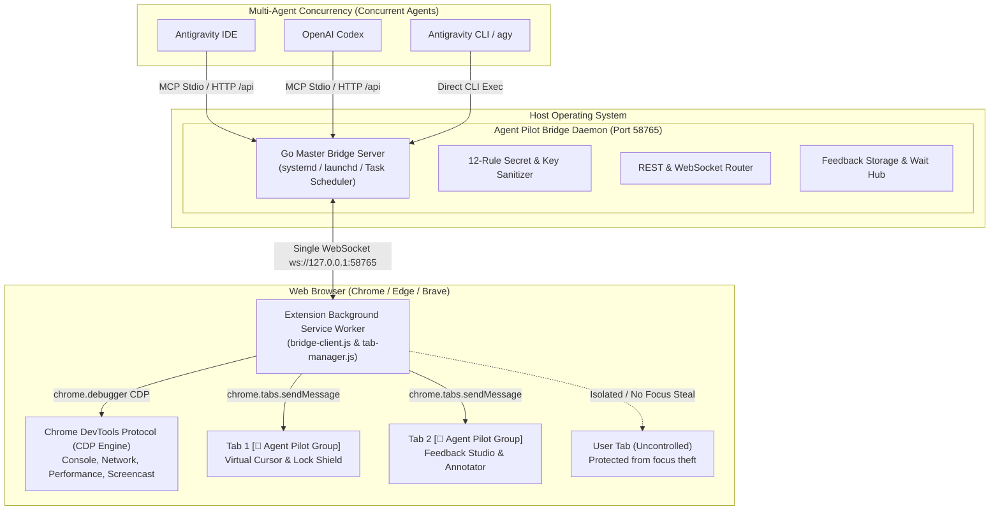

# Agent Pilot - Architecture, Server & Multi-Agent Concurrency Reference

This document details the internal architecture, network protocols, multi-agent concurrency guarantees, and security model of Agent Pilot.

---

## 1. System Topology



---

## 2. Multi-Agent Concurrency Principles

When developers run multiple AI agents simultaneously (e.g. Antigravity IDE alongside Codex and Antigravity CLI):

1. **Zero Port Collision (Dual Mode)**:
   - Only a single master daemon binds port `58765`.
   - When an agent initiates `agent-pilot mcp` or executes a CLI command, the binary probes `http://127.0.0.1:58765/health`. If active, it switches to **Forwarder Mode**, routing requests over HTTP REST without attempting to bind port `58765`.
2. **Tab Isolation (`tabId`)**:
   - Each agent should maintain its own target `tabId`.
   - Actions targeting `tabId: 101` execute without disturbing `tabId: 102`.
3. **Focus Protection**:
   - Tab creation (`browser_open_tab` or `agent-pilot open`) defaults to `active: false`. The browser tab opens in the background without stealing OS focus or interrupting human typing.

---

## 3. HTTP REST API Specification

The Go Bridge daemon provides a high-speed HTTP REST API on port `58765`:

| Method | Endpoint | Description | Request Payload | Response |
| :--- | :--- | :--- | :--- | :--- |
| `GET` | `/health` | Daemon health & connected clients | None | `{"status":"ok","clients":1,"version":"1.0.7-beta"}` |
| `POST` | `/api` | Forward any browser RPC command | `{"action":"page.click","payload":{...}}` | `{"success":true,"result":{...}}` |
| `POST` | `/api/feedback/save` | Channel B: Save feedback to inbox | Feedback payload (JSON) | `{"success":true,"sessionId":"..."}` |
| `GET` | `/api/feedback/pending` | Channel B: Read pending sessions | `?limit=10&clear=false` | `{"success":true,"sessions":[...]}` |
| `POST` | `/api/feedback/wait` | Channel A: Long-poll for human input | `{"timeout":120}` | `{"success":true,"session":{...}}` |

### CDP-dependent methods (debugger attach required)

Any `method` forwarded through `POST /api` runs with one of two engines. These methods require an attached debugger (`chrome.debugger`) and fail with a clear error when attach is impossible (DevTools already open, permission/policy blocked):

- `page.screenshot` (required for background tabs; active tab can fall back)
- `page.uploadFile`, `page.handleDialog`
- `emulation.set`, `emulation.resize`
- `network.listRequests`, `network.getResponseBody`
- `performance.trace`, `performance.metrics`
- `memory.heapSnapshot`, `memory.collectGarbage`
- `devtools.getData`
- `cdp.attach` / `cdp.detach` / `cdp.send` / `cdp.status`

Optional CDP (synthetic by default, opt-in via `via:"cdp"` | `"auto"`): `page.click`, `page.drag`.
CDP-first with automatic synthetic fallback: `page.hover`, `page.pressKey`.
Everything else (`page.snapshot`, `page.getElement`, `page.type`, `page.scroll`, `page.fillForm`, `page.waitFor`, `page.pickColor`, `tabs.*`, `page.evaluate`) does not require CDP.

Pre-flight check:

```bash
curl -s -X POST http://127.0.0.1:58765/api -H 'Content-Type: application/json' \
  -d '{"method":"cdp.status","params":{"tabId":123}}'
# {"success":true,"result":{"attached":true,"tabId":123}} or {"attached":false,"error":"...","hint":"..."}
```

---

## 4. WebSocket Bridge Protocol

The Chrome Extension communicates with the daemon via `ws://127.0.0.1:58765/`.

### Message Types:
- **`command` (Server -> Extension)**:
  ```json
  {
    "id": "cmd_1789295000",
    "type": "command",
    "action": "page.click",
    "payload": { "selector": "#btn-submit" }
  }
  ```
- **`response` (Extension -> Server)**:
  ```json
  {
    "id": "cmd_1789295000",
    "type": "response",
    "success": true,
    "result": { "clicked": true }
  }
  ```
- **`event` (Bi-directional notification)**:
  Used for `feedback_submitted`, `agent_emergency_unlocked`, and tab lifecycle notifications.

---

## 5. Security & Redaction Layer

Agent Pilot implements a 12-rule Secret Redaction Layer in both Go (`cli/sanitizer.go`) and JavaScript (`extensions/background/secret-sanitizer.js`). All console logs, network responses, and screenshots passing to AI Agents are sanitized:

1. **Private Keys**: RSA, DSA, EC, OPENSSH private keys.
2. **AI Provider API Keys**: OpenAI (`sk-proj-...`), Anthropic (`sk-ant-...`), Google Gemini (`AIzaSy...`).
3. **Developer Platforms**: GitHub (`ghp_...`, `github_pat_...`), Slack (`xoxb-...`), AWS Access Keys (`AKIA...`), Stripe (`sk_live_...`).
4. **Auth Tokens**: JWTs (`eyJ...`), Bearer Tokens, OAuth secrets.
5. **URL Query Params**: `token`, `key`, `secret`, `password`, `apiKey` redacted to `[REDACTED]`.
6. **JSON Key Redaction**: Recursively redacts keys matching sensitive names (`auth`, `password`, `secret`, `access_token`).

---

## 6. Continuous Session & Visual Indicator Engine

### Session Lifecycle:
- **Session Active**:
  - Native Chrome Tab Group `[🤖 Agent Pilot]` assigned.
  - Extension toolbar badge shows `AI` in emerald (`#10b981`).
  - Glowing animated neon border appears around the screen.
  - Top-right Action Pill shows session name and status.
  - Virtual mouse cursor remains permanently visible and moves with cubic easing.
- **Session End**:
  - Lock shield and virtual cursor smoothly fade out.
  - Emergency takeover via `Escape` key or `🔓 Chiếm quyền` button immediately terminates the session and returns control to the user.
